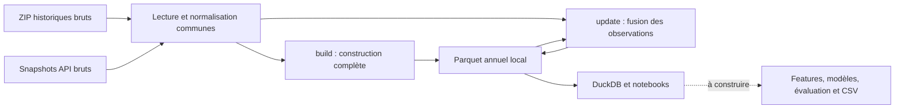

# Méthodologie

Ce document consigne les choix présents dans le code au **31 octobre 2026**, leurs raisons, leurs limites et les questions encore ouvertes. Le [README](../README.md) reste le guide de commandes rapide.

- **Implémenté** : comportement observable dans les modules et couvert par les tests indiqués.
- **Provisoire** : règle ou hypothèse en place qui doit encore être justifiée par les données ou le métier.
- **À décider / à construire** : aucun arbitrage ou résultat ne doit être déduit des seuls noms de fichiers, dépendances ou gabarits.

Le statut « implémenté » décrit l'arbre de travail ; le statut de publication et de fusion reste celui des PR GitHub. Les chiffres d'exploration rapportés sont distingués des contrôles réellement exécutés.

## Repères de lecture

1. [Périmètre du brief](#périmètre-du-brief)
2. [Architecture et organisation](#architecture-et-organisation)
3. [Collecte des données](#collecte-des-données)
4. [Contrat de données](#contrat-de-données)
5. [Stockage, mémoire et reproductibilité](#stockage-mémoire-et-reproductibilité)
6. [Constats d'exploration](#constats-dexploration)
7. [Accès SQL et exemples](#accès-sql-local-issue-7)
8. [Actualisation et reprise](#actualisation-des-observations-issue-8)
9. [Vérification et tests](#vérification-et-tests)
10. [Modélisation et feuille de route](#modélisation-évaluation-et-feuille-de-route)
11. [Backtest](#backtest-issue-15)
12. [Décisions ouvertes](#décisions-ouvertes)

## Périmètre du brief

Le brief LivraisonCo 2026 fourni par les organisateurs est la référence. Les issues GitHub servent à réaliser ses livrables ; l'infrastructure reste proportionnée au PoC.

- **Cibles :** débit horaire et taux d'occupation pour `Champs-Elysées`, `Convention` et `Saint-Pères`, du 7 au 11 novembre 2026 inclus. Mesurer les erreurs par validation historique et RMSE.
- **Fichier de rendu :** `output_<nom_du_groupe>.csv`, 360 lignes (3 arcs × 120 heures), avec exactement `arc`, `datetime`, `debit_horaire`, `taux_occupation`. Les dates sont des chaînes au format `%Y-%m-%d %H:%M` et les deux mesures des flottants. Le brief utilise un séparateur point-virgule ; le contrat Parquet interne reste distinct de ce fichier final.
- **Présentation :** sept planches maximum plus annexes, à présenter en 15 minutes. Expliquer l'approche et les résultats, puis proposer une feuille de route pour l'optimisation des livraisons : modèles complémentaires, données à collecter et calendrier.
- **Hypothèses métier fournies :** livreurs à 10 €/heure entre 08:00 et 20:00, 14 €/heure la nuit ; tranches de travail de 4 à 8 heures. Ces éléments alimentent la feuille de route, sans imposer la construction d'un optimiseur de livraison complet pendant cette phase.
- **Échéance :** prévisions, code reproductible et présentation à remettre avant le 6 novembre 2026 à 18:00, heure de Paris.
- **Collecte :** télécharger arc par arc et actualiser les observations avant la prévision finale. Les backtests historiques et les proxies sont auxiliaires : ils ne changent ni les trois cibles évaluées ni les dates officielles.

## Architecture et organisation

### Modules et responsabilités

| Élément | Choix en place | Raison |
|---|---|---|
| [`src/traffic_prediction/`](../src/traffic_prediction/) | Package Python installé en mode éditable. | Partager les mêmes fonctions entre commandes, notebooks et composants futurs. |
| [`historical.py`](../src/traffic_prediction/data/historical.py) | Découverte des archives, téléchargement brut, lecture ZIP et contrôle d'intégrité. | Centraliser les particularités du format historique, dont Deflate64. |
| [`traffic.py`](../src/traffic_prediction/data/traffic.py) | Extraction API et fonctions communes de sélection, normalisation et grille. | Appliquer les mêmes conventions aux archives et aux observations récentes. |
| [`build.py`](../src/traffic_prediction/data/build.py) | Construction complète, schéma Arrow, validation et écriture des partitions. | Séparer le format final interne de la récupération des sources. |
| [`query.py`](../src/traffic_prediction/data/query.py) | Vue SQL sur les fichiers Parquet et résultats Pandas. | Réutiliser les fichiers locaux dans les analyses. |
| [`update.py`](../src/traffic_prediction/data/update.py) | Couverture, période de reprise, orchestration des téléchargements, fusion et publication. | Actualiser sans reconstruire toutes les archives ni dupliquer la normalisation. |
| [`validate.py`](../src/traffic_prediction/data/validate.py) | Contrôles du dataset, manifeste d'intégrité et validation du CSV de prévisions. | Vérifier les artefacts et la complétude sans réimplémenter le nettoyage ou un modèle. |
| [`configs/baseline.yaml`](../configs/baseline.yaml) | Identités, sens des arcs et rôles évalué/proxy. | Éviter de disperser ces paramètres entre notebooks et commandes. |
| [`notebooks/`](../notebooks/) | Gabarits numérotés pour exploration, nettoyage, features, baseline, expériences et impact livraison. | Organiser le travail exploratoire ; les traitements réutilisables vont dans le package. |

La fonction `process_archives` reste une entrée compatible pour les traitements historiques ; elle délègue à `process_sources`. Ce n'est pas une seconde implémentation du pipeline.



### Environnement et dépendances

- Le projet utilise `pyproject.toml` et la structure `src/`. `pip install -e . --no-deps` enregistre le package ; il faut installer séparément les dépendances du flux utilisé.
- `pyproject.toml` demande Python ≥ 3.10 ; les versions de [requirements.txt](../requirements.txt) visent Python 3.10–3.13. La vérification locale consignée ici a été réalisée sous Windows et Python 3.12, sans matrice de tests sur toutes ces versions.
- Les versions sont épinglées pour rendre l'environnement explicite. Le README installe le sous-ensemble nécessaire aux données et aux notebooks, afin de ne pas imposer tout l'environnement de modélisation dès le départ.
- Les téléchargements API et les ZIP ordinaires utilisent `urllib`, `json` et `zipfile` de la bibliothèque standard. Les imports NumPy, Pandas et YAML de `traffic.py` sont différés pour conserver une commande d'extraction utilisable sans les dépendances de traitement.
- Pandas et NumPy servent aux transformations ; PyArrow fixe le schéma et écrit les Parquet ; PyYAML charge les arcs ; DuckDB 1.4.5 fournit l'interface SQL.
- `stream-unzip==0.0.100`, avec `stream-inflate==0.0.43` et `pycryptodome==4.2.0`, fournit le lecteur Deflate64 optionnel. Il est chargé à la demande pour ce format ; les tests historiques complets l'utilisent aussi.
- `requests` figure dans les dépendances préparées, mais les téléchargeurs actuels reposent sur `urllib`. De même, la présence de bibliothèques de modèles ne signifie pas qu'un modèle a été choisi ou entraîné.

### Travail en équipe et artefacts

Les commandes ont des chemins par défaut ancrés à la racine du dépôt ; un notebook lancé depuis `notebooks/` peut donc employer la même API. Le terminal, VS Code et le noyau du notebook doivent utiliser le même environnement Python.

Une issue correspond à une branche et une PR. Les copies personnelles des gabarits limitent les conflits de notebooks. Les données brutes, données transformées, modèles entraînés et sorties générées sont exclus de Git par [.gitignore](../.gitignore) ; seuls les emplacements vides peuvent être versionnés. Les secrets et environnements locaux sont également exclus. `nbstripout` est préparé dans les dépendances, mais aucun hook automatique de suppression des sorties n'est configuré dans le dépôt.

## Collecte des données

### Principes communs

Conserver une copie brute avant transformation permet de revenir sur une règle de nettoyage, de comparer deux extractions et d'examiner les champs non retenus dans la table de travail. Le téléchargement ne renomme pas les variables, n'impute pas les valeurs et ne transforme pas les données en Parquet.

Les appels réseau déclarent un timeout de 30 secondes pour les métadonnées et prévisualisations, et de 60 secondes pour les téléchargements. Ces paramètres ne constituent pas une durée maximale totale pour une archive. Par défaut, il y a au plus trois tentatives. Les reprises après erreur recommencent le téléchargement depuis le début ; aucun téléchargement HTTP partiel n'est repris à un offset. Les erreurs HTTP permanentes 4xx ne sont pas réessayées, hors 408 et 429. Entre tentatives, le délai augmente ; les téléchargements attendent une puis deux secondes.

Les fichiers temporaires sont publiés sous leur nom final après validation. Leur nettoyage ne remplace pas le contrôle de la source : la présence d'un fichier nommé correctement ne suffit pas à le considérer comme valide.

### Archives historiques : issue #4

**Source :** [comptages routiers permanents — historique](https://opendata.paris.fr/explore/dataset/comptages-routiers-permanents-historique/).

1. Lire les métadonnées du jeu `comptages-routiers-permanents-historique` via l'API `datasets/1.0`.
2. Reconnaître les pièces jointes intitulées `opendata_txt_<année>.zip` et construire leurs endpoints de téléchargement à partir des identifiants fournis.
3. Sélectionner une année ou une plage inclusive. Une année demandée absente de la découverte provoque une erreur avant les téléchargements.
4. Conserver chaque pièce jointe séparément dans `data/raw/historical/<année>/<attachment_id>.zip`. Plusieurs pièces jointes d'une même année ne sont pas écrasées.

La disponibilité des années n'est pas codée en dur : la commande `--list` est la référence au moment de l'exécution. Les deux pièces jointes 2025 sont conservées séparément à l'ingestion, même si leur contenu a été rapporté identique.

Les archives sont téléchargées par blocs de **1 MiB** dans un fichier `.part`. Le nombre d'octets est comparé au `Content-Length` lorsqu'il est fourni. La validation exige un membre texte et lit les contenus pour vérifier leur intégrité avant remplacement du fichier final.

Un ZIP déjà présent et valide est réutilisé. Ce mécanisme ne détecte pas automatiquement une révision distante : aucun contrôle ETag, Last-Modified ou manifeste de versions du portail n'est implémenté.

### ZIP volumineux et Deflate64

Les textes sont traités directement depuis le ZIP, sans extraction complète. Le volume brut annoncé pendant l'exploration — environ 177 Mo compressés et 6,1 Go de textes pour 2024 — motive la lecture en flux ; ce chiffre n'est pas une mesure de RAM.

Le ZIP 2023 utilise Deflate64, non pris en charge par `zipfile` seul. Le choix actuel est un lecteur optionnel `stream-unzip`, avec des blocs de lecture compressée de 64 KiB et une interface binaire consommable par Pandas. Les noms, tailles et CRC sont contrôlés, y compris par comparaison avec le répertoire central et pour les membres ignorés par le traitement.

Les ZIP ordinaires gardent l'ordre des noms de membres ; le lecteur Deflate64 suit l'ordre physique de l'archive pour rester en flux. Ce choix est déterministe pour une même archive, mais ne constitue pas un tri chronologique supplémentaire.

Le support Deflate64 a été vérifié avec de véritables petites archives compressées, dont un champ de plus de 64 KiB, et avec des corruptions injectées. **Le téléchargement et le traitement complets du vrai ZIP 2023 n'ont pas été exécutés pendant cette vérification.**

### Observations récentes : issue #5

**Source :** [comptages routiers permanents — observations récentes](https://opendata.paris.fr/explore/dataset/comptages-routiers-permanents/).

L'API utilisée est `explore/v2.1/catalog/datasets/comptages-routiers-permanents` :

- `/records` sert à prévisualiser quelques observations et à lire `total_count` ;
- `/exports/jsonl` avec `limit=-1` sert à l'extraction complète de la plage demandée, pour éviter de confondre une page d'API avec le jeu complet ;
- les filtres portent sur `t_1h >= début` et `t_1h < fin`. Les bornes doivent inclure un fuseau et sont converties en UTC ;
- le filtre optionnel `road_id` / `--road-id` sélectionne un `iu_ac` entier positif. L'actualisation l'utilise arc par arc, conformément au brief. Le mode générique sans filtre de route reste disponible.

Chaque exécution conserve un snapshot distinct `data/raw/recent/traffic_<début UTC>_<fin UTC>_<suffixe>.jsonl`. Le suffixe assure l'unicité ; son ordre alphabétique n'indique pas la date d'extraction. Deux exécutions identiques peuvent donc créer deux fichiers bruts, ce qui est volontaire.

Le contrôle d'une extraction comprend le statut HTTP, la structure minimale des observations, des timestamps avec fuseau dans la plage demandée et, si sélectionné, le bon identifiant d'arc. Le flux est lu ligne par ligne, avec une limite de **4 MiB par ligne JSONL**. Le nombre d'octets est contrôlé si connu et le nombre de lignes est comparé au compteur API avant puis après l'export.

Un export vide est un snapshot valide. Un export incomplet ou dont le nombre de lignes a changé échoue explicitement. Des comptes identiques ne prouvent cependant pas que toutes les valeurs distantes sont restées figées pendant l'extraction : l'API ne fournit pas ici de transaction ou de version de snapshot que le code exploite.

## Contrat de données

### Identification des arcs

La configuration [baseline.yaml](../configs/baseline.yaml) porte les identités attendues. Le filtrage conserve le couple **nœud amont → nœud aval**, puis vérifie le `iu_ac` ; le sens inverse est un autre tronçon.

| Rôle | Arc | `iu_ac` | Nœud amont | Nœud aval |
|---|---|---:|---|---|
| Évalué | Champs-Elysées | 4264 | `Av_Champs_Elysees-Washington` | `Av_Champs_Elysees-Berri` |
| Évalué | Convention | 5671 | `Lecourbe-Convention` | `Convention-Blomet` |
| Évalué | Saint-Pères | 191 | `Sts_Peres-Voltaire` | `Sts_Peres-Universite` |
| Proxy expérimental | La Boétie-Berri | 4272 | `Av_Champs_Elysees-La_Boetie` | `Av_Champs_Elysees-Berri` |
| Proxy expérimental | Washington-Balzac | 4265 | `Av_Champs_Elysees-Washington` | `Av_Champs_Elysees-Balzac` |

Le code exige au moins un arc évalué et l'unicité des noms, identifiants et couples de nœuds. La configuration générique peut servir aux tests ou à un sous-ensemble d'arcs ; le rendu officiel doit néanmoins contenir les trois cibles du brief.

Les deux proxies sont des **candidats de variables explicatives**, pas des remplacements de la vérité terrain des Champs-Elysées. Ils ont leurs propres noms et `role=proxy`. Aucune copie de leurs mesures vers `role=evalue` n'est implémentée.

### Trafic horaire (issue #6)

**Fichier.** `data/processed/traffic/year=YYYY/part-0.parquet` : Parquet compressé (zstd), un fichier par année. Produit par `python -m traffic_prediction.data.build` (voir le README), non versionné.

Lecture : `pd.read_parquet("data/processed/traffic")`. Pandas ajoute une colonne `year` déduite du nom du dossier ; elle sert de filtre, par exemple `filters=[("year", "=", 2025)]`.

**Grille.** Une ligne par arc et par heure, de `--start` à 00:00 jusqu'à `--end` à 23:00 inclus (par défaut du 2024-01-01 au 2025-12-31). La clé (`arc`, `datetime`) est unique. Les arcs sont listés dans `configs/baseline.yaml`, section `traffic` : les arcs évalués (`evaluated_arcs`) et des arcs proxy (`proxy_arcs`).

| Colonne | Type | Unité | Contenu |
|---|---|---|---|
| `arc` | string | | Nom de l'arc. Pour les arcs évalués, le nom imposé dans le fichier de rendu : `Champs-Elysées`, `Convention`, `Saint-Pères`. |
| `role` | string | | `evalue` (arc noté par BCG X) ou `proxy` (arc voisin auxiliaire expérimental). |
| `iu_ac` | int32 | | Identifiant Open Data du tronçon. |
| `datetime` | timestamp ns sans fuseau | | Heure de la mesure, voir la convention ci-dessous. |
| `debit_horaire` | float64 | véhicules par heure | `q` d'Open Data. |
| `taux_occupation` | float64 | % du temps, de 0 à 100 | `k` d'Open Data. |
| `etat_trafic` | int8, nullable | code | 0 Inconnu, 1 Fluide (k < 15), 2 Pré-saturé (15 ≤ k < 30), 3 Saturé (30 ≤ k < 50), 4 Bloqué (k ≥ 50). |
| `etat_barre` | int8, nullable | code | 0 Inconnu, 1 Ouvert, 2 Barré, 3 Invalide. À ne pas utiliser comme variable de modèle (voir les constats). |
| `qualite_mesure` | string | | Qualité de la ligne, voir ci-dessous. |

Les valeurs manquantes sont NaN pour les mesures et `<NA>` pour les états. Aucune valeur n'est imputée.

**Convention d'heure.** `datetime` conserve l'étiquette locale de `t_1h` des archives ; les timestamps de l'API sont convertis avant retrait du fuseau : c'est l'heure **locale de Paris, sans fuseau**, et elle marque la **fin** de l'heure mesurée. D'après la notice, « 2019-01-01 01:00:00 » couvre de 00:00 à 01:00. Comme dans la source, chaque jour compte 24 heures :

- Au passage à l'heure d'été, la source contient une ligne pour l'heure qui n'existe pas, souvent vide. Elle est gardée.
- Au retour à l'heure d'hiver, deux instants UTC peuvent devenir la même heure locale 02:00. La clé actuelle ne conserve qu'une ligne après dédoublonnage ; la dernière dans l'ordre de lecture est gardée. Cet ordre n'est pas une garantie de tri chronologique de l'export API.
- Les heures de l'API récente sont en UTC avec fuseau. `normalize_raw` les convertit en heure de Paris sans fuseau. La contribution d'exploration initiale rapporte une concordance de 100 % sur le recouvrement septembre–décembre 2025 pour Convention et Saint-Pères. Ce constat est conservé comme résultat rapporté, sans nouveau calcul de cet historique dans la présente revue.
- Les heures ne sont pas décalées pour suivre le format de rendu : on ne sait pas encore si BCG X désigne le début ou la fin de l'heure. La question reste ouverte.
- Quand la période commence le 1er janvier, les archives lisibles de l'année précédente sont également recherchées pour récupérer la ligne de minuit. Une archive précédente manquante ou de compression non prise en charge produit un avertissement. L'archive 2023 est maintenant lisible avec le décodeur Deflate64 optionnel ; sans cette archive ou une autre source fournie contenant la mesure, `2024-01-01 00:00` reste `absente`. Les lignes hors période sont comptées dans le résumé.

**Qualité de la mesure (`qualite_mesure`).**

| Valeur | Règle |
|---|---|
| `ok` | `q` et `k` présents. |
| `partielle` | Une seule des deux mesures est présente. |
| `vide` | La ligne existe dans la source, mais `q` et `k` sont vides. |
| `invalide` | Au moins une valeur impossible, remplacée par NaN : valeur non numérique, `q < 0`, `k < 0`, `k > 100`, ou `q = 0` alors que `k > 0`. Dans ce dernier cas, la règle actuelle met `q` à NaN et garde `k`. La justification métier de cette règle reste une hypothèse à confirmer. |
| `absente` | L'heure manque dans la source ; elle a été ajoutée par la grille. |

`etat_barre` n'entre pas dans le calcul de la qualité. Les états sont lus et convertis depuis la source ; ils ne sont pas recalculés à partir de `k`.

**Hypothèse à confirmer : `q=0, k>0`.** Cette règle est implémentée et testée, mais un test logiciel ne démontre pas qu'elle correspond à un défaut de capteur. Elle ne doit pas être présentée comme une certitude métier. Sa conservation ou sa modification reste à discuter avec l'équipe.

Les mesures infinies sont également invalides et remplacées par NaN. Un état fourni avec un code ou un libellé inconnu arrête le traitement ; un état manquant reste manquant.

**Doublons.**

- Une archive identique à une autre (même SHA-256) n'est lue qu'une fois. C'est le cas de 2025, que le portail liste deux fois.
- Si plusieurs lignes portent le même couple (`arc`, `datetime`) avec des valeurs identiques, une seule est gardée. Si leurs valeurs diffèrent, on garde la dernière ligne entière dans l'ordre de lecture, y compris ses valeurs manquantes. Les deux cas sont comptés dans le résumé.
- Les archives sont lues par ordre de nom. Leurs membres sont lus par ordre de nom pour les ZIP ordinaires, et dans l'ordre physique de l'archive pour Deflate64 afin de décompresser en flux. Les snapshots JSONL sont lus ensuite, dans l'ordre explicite des arguments `--recent-file`. Leur nom aléatoire ne permet pas de déduire leur date d'extraction : aucun tri automatique ni mélange des valeurs de plusieurs lignes n'est effectué.

**Filtre et garde-fous.**

- Un arc est défini par son couple (nœud amont, nœud aval), dans cet ordre. Le sens inverse est un autre arc, avec un autre `iu_ac`.
- Si un couple de nœuds configuré apparaît avec un autre `iu_ac` que celui attendu, le traitement s'arrête.
- Un horodatage manquant ou qui ne correspond pas à une heure entière de Paris arrête le traitement avant la création de la grille, pour éviter de perdre silencieusement une observation.
- Un arc sans aucune mesure sur la période ne bloque pas le traitement : il produit un avertissement, il est compté, et ses heures restent NaN.
- Rien n'est écarté sans être signalé. Le résumé de fin compte les lignes lues, gardées, hors période, en double et invalides, et donne la part de valeurs manquantes par arc, par variable et par mois.

**Validation.** Avant l'écriture, le traitement vérifie les colonnes et leur ordre, les types, le nombre de lignes (arcs × heures), l'appartenance à la grille demandée, l'absence de doublons, la cohérence `arc`/`iu_ac`/`role`, les plages de valeurs et les labels de qualité. Les labels sont confrontés aux mesures : `ok` exige deux valeurs, `partielle` une seule, `vide` aucune, et `invalide` au moins une mesure masquée ; une ligne `absente` ne porte ni mesure ni état observé. Après l'écriture, il relit le schéma et le nombre de lignes de chaque fichier. Les transformations sont déterministes pour les mêmes entrées, configuration et versions ; l'identité binaire des Parquet entre versions de bibliothèques n'est pas un engagement.

## Stockage, mémoire et reproductibilité

### Choix du format et du partitionnement

| Choix | Objectif | Limite ou contrepartie |
|---|---|---|
| Bruts immuables dans `data/raw/` | Garder l'information source et permettre une nouvelle interprétation. | Les snapshots successifs occupent de l'espace disque ; pas de politique de rétention automatique. |
| Parquet typé et compressé zstd | Fixer les types et limiter le volume du jeu de travail. | Ce format interne ne remplace pas le CSV exigé pour le rendu. |
| `year=YYYY/part-0.parquet` | Une organisation simple cohérente avec les archives annuelles et les cinq arcs configurés. | Une correction peut réécrire toute l'année concernée ; pas de partitionnement mensuel retenu pour l'écriture actuelle. |
| Schéma Arrow `TRAFFIC_SCHEMA` centralisé dans `build.py` | Éviter des sorties différentes selon la source. | Les évolutions du schéma doivent être propagées aux lecteurs et aux tests. |
| Écriture dans un fichier temporaire du même dossier puis remplacement | Ne pas exposer un fichier annuel partiellement écrit lors de la construction. | La construction complète n'est pas une transaction unique couvrant plusieurs années. |

Pandas peut inférer une colonne `year` à partir des dossiers Hive. Cette colonne de partition ne fait pas partie des neuf champs stockés dans `TRAFFIC_SCHEMA`. Les autres champs bruts, dont la géométrie `dessin` des archives ou les objets géographiques de l'API, restent disponibles dans les fichiers originaux mais ne sont pas normalisés en variables géographiques à ce stade.

### Construction complète et mise à jour

`build_traffic` construit la période demandée, valide la table et remplace chaque fichier annuel concerné. Un build limité à un seul jour remplace donc aussi le fichier de cette année par cette période. Les autres années sont conservées. Le contrôle post-écriture vérifie schéma et nombre de lignes ; il ne s'agit pas d'une seconde lecture exhaustive de toutes les valeurs.

`update_traffic` a un contrat différent : il fusionne les observations reçues avec l'historique et prépare toutes les partitions modifiées avant publication. Ses garanties de reprise et ses limites sont détaillées plus bas. Les deux commandes ne sont pas interchangeables.

### Consommation mémoire et optimisations déjà réalisées

- Les ZIP sont téléchargés et décompressés en flux ; les textes sont lus par lots de `CHUNK_ROWS=200_000` lignes.
- La lecture historique ne charge que les huit colonnes nécessaires à la normalisation. La lecture JSONL écarte les champs inutiles de son tampon et garde les huit valeurs sous forme de tuples.
- Le jeu de travail ne conserve que les arcs configurés et les lignes de la période avant la concaténation finale. Les doublons sont ensuite résolus et les heures manquantes complétées.
- Les contrôles de sortie évaluent les masques d'erreur successivement, plutôt que de conserver tous les masques de la taille de la table.
- **Ce n'est pas un pipeline entièrement hors mémoire.** Les observations retenues, la grille finale et la partition annuelle fusionnée occupent encore de la RAM. Un résultat SQL converti en DataFrame l'occupe également.
- Un benchmark local sur 20 818 enregistrements JSONL a mesuré un pic d'allocations Python passant d'environ 8,4 à 6,8 MiB, soit 19 % de moins. Le temps était pratiquement inchangé, environ 1,55 contre 1,56 seconde. Il ne s'agit ni de la mémoire totale du processus ni d'un benchmark des archives complètes.

### Reproductibilité effectivement disponible

Les entrées brutes sont conservées, la configuration et les versions sont explicites, et les règles de transformation et de priorité sont déterministes. Les doublons d'archives sont identifiés par SHA-256, calculé par blocs de 1 MiB. Les règles de nettoyage peuvent ainsi être réexaminées sans avoir détruit les valeurs d'origine.

Le validateur peut désormais enregistrer un manifeste du dataset traité : fichiers et SHA-256, configuration des arcs, couverture, qualité et versions. Il identifie les artefacts locaux ; il ne constitue pas encore un manifeste global de toutes les entrées brutes, du commit d'exécution et du cutoff d'un modèle. Les snapshots API ne sont pas automatiquement sélectionnés par « plus récent » : leur ordre doit être fourni explicitement. La stabilité du jeu distant ou l'identité binaire des sorties entre environnements ne doit pas être supposée.

Le filtre de dates porte sur l'heure de mesure, pas sur sa date de publication ou de correction. Réinterroger aujourd'hui une ancienne période ne reconstitue donc pas nécessairement ce qui était connu à l'époque. Cette distinction devra être prise en compte pour les backtests et le gel des données de prévision.

## Constats d'exploration

Les chiffres ci-dessous proviennent de la contribution d'exploration associée à l'issue #6 et des échanges de l'équipe, avec une consultation de l'API rapportée au 29 octobre 2026. Ils n'ont pas été recalculés sur l'ensemble des archives pendant cette revue. Ce sont des résultats datés, à reproduire ou actualiser avant une présentation chiffrée ; les tests synthétiques ne les démontrent pas.

### Données trafic 2024–2025 (issue #6)

- **Les manques viennent par blocs de mois** (pannes de capteurs), pas au hasard :
  - Saint-Pères : de décembre 2024 à septembre 2025 ;
  - Convention : avril–mai 2024, septembre–novembre 2024, mars–mai 2025 ;
  - Champs-Élysées : novembre et décembre 2025.

  Pour le détail mois par mois, lancer la commande de traitement : son résumé l'affiche.
- **Champs-Elysées : dernière mesure le 2025-11-19 à 12:00.** Ni l'archive ni l'API (consultée jusqu'au 29/10/2026) ne contiennent de mesure plus récente, et aucun autre `iu_ac` n'a repris le couple Washington → Berri.
- **511 heures n'ont de données pour aucun capteur en 2024**, du 28/03 au 01/04 et fin novembre.
- **`etat_barre` est incohérent entre les deux sources.** Dans l'archive, il vaut 3 (« Invalide ») sur 99 % des lignes, y compris quand les mesures sont normales. Il vaut 2 (« Barré ») sur les Champs-Élysées lors de fermetures (14/07, 31/12, etc.). Pour les mêmes heures, l'API donne 1 (« Ouvert ») dès qu'il y a une mesure. **Recommandation de l'exploration : ne pas l'utiliser comme variable explicative sans investigation.** Aucun modèle ni filtre de feature engineering ne met encore cette recommandation en application.
- **`etat_trafic` se déduit entièrement de `k`** par les seuils de la notice : il vaut 0 si et seulement si `k` est vide. Sa valeur ajoutée comme variable explicative reste à évaluer. Un état contemporain de l'heure à prévoir ne peut pas être supposé connu à l'avance.
- **Proxy La Boétie-Berri (4272)** : on n'y trouve quasiment que le taux d'occupation. `q` manque à 96,6 % et n'est présent qu'en janvier 2024. Question ouverte : faut-il le garder comme proxy de taux seulement, ou chercher un autre proxy ? Candidats vus dans l'API en 2026, en part d'heures avec `k`, sans avoir vérifié `q` : 4274 (Berri → La Boétie, sens inverse, environ 75 %) et 4267 (Balzac → Washington, sens inverse, environ 47 %).
- **Proxy Washington-Balzac (4265)** : il est très dégradé à partir d'avril 2025. `q` manque à 85–100 % chaque mois, et `k` manque à 100 % de juillet à novembre 2025.
- **`q = 0` alors que `k > 0`** : 98 heures sur La Boétie-Berri et 101 sur Washington-Balzac, aucune sur les arcs évalués. Ces lignes sont marquées `invalide`.
- **L'archive 2023 est compressée en Deflate64**, illisible par `zipfile` seul. Cette limite est désormais prise en charge par le lecteur en flux optionnel.
- **API récente (pour l'issue #5)** :
  - elle commence le 01/09/2025 et recouvre donc l'archive jusqu'à fin 2025 ;
  - elle a elle aussi des heures absentes ;
  - ses heures sont en UTC avec fuseau ;
  - `etat_trafic` et `etat_barre` y sont en texte ;
  - `libelle` y est écrit différemment, mais les nœuds sont identiques.

## Accès SQL local (issue #7)

**Choix : DuckDB embarqué, connexion en mémoire.** L'objectif est de permettre l'exploration SQL locale et les jointures depuis les notebooks, avec les mêmes fichiers Parquet. Aucun PostgreSQL, service cloud ou fichier de base de données persistant n'est nécessaire au flux actuel. La création d'un serveur SQL ou d'une couche ORM ne fait pas partie de ce choix.

`traffic_prediction.data.query.connect_traffic()` ouvre une connexion DuckDB en mémoire et enregistre une vue `traffic` sur les fichiers Parquet de `data/processed/traffic/`. Un fichier seul ou un autre dossier peut être fourni avec `path=...`. La recherche est récursive, avec prise en charge des partitions Hive (`year=...`, éventuellement `month=...`). Les colonnes de partition ont des types inférés ; un mois écrit `01` peut être une chaîne.

`query_traffic(sql, parameters, path=...)` renvoie le résultat SQL sous forme de DataFrame Pandas et ferme sa connexion. Pour plusieurs requêtes ou une jointure avec un DataFrame de notebook, utiliser `with connect_traffic() as connection` et `connection.register(...)`. Les exemples complets sont regroupés ci-dessous.

La vue lit les fichiers à la demande, sans copie préalable de tout le jeu de données en Pandas ou dans une table SQL. Les filtres sur les partitions permettent d'éviter les fichiers inutiles ; les projections et filtres compatibles sont exécutés par le lecteur Parquet. Le résultat demandé occupe de la mémoire lorsqu'il est converti en DataFrame. La liste de fichiers est fixée à l'ouverture : reconnecter après ajout ou suppression de partitions.

Les connexions sont propres à chaque appel ou bloc `with`, sans connexion globale partagée. Les paramètres positionnels `?` et nommés `$nom` sont pris en charge. `union_by_name=False` évite de masquer automatiquement des différences de schéma entre fichiers ; le module contrôle la présence des colonnes attendues et DuckDB peut signaler d'autres incompatibilités lors d'une requête.

Les requêtes conservent les valeurs manquantes, les rôles et les conventions d'heure du contrat de données. Utiliser des paramètres SQL pour les valeurs de filtre et des bornes explicites, par exemple `datetime >= ? AND datetime < ?` en heure locale de Paris sans fuseau. Aucun décalage, remplacement de cible par un proxy, ni dédoublonnage supplémentaire n'est effectué par la vue.

### Exemples SQL

Ces exemples s'utilisent depuis les notebooks existants ou une session Python, après le traitement des données.

Filtrer par période et identifiants d'arcs, avec des paramètres SQL :

```python
from datetime import datetime
from traffic_prediction.data.query import query_traffic

observations = query_traffic(
    """SELECT arc, datetime, debit_horaire, taux_occupation, qualite_mesure
       FROM traffic
       WHERE datetime >= ? AND datetime < ? AND iu_ac IN (?, ?)
         AND role = ?
       ORDER BY arc, datetime""",
    [datetime(2025, 10, 1), datetime(2025, 11, 1), 5671, 191, "evalue"],
)
```

Réutiliser une connexion pour une agrégation mensuelle et une jointure à un DataFrame :

```python
import pandas as pd
from traffic_prediction.data.query import connect_traffic

with connect_traffic() as connection:
    monthly = connection.execute(
        """SELECT arc, date_trunc('month', datetime) AS month,
                  avg(debit_horaire) AS mean_flow,
                  count(debit_horaire) AS measured_hours
           FROM traffic WHERE role = 'evalue' AND year = ?
           GROUP BY arc, date_trunc('month', datetime)
           ORDER BY arc, month""",
        [2025],
    ).fetchdf()

    roads = pd.DataFrame({"iu_ac": [5671, 191], "delivery_zone": ["south", "central"]})
    connection.register("roads", roads)
    by_zone = connection.execute(
        """SELECT delivery_zone, avg(debit_horaire) AS mean_flow
           FROM traffic JOIN roads USING (iu_ac)
           WHERE year = 2025 GROUP BY delivery_zone"""
    ).fetchdf()
```

`fetchdf()` renvoie uniquement le résultat demandé dans Pandas. Utiliser `count(debit_horaire)` pour compter les heures mesurées, car les valeurs nulles restent nulles. Reconnecter après ajout ou suppression de fichiers ; la liste des fichiers est fixée à l'ouverture.

## Actualisation des observations (issue #8)

La commande `python -m traffic_prediction.data.update` permet de réaliser la seconde collecte demandée par le brief avant la prévision finale, sans reconstruire toutes les archives. Elle télécharge chaque arc configuré séparément avec le filtre API `iu_ac`, puis réutilise la normalisation et la grille existantes. Les trois cibles restent distinctes des proxies expérimentaux.

La couverture distingue les heures stockées de la dernière heure réellement fournie par une source : les lignes synthétiques `absente` ne font pas avancer le point de reprise. Par défaut, sept jours calendaires de recouvrement sont repris depuis la dernière journée source, jusqu'au moment de l'appel. Ce moment est capturé une fois pour borner les requêtes des différents arcs. Les dates explicites sont inclusives en heure de Paris ; la conversion des bornes tient compte des changements d'heure. Un jeu sans couverture source demande un `--start` explicite. `Coverage` distingue `first_hour`, `last_hour` et `last_source_hour`. Une ligne source `vide` ou `invalide` compte pour la couverture source ; ce n'est pas nécessairement une mesure exploitable pour chaque cible.

Le point de reprise est global aux arcs du jeu, pas individuel par capteur. Une correction plus ancienne que le recouvrement de sept jours demande une période explicite ; l'actualisation ne garantit pas de détecter toute révision de l'historique distant.

Une ligne API présente remplace toute la ligne correspondante, y compris ses valeurs nulles. Une ligne absente de l'API ne supprime pas une observation historique. Les partitions annuelles identiques ne sont pas réécrites, les autres années sont conservées, et les valeurs ne sont jamais transférées d'un proxy à une cible.

Les partitions modifiées sont préparées et validées avant publication. Le remplacement de chaque fichier est atomique, avec sauvegarde et restauration en cas d'exception. Un arrêt brutal peut interrompre la publication entre deux années sans laisser de Parquet partiellement écrit : relancer la même période termine l'actualisation. Un verrou empêche deux actualisations concurrentes.

### Options et reprise après interruption

- `--start` et `--end` sont des jours de Paris inclusifs ; les téléchargements sont toujours bornés au moment de l'appel. Sans `--end`, la journée courante est partielle. `--refresh-days N` modifie le recouvrement par défaut ; un `--start` explicite le remplace.
- `--output-dir`, `--raw-dir` et `--config` changent les chemins ou la configuration. L'actualisation exige le format produit par `build.py`, `year=YYYY/part-0.parquet`, et la même configuration d'arcs que les partitions existantes. Les autres formats Hive restent consultables en SQL, mais doivent être migrés avant actualisation.
- Les snapshots bruts restent dans `data/raw/recent/`. Un export vide ne prolonge pas la couverture et ne remplace pas les observations stockées. Les heures ajoutées par la grille ne sont pas considérées comme une couverture source.
- Ne pas exécuter de construction complète dans le même dossier pendant une actualisation. Après un arrêt brutal, vérifier qu'aucun processus d'actualisation ne tourne avant de supprimer un verrou `.traffic-update.lock` devenu obsolète, puis relancer la période demandée.
- Les fichiers de travail sont isolés dans un dossier `.traffic-update-*` et ne sont pas des partitions Parquet consultables. Si la restauration après erreur échoue elle aussi, les sauvegardes sont conservées et leur emplacement est indiqué dans le message d'erreur ; les utiliser pour la récupération avant une nouvelle actualisation.

Le traitement réutilise `download_observations`, `process_sources`, `validate_traffic` et `TRAFFIC_SCHEMA` ; l'orchestration reste dans `update.py`. Les anciennes années non concernées ne sont pas reconstruites. Les fichiers identiques sont laissés en place, ce qui préserve aussi leur date de modification.

Le rapport expose la période demandée, la couverture source précédente, les snapshots bruts et les partitions écrites ou inchangées. Les compteurs de `ProcessingStats` concernent les données entrantes ; ce n'est pas un journal exhaustif de chaque valeur historique corrigée.

La protection est un verrou entre actualisations et une publication atomique **par fichier**, pas une transaction durable unique sur toutes les années. Une construction complète lancée en parallèle ne partage pas ce verrou. Aucun ordonnanceur, daemon ou synchroniseur cloud n'a été ajouté.

## Vérification et tests

### Validation locale du dataset

`python -m traffic_prediction.data.validate` valide le dataset de travail existant. `--write-manifest` enregistre le rapport dans `data/processed/traffic/_validation.json` ; `--check-manifest` vérifie les artefacts courants par rapport au rapport enregistré. `--manifest-path` change l'emplacement du JSON. Aucun téléchargement réseau n'est nécessaire à ces commandes.

Le validateur vérifie le schéma exact de chaque Parquet, lit les données une année à la fois via DuckDB et réutilise `build.validate_traffic`. Il contrôle les timestamps absents, les doublons, les nombres de lignes, les arcs et rôles, les valeurs et la cohérence entre les dossiers Hive `year`/`month` et les timestamps des observations.

Par défaut, la grille doit être complète entre le premier et le dernier jour stockés, pour tous les arcs configurés. Une année ou une journée manquante entre deux partitions provoque une erreur. Des bornes `--start` et `--end` peuvent limiter les contrôles ligne par ligne à une période inclusive ; le schéma et les hashes continuent à couvrir tous les fichiers. Cette portée est inscrite dans le rapport.

**Complétude structurelle et disponibilité des mesures sont distinctes.** Une grille complète avec des `NaN` reste valide si les labels de qualité et les contraintes sont cohérents. Le rapport indique, par arc, le nombre de lignes source, les valeurs de `q` et `k` présentes après normalisation, les manques, les labels de qualité et la dernière heure source. Il ne déclare pas automatiquement le dataset suffisant pour entraîner un modèle.

### Métadonnées et reproductibilité : issue #9

Le rapport versionné contient les chemins relatifs, tailles, SHA-256 et nombres de lignes des Parquet ; la couverture stockée et la fenêtre validée ; les identités d'arcs ; les versions de Python et des principales bibliothèques. L'empreinte du dataset porte sur ses fichiers et la configuration canonique des arcs. La date de validation, le chemin absolu et le système d'exploitation n'entrent pas dans cette empreinte ; les commentaires YAML ne changent pas l'identité de la configuration.

La vérification compare des **artefacts exacts**, pas une équivalence sémantique entre deux encodages Parquet différents. Copier les mêmes fichiers sur une autre machine conserve leur identité ; reconstruire des valeurs identiques avec un autre encodeur peut changer les octets. Le test de reproduction du pipeline compare donc aussi les résultats Pandas triés.

Les inventaires sont comparés avant et après la validation pour détecter les modifications en cours de lecture. Un verrou d'actualisation présent bloque le contrôle. Le JSON n'est remplacé qu'après une validation réussie, par une écriture temporaire atomique ; une validation ou publication échouée conserve le précédent manifeste. Après une mise à jour volontaire des observations, relancer `--write-manifest` pour enregistrer leur nouvel état.

### Validation du rendu officiel

`python -m traffic_prediction.data.validate --submission outputs/submissions/output_team.csv` vérifie le nom `output_<nom_du_groupe>.csv`, charge un CSV séparé par des points-virgules et vérifie les quatre colonnes, les trois noms officiels, les 360 couples arc/heure uniques du 7 au 11 novembre 2026, le format exact `%Y-%m-%d %H:%M` et des mesures flottantes finies. Le débit doit être positif ou nul et le taux d'occupation compris entre 0 et 100.

Ce contrôle ne produit aucune prévision et ne mesure pas la RMSE. La règle provisoire de nettoyage des observations `q=0, k>0` n'est pas appliquée aux valeurs prédites. La génération et l'export du CSV par un modèle restent à construire.

### Stratégie retenue

Les tests utilisent de petits fichiers représentatifs et des réponses réseau simulées. Ils doivent vérifier les contrats et les échecs qui risqueraient de perdre des données, sans exiger un téléchargement de plusieurs gigaoctets ni une API vivante.

| Suite | Comportements vérifiés |
|---|---|
| [`test_historical.py`](../tests/test_historical.py) | Découverte, plages d'années, pièces jointes multiples, flux borné, interruptions, réutilisation, ZIP réel Deflate64, CRC corrompus, archive tronquée et dépendance absente. |
| [`test_traffic.py`](../tests/test_traffic.py) | Filtres de dates et d'arc, exports complets, comptages, erreurs HTTP, réponses incomplètes, snapshots distincts et CLI sans dépendances de traitement. |
| [`test_traffic_processing.py`](../tests/test_traffic_processing.py) | Normalisation des deux sources, états et mesures invalides, conventions de temps, doublons, grille, frontières d'années, proxies vides, schéma et round-trip Parquet, CLI et mélange des sources. |
| [`test_query.py`](../tests/test_query.py) | Vue SQL, partitions année/mois, fichiers et chemins avec espaces ou apostrophes, paramètres, filtres, agrégations, jointures, nulls, sortie réelle du build, plan Parquet et fermeture des connexions. |
| [`test_update.py`](../tests/test_update.py) | Ajouts, corrections nulles, répétitions sans réécriture, histoire préservée, couverture source, bootstrap, jours de 23/25 heures, échecs réseau/écriture/validation, rollback, interruption clavier et verrou concurrent. |
| [`test_data.py`](../tests/test_data.py) | Chaîne HTTP simulée → ingestion → build → SQL → actualisation → manifeste, reprise après interruptions, reproduction dans un autre dossier, erreurs de complétude, intégrité et contrat du CSV officiel. |
| [`test_imports.py`](../tests/test_imports.py) | Import des modules du package, y compris les points d'entrée nouvellement ajoutés. |

La dernière exécution locale consignée a donné **249 tests et 27 sous-tests réussis** sous Python 3.12. Les contrôles de documentation ont aussi parsé les blocs PowerShell, vérifié les options de commandes et les liens locaux, puis exécuté les exemples SQL sur des Parquet de test.

Un snapshot récent réel de **2 974 observations** a auparavant été converti en **120 lignes horaires** pour les cinq arcs configurés sur une journée, avec contrôle du schéma Parquet. Ce contrôle ponctuel ne remplace pas un test exhaustif de toutes les années ou de l'API en production.

### Ce que ces tests ne démontrent pas

- La pertinence métier du nettoyage `q=0, k>0` ou la valeur prédictive des proxies.
- Une couverture complète des données réellement disponibles pour les Champs-Elysées.
- La compatibilité exécutée sur tous les systèmes et toutes les versions de Python visées.
- Une reprise transactionnelle de plusieurs années après coupure électrique ; seule la validité par fichier et la reprise décrite pour l'updater sont visées.
- La qualité des prévisions ou la disponibilité des features propres aux futurs modèles : le test du backtest borne seulement les observations qui leur sont transmises.
- La reproduction des chiffres d'exploration de l'équipe sur toutes les archives.

### Tests automatiques sur GitHub

Le workflow [Data pipeline tests](../.github/workflows/tests.yml) est configuré sur les PR, les pushes vers `main` et les déclenchements manuels. La matrice couvre Windows et Linux avec Python 3.10 et 3.13 ; la vérification locale ci-dessus utilise Python 3.12. Les actions de checkout et d'installation de Python sont épinglées par commit, et le jeton de workflow n'a que le droit de lecture du dépôt.

La CI extrait les versions du sous-ensemble données/tests directement depuis `requirements.txt`, installe le package éditable et lance `python -m pytest -q`. Les bibliothèques lourdes de modèles ne sont pas installées tant que les tests ne les utilisent pas. Il faudra adapter ce périmètre à l'implémentation des modèles. Les tests du pipeline n'appellent pas l'API réelle.

La configuration du workflow ne constitue pas une exécution distante réussie : son résultat devra être vérifié lors de la publication de la PR. `test_features.py` reste un emplacement réservé ; la suite de backtest et son test anti-fuite sont décrits ci-dessous.

## Modélisation, évaluation et feuille de route

### Statut des composants

| Sujet | Préparé dans le dépôt | Décision ou travail restant |
|---|---|---|
| Données externes | Modules `weather.py`, `calendar_events.py`, `disruptions.py` et dépendance `holidays`. | Choisir les sources, contrôler leur disponibilité à la date de prévision et implémenter la collecte. Aucun enrichissement n'est encore exécuté. |
| Feature engineering | `features.py` et notebook 03. | Définir les variables temporelles, retards et agrégats ; contrôler l'absence d'information future. |
| Baseline | Notebook 04. | Choisir et mesurer une première prévision de référence. Aucun score de baseline n'est consigné. |
| Familles de modèles | Répertoire `models/` ; scikit-learn, LightGBM, Chronos et PyTorch préparés dans les dépendances. | Ces bibliothèques sont des possibilités, pas une architecture gagnante ou une décision de modèle final. |
| Entraînement | `train.py`. | Implémenter la préparation sur les données d'entraînement, l'ajustement et la sauvegarde. |
| Évaluation | `evaluate.py`, contrat `models/base.py` et huit fenêtres configurées. | Backtest implémenté ; mesurer les modèles sur les données locales disponibles. |
| Prévision et export | `predict.py` ; contrôle du format disponible dans `data/validate.py`. | Produire les 120 heures × 3 arcs et exporter le CSV demandé ; le validateur ne génère pas les valeurs. |
| Impact livraison | Notebook 06. | Construire la proposition métier, ses hypothèses et la feuille de route des sept planches. |

Les modules d’entraînement, de features et d’export restent des gabarits ; le backtest et sa référence semaine précédente sont implémentés. Aucun entraînement, sélection de modèle ou génération complète du CSV final n'est réalisé par les commandes de données.

### Principes de validation déjà posés

Les gabarits et docstrings demandent une validation chronologique, des variables disponibles au moment de la prévision et un prétraitement appris uniquement sur l'entraînement. Le backtest ci-dessous applique la coupure temporelle aux entrées du modèle ; les features propres à chaque modèle doivent aussi respecter ces principes.

Le brief impose la RMSE. Le backtest publie séparément les deux cibles, leurs scores normalisés et la couverture ; aucune pondération officielle entre `q` et `k` n’est supposée.

La simulation d'octobre 2025 avec test début novembre 2025 a été évoquée par l'équipe pour avancer malgré les manques récents. C'est une proposition de backtest ; elle ne remplace pas la période officielle de novembre 2026 sans validation des organisateurs.

Les états contemporains du trafic, les observations futures ou une météo observée après le cutoff ne doivent pas être supposés disponibles lors d'une prévision. Les features et leurs tests de disponibilité temporelle restent à construire.

### Suivi des expériences

[`docs/experiments.csv`](experiments.csv) utilise désormais `date,author,model,description,scores` (le journal précédent ne contenait aucune expérience). Chaque appel réussi ajoute une ligne : date UTC, auteur (utilisateur local par défaut), classe du modèle, description et JSON strict des tables de scores avec cutoffs et compteurs. Les scores indéfinis deviennent `null`. Le JSON conserve les fenêtres sans vérité ; une moyenne seule ne suffit pas à comparer les modèles.

Le chemin est ancré à la racine du dépôt, même depuis un notebook. Passer `experiments_path=None` désactive le journal ; un autre chemin isole un essai. Un en-tête incompatible provoque une erreur sans ajout. Les écritures du journal sont destinées aux exécutions séquentielles locales. Consigner les paramètres du modèle et la version/manifeste des données dans `description` : le framework n’archive pas les poids ni les données d’entraînement.

### Feuille de route métier

Le rôle du trafic prédit est d'aider à choisir des créneaux de livraison plus favorables. Passer de cette information à une décision de coût nécessite encore des éléments : demande de colis, durées de livraison, capacité des livreurs, contraintes de service et relation entre trafic et temps de parcours.

Le brief fournit les coûts horaires et les durées de vacation. La présentation doit proposer les modèles complémentaires, les données et les étapes nécessaires pour exploiter ces contraintes. Aucun algorithme de tournées, règle de conversion de `q/k` en vitesse, nombre optimal de livreurs ou gain financier chiffré n'a été arrêté ou implémenté.

## Backtest (issue #15)

### Interface et utilisation

`models/base.py` définit le protocole structurel `ForecastModel` : aucune classe parente n’est imposée. La méthode `predict(history: DataFrame, target_times: DatetimeIndex) -> DataFrame` reçoit les colonnes du trafic traité, y compris les proxies, et renvoie `arc`, `datetime`, `debit_horaire`, `taux_occupation`. Les couples arc/heure doivent être uniques ; les dates sont des heures entières **locales Paris sans fuseau**, conformément au Parquet. Une chaîne de caractères doit être convertie en datetime par le modèle avant retour.

Charger les fichiers existants avec `query_traffic("SELECT * FROM traffic")`, puis appeler `backtest(model, data)` ; `cutoffs` permet de fournir d’autres jeudis. Les huit cutoffs par défaut sont dans `configs/baseline.yaml`. Aucun téléchargement n’est déclenché. Pour un gros historique, limiter la requête SQL à l’historique nécessaire au modèle et aux fenêtres voulues, sans supprimer les lignes de vérité ni les arcs sans mesure. La copie du seul historique antérieur à chaque cutoff isole les mutations du modèle du DataFrame d’origine.

Un cutoff désigne le **jeudi entier**, jusqu’à 23:00 inclus. Le vendredi est une journée de latence ; les 120 étiquettes vont du samedi 00:00 au mercredi 23:00. La fenêtre reste composée de 120 heures locales même lors d’un changement d’heure, selon la grille interne dédupliquée. Les fenêtres de Noël, du Nouvel An, de Pâques, du 14 juillet et des deux 11 novembre couvrent des jours fériés lundi/mardi/mercredi. Deux semaines d’automne ordinaires complètent la liste, dont le 24–28 octobre 2026 après intégration de l’updater #8.

Le framework ne transmet aucune ligne après le jeudi. Le modèle doit réinitialiser/réentraîner son état à chaque appel et ne pas charger d’observations futures par un autre accès : l’interface ne peut pas empêcher un modèle d’utiliser un fichier externe ou un état préentraîné avec des données futures. Le test espion vérifie les bornes sur plusieurs fenêtres, la présence des proxies et l’absence de mutation des données d’origine.

### Scores et couverture

`BacktestResult.scores` contient une ligne par cutoff, arc évalué, variable et sous-ensemble (`all` ou `atypical`). `per_arc` moyenne les fenêtres par arc/variable/sous-ensemble ; `summary` moyenne les couples arc/fenêtre par variable/sous-ensemble. Seuls les arcs `role == "evalue"` sont évalués, y compris ceux présents dans l’entrée mais sans aucune vérité dans une fenêtre. Un arc totalement absent de l’entrée ne peut pas être découvert : conserver la grille produite par le pipeline.

La vérité est réindexée sur tous les couples arc × 120 heures. Une heure est ignorée si la ligne manque, si `qualite_mesure != "ok"` ou si la valeur de la cible est absente, non finie ou hors limites physiques (débit ≥ 0, occupation entre 0 et 100). `n_expected`, `n_scored` et `n_ignored` sont rapportés pour chaque cible et sous-ensemble. Une prévision absente ou non finie **sur une vérité valide fait échouer le run**, afin de ne pas améliorer artificiellement le score. Des prévisions manquantes sur une vérité ignorée sont autorisées.

`rmse = sqrt(mean((prediction - vérité)**2))` est calculée séparément pour les deux variables. Les jours atypiques sont samedi, dimanche ou jour férié de France métropolitaine (`holidays.France`, sans jours régionaux). Une fenêtre sans vérité produit une RMSE `NaN`, avec 120 heures ignorées par cible. Les moyennes sont des **moyennes arithmétiques des RMSE disponibles**, sans pondération par nombre d’heures ; elles ne sont pas une RMSE des erreurs mises en commun. `n_groups`, `n_groups_scored` et `n_groups_normalized` rendent explicite le nombre de contributions. Comparer deux modèles demande les mêmes cutoffs et données.

`PreviousWeekModel` fournit la référence minimale nécessaire à la normalisation : même arc, même heure locale sept jours avant, uniquement si la qualité source est `ok`. Aucun proxy, entraînement ou remplissage n’est appliqué. `baseline_n_scored` compte les vérités valides dont la référence est finie ; `baseline_rmse` est calculée sur ces seules heures. `normalized_score = rmse / baseline_rmse` est défini uniquement si la référence couvre **toutes** les vérités valides du groupe et si sa RMSE est strictement positive. Sinon le ratio reste `NaN` (y compris une référence parfaite) ; aucune division par zéro ni comparaison sur des heures différentes. Un ratio inférieur à 1 indique une amélioration sur la référence.

### Validation

`tests/test_evaluate.py` utilise uniquement des DataFrames synthétiques : anti-fuite, gap, 120 heures, fêtes, scores calculés à la main, alignement, données absentes/invalides, arc entièrement sans vérité, prévisions incomplètes, référence manquante/parfaite, moyennes et journal CSV/JSON. La CI installe la dépendance `holidays` déjà épinglée dans `requirements.txt`. Aucun score sur les archives réelles n’est revendiqué.

## Décisions ouvertes

| Point | Comportement ou constat actuel | Prochain arbitrage |
|---|---|---|
| `q=0, k>0` | `q` masqué, `k` conservé, ligne `invalide`. | Justifier ou modifier la règle métier avant d'en tirer une conclusion sur les capteurs. |
| Heure de rendu | Étiquette locale de fin d'heure conservée ; pas de décalage automatique. | Confirmer si le `datetime` du rendu attendu désigne le début ou la fin de l'heure. |
| Champs-Elysées sans données récentes | Cible conservée, valeurs manquantes explicites ; proxies séparés. | Clarifier l'évaluation avec les organisateurs et tester les proxies ; aucune substitution officielle n'est validée. |
| Période de travail historique | Huit fenêtres de backtest 2024–2026 configurées. | Vérifier la couverture locale ; maintenir la cible officielle de novembre 2026. |
| Proxies 4272 et 4265 | Candidats configurés, avec fortes lacunes rapportées. | Mesurer leur utilité séparément pour `q` et `k` ; vérifier les autres candidats avant adoption. |
| `etat_barre` et `etat_trafic` | Champs conservés dans le contrat ; réserves de l'exploration. | Décider des features selon qualité et disponibilité à l'instant de prévision. |
| Modèles, enrichissements, scores | Backtest et référence semaine précédente implémentés ; autres modèles à construire. | Comparer les modèles et variables sur les fenêtres communes. |
| Reproductibilité finale | Bruts conservés et manifeste des fichiers traités disponible ; pas de provenance complète d'un modèle. | Figer le cutoff et toutes les entrées utilisées pour chaque score et pour le rendu. |
| Validation réelle 2023 | Support testé sur fixtures Deflate64. | Vérifier le vrai téléchargement et traitement de l'archive quand cette année est nécessaire. |

## Mise à jour de ce document

Documenter une décision quand elle est prise : ce qui change, sa raison, le comportement réellement implémenté, la validation effectuée et les limites restantes. Un résultat chiffré doit être accompagné de sa période et de sa provenance. Une proposition non testée reste une proposition.

Le code et les tests décrivent le comportement technique ; les constats exploratoires justifient ou interrogent les choix métier ; le brief reste la référence pour arbitrer le périmètre. Aucun statut d'issue ou succès de tests de données ne signifie, à lui seul, que les livrables de prévision et de présentation sont terminés.
