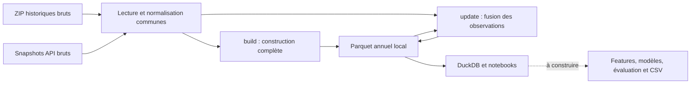

# Méthodologie

Ce document consigne les choix présents dans le code au **1er novembre 2026**, leurs raisons, leurs limites et les questions encore ouvertes. Le [README](../README.md) reste le guide de commandes rapide.

- **Implémenté** : comportement observable dans les modules et couvert par les tests indiqués.
- **Provisoire** : règle ou hypothèse en place qui doit encore être justifiée par les données ou le métier.
- **À décider / à construire** : aucun arbitrage ou résultat ne doit être déduit des seuls noms de fichiers, dépendances ou gabarits.

Le statut « implémenté » décrit l'arbre de travail ; le statut de publication et de fusion reste celui des PR GitHub. Les chiffres d'exploration rapportés sont distingués des contrôles réellement exécutés.

## Repères de lecture

1. [Périmètre du brief](#périmètre-du-brief)
2. [Architecture et organisation](#architecture-et-organisation)
3. [Collecte des données](#collecte-des-données)
4. [Contrat de données](#contrat-de-données)
5. [Stockage, mémoire et reproductibilité](#stockage-mémoire-et-reproductibilité)
6. [Constats d'exploration](#constats-dexploration)
7. [Accès SQL et exemples](#accès-sql-local-issue-7)
8. [Actualisation et reprise](#actualisation-des-observations-issue-8)
9. [Vérification et tests](#vérification-et-tests)
10. [Modélisation et feuille de route](#modélisation-évaluation-et-feuille-de-route)
11. [Backtest](#backtest-issue-15)
12. [Météo](#météo-issue-21)
13. [Baselines](#baselines-issue-17)
14. [Chantiers et événements](#chantiers-et-événements-issue-34)
15. [Chronos-2](#chronos-2-issue-19)
16. [Table de modélisation](#table-de-modélisation-issue-22)
17. [Timestral](#timestral-issue-20)
18. [Variables tabulaires](#variables-tabulaires-issue-30)
19. [LightGBM](#lightgbm-issue-31)
20. [Décisions ouvertes](#décisions-ouvertes)

## Périmètre du brief

Le brief LivraisonCo 2026 fourni par les organisateurs est la référence. Les issues GitHub servent à réaliser ses livrables ; l'infrastructure reste proportionnée au PoC.

- **Cibles :** débit horaire et taux d'occupation pour `Champs-Elysées`, `Convention` et `Saint-Pères`, du 7 au 11 novembre 2026 inclus. Mesurer les erreurs par validation historique et RMSE.
- **Fichier de rendu :** `output_<nom_du_groupe>.csv`, 360 lignes (3 arcs × 120 heures), avec exactement `arc`, `datetime`, `debit_horaire`, `taux_occupation`. Les dates sont des chaînes au format `%Y-%m-%d %H:%M` et les deux mesures des flottants. Le brief utilise un séparateur point-virgule ; le contrat Parquet interne reste distinct de ce fichier final.
- **Présentation :** sept planches maximum plus annexes, à présenter en 15 minutes. Expliquer l'approche et les résultats, puis proposer une feuille de route pour l'optimisation des livraisons : modèles complémentaires, données à collecter et calendrier.
- **Hypothèses métier fournies :** livreurs à 10 €/heure entre 08:00 et 20:00, 14 €/heure la nuit ; tranches de travail de 4 à 8 heures. Ces éléments alimentent la feuille de route, sans imposer la construction d'un optimiseur de livraison complet pendant cette phase.
- **Échéance :** prévisions, code reproductible et présentation à remettre avant le 6 novembre 2026 à 18:00, heure de Paris.
- **Collecte :** télécharger arc par arc et actualiser les observations avant la prévision finale. Les backtests historiques et les proxies sont auxiliaires : ils ne changent ni les trois cibles évaluées ni les dates officielles.

## Architecture et organisation

### Modules et responsabilités

| Élément | Choix en place | Raison |
|---|---|---|
| [`src/traffic_prediction/`](../src/traffic_prediction/) | Package Python installé en mode éditable. | Partager les mêmes fonctions entre commandes, notebooks et composants futurs. |
| [`historical.py`](../src/traffic_prediction/data/historical.py) | Découverte des archives, téléchargement brut, lecture ZIP et contrôle d'intégrité. | Centraliser les particularités du format historique, dont Deflate64. |
| [`traffic.py`](../src/traffic_prediction/data/traffic.py) | Extraction API et fonctions communes de sélection, normalisation et grille. | Appliquer les mêmes conventions aux archives et aux observations récentes. |
| [`build.py`](../src/traffic_prediction/data/build.py) | Construction complète, schéma Arrow, validation et écriture des partitions. | Séparer le format final interne de la récupération des sources. |
| [`query.py`](../src/traffic_prediction/data/query.py) | Vue SQL sur les fichiers Parquet et résultats Pandas. | Réutiliser les fichiers locaux dans les analyses. |
| [`update.py`](../src/traffic_prediction/data/update.py) | Couverture, période de reprise, orchestration des téléchargements, fusion et publication. | Actualiser sans reconstruire toutes les archives ni dupliquer la normalisation. |
| [`validate.py`](../src/traffic_prediction/data/validate.py) | Contrôles du dataset, manifeste d'intégrité et validation du CSV de prévisions. | Vérifier les artefacts et la complétude sans réimplémenter le nettoyage ou un modèle. |
| [`weather.py`](../src/traffic_prediction/data/weather.py) | Météo Open-Meteo : historique et prévision, conversion en étiquettes de Paris, raccord et validation. | Fournir une covariable connue à l'avance, sur la même grille horaire que le trafic. |
| [`disruptions.py`](../src/traffic_prediction/data/disruptions.py) | Chantiers Open Data Paris proches des arcs évalués (distance géométrique) et liste manuelle d'événements, en table horaire validée. | Contrôler la période de test et expliquer des erreurs passées ; ce n'est pas une variable d'entraînement. |
| [`features.py`](../src/traffic_prediction/features.py) | Variables tabulaires ajustées à un cutoff : calendrier cyclique, décalages hebdomadaires, profils historiques, météo disponible. | Partager le même calcul entre apprentissage et prévision, avec des tests anti-fuite (#30). |
| [`train.py`](../src/traffic_prediction/train.py) | Deux régressions LightGBM globales, réentraînées au cutoff, avec importance des variables et repli explicite. | Comparer une famille tabulaire aux modèles de fondation sur les mêmes fenêtres (#31). |
| [`configs/baseline.yaml`](../configs/baseline.yaml) | Identités, sens des arcs et rôles évalué/proxy. | Éviter de disperser ces paramètres entre notebooks et commandes. |
| [`notebooks/`](../notebooks/) | Gabarits numérotés pour exploration, nettoyage, features, baseline, expériences et impact livraison. | Organiser le travail exploratoire ; les traitements réutilisables vont dans le package. |

La fonction `process_archives` reste une entrée compatible pour les traitements historiques ; elle délègue à `process_sources`. Ce n'est pas une seconde implémentation du pipeline.



### Environnement et dépendances

- Le projet utilise `pyproject.toml` et la structure `src/`. `pip install -e . --no-deps` enregistre le package ; il faut installer séparément les dépendances du flux utilisé.
- `pyproject.toml` demande Python ≥ 3.10 ; les versions de [requirements.txt](../requirements.txt) visent Python 3.10–3.13. La vérification locale consignée ici a été réalisée sous Windows et Python 3.12, sans matrice de tests sur toutes ces versions.
- Les versions sont épinglées pour rendre l'environnement explicite. Le README installe le sous-ensemble nécessaire aux données et aux notebooks, afin de ne pas imposer tout l'environnement de modélisation dès le départ.
- Les téléchargements API et les ZIP ordinaires utilisent `urllib`, `json` et `zipfile` de la bibliothèque standard. Les imports NumPy, Pandas et YAML de `traffic.py` sont différés pour conserver une commande d'extraction utilisable sans les dépendances de traitement.
- Pandas et NumPy servent aux transformations ; PyArrow fixe le schéma et écrit les Parquet ; PyYAML charge les arcs ; DuckDB 1.4.5 fournit l'interface SQL.
- `stream-unzip==0.0.100`, avec `stream-inflate==0.0.43` et `pycryptodome==4.2.0`, fournit le lecteur Deflate64 optionnel. Il est chargé à la demande pour ce format ; les tests historiques complets l'utilisent aussi.
- `requests` figure dans les dépendances préparées, mais les téléchargeurs actuels reposent sur `urllib`. De même, la présence de bibliothèques de modèles ne signifie pas qu'un modèle a été choisi ou entraîné.

### Travail en équipe et artefacts

Les commandes ont des chemins par défaut ancrés à la racine du dépôt ; un notebook lancé depuis `notebooks/` peut donc employer la même API. Le terminal, VS Code et le noyau du notebook doivent utiliser le même environnement Python.

Une issue correspond à une branche et une PR. Les copies personnelles des gabarits limitent les conflits de notebooks. Les données brutes, données transformées, modèles entraînés et sorties générées sont exclus de Git par [.gitignore](../.gitignore) ; seuls les emplacements vides peuvent être versionnés. Les secrets et environnements locaux sont également exclus. `nbstripout` est préparé dans les dépendances, mais aucun hook automatique de suppression des sorties n'est configuré dans le dépôt.

## Collecte des données

### Principes communs

Conserver une copie brute avant transformation permet de revenir sur une règle de nettoyage, de comparer deux extractions et d'examiner les champs non retenus dans la table de travail. Le téléchargement ne renomme pas les variables, n'impute pas les valeurs et ne transforme pas les données en Parquet.

Les appels réseau déclarent un timeout de 30 secondes pour les métadonnées et prévisualisations, et de 60 secondes pour les téléchargements. Ces paramètres ne constituent pas une durée maximale totale pour une archive. Par défaut, il y a au plus trois tentatives. Les reprises après erreur recommencent le téléchargement depuis le début ; aucun téléchargement HTTP partiel n'est repris à un offset. Les erreurs HTTP permanentes 4xx ne sont pas réessayées, hors 408 et 429. Entre tentatives, le délai augmente ; les téléchargements attendent une puis deux secondes.

Les fichiers temporaires sont publiés sous leur nom final après validation. Leur nettoyage ne remplace pas le contrôle de la source : la présence d'un fichier nommé correctement ne suffit pas à le considérer comme valide.

### Archives historiques : issue #4

**Source :** [comptages routiers permanents — historique](https://opendata.paris.fr/explore/dataset/comptages-routiers-permanents-historique/).

1. Lire les métadonnées du jeu `comptages-routiers-permanents-historique` via l'API `datasets/1.0`.
2. Reconnaître les pièces jointes intitulées `opendata_txt_<année>.zip` et construire leurs endpoints de téléchargement à partir des identifiants fournis.
3. Sélectionner une année ou une plage inclusive. Une année demandée absente de la découverte provoque une erreur avant les téléchargements.
4. Conserver chaque pièce jointe séparément dans `data/raw/historical/<année>/<attachment_id>.zip`. Plusieurs pièces jointes d'une même année ne sont pas écrasées.

La disponibilité des années n'est pas codée en dur : la commande `--list` est la référence au moment de l'exécution. Les deux pièces jointes 2025 sont conservées séparément à l'ingestion, même si leur contenu a été rapporté identique.

Les archives sont téléchargées par blocs de **1 MiB** dans un fichier `.part`. Le nombre d'octets est comparé au `Content-Length` lorsqu'il est fourni. La validation exige un membre texte et lit les contenus pour vérifier leur intégrité avant remplacement du fichier final.

Un ZIP déjà présent et valide est réutilisé. Ce mécanisme ne détecte pas automatiquement une révision distante : aucun contrôle ETag, Last-Modified ou manifeste de versions du portail n'est implémenté.

### ZIP volumineux et Deflate64

Les textes sont traités directement depuis le ZIP, sans extraction complète. Le volume brut annoncé pendant l'exploration — environ 177 Mo compressés et 6,1 Go de textes pour 2024 — motive la lecture en flux ; ce chiffre n'est pas une mesure de RAM.

Le ZIP 2023 utilise Deflate64, non pris en charge par `zipfile` seul. Le choix actuel est un lecteur optionnel `stream-unzip`, avec des blocs de lecture compressée de 64 KiB et une interface binaire consommable par Pandas. Les noms, tailles et CRC sont contrôlés, y compris par comparaison avec le répertoire central et pour les membres ignorés par le traitement.

Les ZIP ordinaires gardent l'ordre des noms de membres ; le lecteur Deflate64 suit l'ordre physique de l'archive pour rester en flux. Ce choix est déterministe pour une même archive, mais ne constitue pas un tri chronologique supplémentaire.

Le support Deflate64 a été vérifié avec de petites archives compressées, dont un champ de plus de 64 KiB, et avec des corruptions injectées. Le 1er novembre 2026, le vrai ZIP 2023 a aussi été téléchargé et intégralement contrôlé par taille et CRC. Seuls ses deux derniers membres ont été interprétés pour récupérer la frontière du 1er janvier 2024 ; l'année 2023 entière n'a pas été transformée en Parquet.

### Observations récentes : issue #5

**Source :** [comptages routiers permanents — observations récentes](https://opendata.paris.fr/explore/dataset/comptages-routiers-permanents/).

L'API utilisée est `explore/v2.1/catalog/datasets/comptages-routiers-permanents` :

- `/records` sert à prévisualiser quelques observations et à lire `total_count` ;
- `/exports/jsonl` avec `limit=-1` sert à l'extraction complète de la plage demandée, pour éviter de confondre une page d'API avec le jeu complet ;
- les filtres portent sur `t_1h >= début` et `t_1h < fin`. Les bornes doivent inclure un fuseau et sont converties en UTC ;
- le filtre optionnel `road_id` / `--road-id` sélectionne un `iu_ac` entier positif. L'actualisation l'utilise arc par arc, conformément au brief. Le mode générique sans filtre de route reste disponible.

Chaque exécution conserve un snapshot distinct `data/raw/recent/traffic_<début UTC>_<fin UTC>_<suffixe>.jsonl`. Le suffixe assure l'unicité ; son ordre alphabétique n'indique pas la date d'extraction. Deux exécutions identiques peuvent donc créer deux fichiers bruts, ce qui est volontaire.

Le contrôle d'une extraction comprend le statut HTTP, la structure minimale des observations, des timestamps avec fuseau dans la plage demandée et, si sélectionné, le bon identifiant d'arc. Le flux est lu ligne par ligne, avec une limite de **4 MiB par ligne JSONL**. Le nombre d'octets est contrôlé si connu et le nombre de lignes est comparé au compteur API avant puis après l'export.

Un export vide est un snapshot valide. Un export incomplet ou dont le nombre de lignes a changé échoue explicitement. Des comptes identiques ne prouvent cependant pas que toutes les valeurs distantes sont restées figées pendant l'extraction : l'API ne fournit pas ici de transaction ou de version de snapshot que le code exploite.

## Contrat de données

### Identification des arcs

La configuration [baseline.yaml](../configs/baseline.yaml) porte les identités attendues. Le filtrage conserve le couple **nœud amont → nœud aval**, puis vérifie le `iu_ac` ; le sens inverse est un autre tronçon.

| Rôle | Arc | `iu_ac` | Nœud amont | Nœud aval |
|---|---|---:|---|---|
| Évalué | Champs-Elysées | 4264 | `Av_Champs_Elysees-Washington` | `Av_Champs_Elysees-Berri` |
| Évalué | Convention | 5671 | `Lecourbe-Convention` | `Convention-Blomet` |
| Évalué | Saint-Pères | 191 | `Sts_Peres-Voltaire` | `Sts_Peres-Universite` |
| Proxy expérimental | La Boétie-Berri | 4272 | `Av_Champs_Elysees-La_Boetie` | `Av_Champs_Elysees-Berri` |
| Proxy expérimental | Washington-Balzac | 4265 | `Av_Champs_Elysees-Washington` | `Av_Champs_Elysees-Balzac` |

Le code exige au moins un arc évalué et l'unicité des noms, identifiants et couples de nœuds. La configuration générique peut servir aux tests ou à un sous-ensemble d'arcs ; le rendu officiel doit néanmoins contenir les trois cibles du brief.

Les deux proxies sont des **candidats de variables explicatives**, pas des remplacements de la vérité terrain des Champs-Elysées. Ils ont leurs propres noms et `role=proxy`. Aucune copie de leurs mesures vers `role=evalue` n'est implémentée.

### Trafic horaire (issue #6)

**Fichier.** `data/processed/traffic/year=YYYY/part-0.parquet` : Parquet compressé (zstd), un fichier par année. Produit par `python -m traffic_prediction.data.build` (voir le README), non versionné.

Lecture : `pd.read_parquet("data/processed/traffic")`. Pandas ajoute une colonne `year` déduite du nom du dossier ; elle sert de filtre, par exemple `filters=[("year", "=", 2025)]`.

**Grille.** Une ligne par arc et par heure, de `--start` à 00:00 jusqu'à `--end` à 23:00 inclus (par défaut du 2024-01-01 au 2025-12-31). La clé (`arc`, `datetime`) est unique. Les arcs sont listés dans `configs/baseline.yaml`, section `traffic` : les arcs évalués (`evaluated_arcs`) et des arcs proxy (`proxy_arcs`).

| Colonne | Type | Unité | Contenu |
|---|---|---|---|
| `arc` | string | | Nom de l'arc. Pour les arcs évalués, le nom imposé dans le fichier de rendu : `Champs-Elysées`, `Convention`, `Saint-Pères`. |
| `role` | string | | `evalue` (arc noté par BCG X) ou `proxy` (arc voisin auxiliaire expérimental). |
| `iu_ac` | int32 | | Identifiant Open Data du tronçon. |
| `datetime` | timestamp ns sans fuseau | | Heure de la mesure, voir la convention ci-dessous. |
| `debit_horaire` | float64 | véhicules par heure | `q` d'Open Data. |
| `taux_occupation` | float64 | % du temps, de 0 à 100 | `k` d'Open Data. |
| `etat_trafic` | int8, nullable | code | 0 Inconnu, 1 Fluide (k < 15), 2 Pré-saturé (15 ≤ k < 30), 3 Saturé (30 ≤ k < 50), 4 Bloqué (k ≥ 50). |
| `etat_barre` | int8, nullable | code | 0 Inconnu, 1 Ouvert, 2 Barré, 3 Invalide. À ne pas utiliser comme variable de modèle (voir les constats). |
| `qualite_mesure` | string | | Qualité de la ligne, voir ci-dessous. |

Les valeurs manquantes sont NaN pour les mesures et `<NA>` pour les états. Aucune valeur n'est imputée.

**Convention d'heure.** `datetime` conserve l'étiquette locale de `t_1h` des archives ; les timestamps de l'API sont convertis avant retrait du fuseau : c'est l'heure **locale de Paris, sans fuseau**, et elle marque la **fin** de l'heure mesurée. D'après la notice, « 2019-01-01 01:00:00 » couvre de 00:00 à 01:00. Comme dans la source, chaque jour compte 24 heures :

- Au passage à l'heure d'été, la source contient une ligne pour l'heure qui n'existe pas, souvent vide. Elle est gardée.
- Au retour à l'heure d'hiver, deux instants UTC peuvent devenir la même heure locale 02:00. La clé actuelle ne conserve qu'une ligne après dédoublonnage ; la dernière dans l'ordre de lecture est gardée. Cet ordre n'est pas une garantie de tri chronologique de l'export API.
- Les heures de l'API récente sont en UTC avec fuseau. `normalize_raw` les convertit en heure de Paris sans fuseau. La contribution d'exploration initiale rapporte une concordance de 100 % sur le recouvrement septembre–décembre 2025 pour Convention et Saint-Pères. Ce constat est conservé comme résultat rapporté, sans nouveau calcul de cet historique dans la présente revue.
- Les heures ne sont pas décalées pour suivre le format de rendu : on ne sait pas encore si BCG X désigne le début ou la fin de l'heure. La question reste ouverte.
- Quand la période commence le 1er janvier, les archives lisibles de l'année précédente sont également recherchées pour récupérer la ligne de minuit. Une archive précédente manquante ou de compression non prise en charge produit un avertissement. L'archive 2023 est maintenant lisible avec le décodeur Deflate64 optionnel ; sans cette archive ou une autre source fournie contenant la mesure, `2024-01-01 00:00` reste `absente`. Les lignes hors période sont comptées dans le résumé.

**Qualité de la mesure (`qualite_mesure`).**

| Valeur | Règle |
|---|---|
| `ok` | `q` et `k` présents. |
| `partielle` | Une seule des deux mesures est présente. |
| `vide` | La ligne existe dans la source, mais `q` et `k` sont vides. |
| `invalide` | Au moins une valeur impossible, remplacée par NaN : valeur non numérique, `q < 0`, `k < 0`, `k > 100`, ou `q = 0` alors que `k > 0`. Dans ce dernier cas, la règle actuelle met `q` à NaN et garde `k`. La justification métier de cette règle reste une hypothèse à confirmer. |
| `absente` | L'heure manque dans la source ; elle a été ajoutée par la grille. |

`etat_barre` n'entre pas dans le calcul de la qualité. Les états sont lus et convertis depuis la source ; ils ne sont pas recalculés à partir de `k`.

**Hypothèse à confirmer : `q=0, k>0`.** Cette règle est implémentée et testée, mais un test logiciel ne démontre pas qu'elle correspond à un défaut de capteur. Elle ne doit pas être présentée comme une certitude métier. Sa conservation ou sa modification reste à discuter avec l'équipe.

Les mesures infinies sont également invalides et remplacées par NaN. Un état fourni avec un code ou un libellé inconnu arrête le traitement ; un état manquant reste manquant.

**Doublons.**

- Une archive identique à une autre (même SHA-256) n'est lue qu'une fois. C'est le cas de 2025, que le portail liste deux fois.
- Si plusieurs lignes portent le même couple (`arc`, `datetime`) avec des valeurs identiques, une seule est gardée. Si leurs valeurs diffèrent, on garde la dernière ligne entière dans l'ordre de lecture, y compris ses valeurs manquantes. Les deux cas sont comptés dans le résumé.
- Les archives sont lues par ordre de nom. Leurs membres sont lus par ordre de nom pour les ZIP ordinaires, et dans l'ordre physique de l'archive pour Deflate64 afin de décompresser en flux. Les snapshots JSONL sont lus ensuite, dans l'ordre explicite des arguments `--recent-file`. Leur nom aléatoire ne permet pas de déduire leur date d'extraction : aucun tri automatique ni mélange des valeurs de plusieurs lignes n'est effectué.

**Filtre et garde-fous.**

- Un arc est défini par son couple (nœud amont, nœud aval), dans cet ordre. Le sens inverse est un autre arc, avec un autre `iu_ac`.
- Si un couple de nœuds configuré apparaît avec un autre `iu_ac` que celui attendu, le traitement s'arrête.
- Un horodatage manquant ou qui ne correspond pas à une heure entière de Paris arrête le traitement avant la création de la grille, pour éviter de perdre silencieusement une observation.
- Un arc sans aucune mesure sur la période ne bloque pas le traitement : il produit un avertissement, il est compté, et ses heures restent NaN.
- Rien n'est écarté sans être signalé. Le résumé de fin compte les lignes lues, gardées, hors période, en double et invalides, et donne la part de valeurs manquantes par arc, par variable et par mois.

**Validation.** Avant l'écriture, le traitement vérifie les colonnes et leur ordre, les types, le nombre de lignes (arcs × heures), l'appartenance à la grille demandée, l'absence de doublons, la cohérence `arc`/`iu_ac`/`role`, les plages de valeurs et les labels de qualité. Les labels sont confrontés aux mesures : `ok` exige deux valeurs, `partielle` une seule, `vide` aucune, et `invalide` au moins une mesure masquée ; une ligne `absente` ne porte ni mesure ni état observé. Après l'écriture, il relit le schéma et le nombre de lignes de chaque fichier. Les transformations sont déterministes pour les mêmes entrées, configuration et versions ; l'identité binaire des Parquet entre versions de bibliothèques n'est pas un engagement.

## Stockage, mémoire et reproductibilité

### Choix du format et du partitionnement

| Choix | Objectif | Limite ou contrepartie |
|---|---|---|
| Bruts immuables dans `data/raw/` | Garder l'information source et permettre une nouvelle interprétation. | Les snapshots successifs occupent de l'espace disque ; pas de politique de rétention automatique. |
| Parquet typé et compressé zstd | Fixer les types et limiter le volume du jeu de travail. | Ce format interne ne remplace pas le CSV exigé pour le rendu. |
| `year=YYYY/part-0.parquet` | Une organisation simple cohérente avec les archives annuelles et les cinq arcs configurés. | Une correction peut réécrire toute l'année concernée ; pas de partitionnement mensuel retenu pour l'écriture actuelle. |
| Schéma Arrow `TRAFFIC_SCHEMA` centralisé dans `build.py` | Éviter des sorties différentes selon la source. | Les évolutions du schéma doivent être propagées aux lecteurs et aux tests. |
| Écriture dans un fichier temporaire du même dossier puis remplacement | Ne pas exposer un fichier annuel partiellement écrit lors de la construction. | La construction complète n'est pas une transaction unique couvrant plusieurs années. |

Pandas peut inférer une colonne `year` à partir des dossiers Hive. Cette colonne de partition ne fait pas partie des neuf champs stockés dans `TRAFFIC_SCHEMA`. Les autres champs bruts, dont la géométrie `dessin` des archives ou les objets géographiques de l'API, restent disponibles dans les fichiers originaux mais ne sont pas normalisés en variables géographiques à ce stade.

### Construction complète et mise à jour

`build_traffic` construit la période demandée, valide la table et remplace chaque fichier annuel concerné. Un build limité à un seul jour remplace donc aussi le fichier de cette année par cette période. Les autres années sont conservées. Le contrôle post-écriture vérifie schéma et nombre de lignes ; il ne s'agit pas d'une seconde lecture exhaustive de toutes les valeurs.

`update_traffic` a un contrat différent : il fusionne les observations reçues avec l'historique et prépare toutes les partitions modifiées avant publication. Ses garanties de reprise et ses limites sont détaillées plus bas. Les deux commandes ne sont pas interchangeables.

### Consommation mémoire et optimisations déjà réalisées

- Les ZIP sont téléchargés et décompressés en flux ; les textes sont lus par lots de `CHUNK_ROWS=200_000` lignes.
- La lecture historique ne charge que les huit colonnes nécessaires à la normalisation. La lecture JSONL écarte les champs inutiles de son tampon et garde les huit valeurs sous forme de tuples.
- Le jeu de travail ne conserve que les arcs configurés et les lignes de la période avant la concaténation finale. Les doublons sont ensuite résolus et les heures manquantes complétées.
- Les contrôles de sortie évaluent les masques d'erreur successivement, plutôt que de conserver tous les masques de la taille de la table.
- **Ce n'est pas un pipeline entièrement hors mémoire.** Les observations retenues, la grille finale et la partition annuelle fusionnée occupent encore de la RAM. Un résultat SQL converti en DataFrame l'occupe également.
- Un benchmark local sur 20 818 enregistrements JSONL a mesuré un pic d'allocations Python passant d'environ 8,4 à 6,8 MiB, soit 19 % de moins. Le temps était pratiquement inchangé, environ 1,55 contre 1,56 seconde. Il ne s'agit ni de la mémoire totale du processus ni d'un benchmark des archives complètes.

### Reproductibilité effectivement disponible

Les entrées brutes sont conservées, la configuration et les versions sont explicites, et les règles de transformation et de priorité sont déterministes. Les doublons d'archives sont identifiés par SHA-256, calculé par blocs de 1 MiB. Les règles de nettoyage peuvent ainsi être réexaminées sans avoir détruit les valeurs d'origine.

Le validateur peut désormais enregistrer un manifeste du dataset traité : fichiers et SHA-256, configuration des arcs, couverture, qualité et versions. Il identifie les artefacts locaux ; il ne constitue pas encore un manifeste global de toutes les entrées brutes, du commit d'exécution et du cutoff d'un modèle. Les snapshots API ne sont pas automatiquement sélectionnés par « plus récent » : leur ordre doit être fourni explicitement. La stabilité du jeu distant ou l'identité binaire des sorties entre environnements ne doit pas être supposée.

Le filtre de dates porte sur l'heure de mesure, pas sur sa date de publication ou de correction. Réinterroger aujourd'hui une ancienne période ne reconstitue donc pas nécessairement ce qui était connu à l'époque. Cette distinction devra être prise en compte pour les backtests et le gel des données de prévision.

## Constats d'exploration

Les chiffres ci-dessous proviennent de la contribution d'exploration associée à l'issue #6 et des échanges de l'équipe, avec une consultation de l'API rapportée au 29 octobre 2026. Ils n'ont pas été recalculés sur l'ensemble des archives pendant cette revue. Ce sont des résultats datés, à reproduire ou actualiser avant une présentation chiffrée ; les tests synthétiques ne les démontrent pas.

### Données trafic 2024–2025 (issue #6)

- **Les manques viennent par blocs de mois** (pannes de capteurs), pas au hasard :
  - Saint-Pères : de décembre 2024 à septembre 2025 ;
  - Convention : avril–mai 2024, septembre–novembre 2024, mars–mai 2025 ;
  - Champs-Élysées : novembre et décembre 2025.

  Pour le détail mois par mois, lancer la commande de traitement : son résumé l'affiche.
- **Champs-Elysées : dernière mesure le 2025-11-19 à 12:00.** Ni l'archive ni l'API (consultée jusqu'au 29/10/2026) ne contiennent de mesure plus récente, et aucun autre `iu_ac` n'a repris le couple Washington → Berri.
- **511 heures n'ont de données pour aucun capteur en 2024**, du 28/03 au 01/04 et fin novembre.
- **`etat_barre` est incohérent entre les deux sources.** Dans l'archive, il vaut 3 (« Invalide ») sur 99 % des lignes, y compris quand les mesures sont normales. Il vaut 2 (« Barré ») sur les Champs-Élysées lors de fermetures (14/07, 31/12, etc.). Pour les mêmes heures, l'API donne 1 (« Ouvert ») dès qu'il y a une mesure. **Recommandation de l'exploration : ne pas l'utiliser comme variable explicative sans investigation.** Aucun modèle ni filtre de feature engineering ne met encore cette recommandation en application.
- **`etat_trafic` se déduit entièrement de `k`** par les seuils de la notice : il vaut 0 si et seulement si `k` est vide. Sa valeur ajoutée comme variable explicative reste à évaluer. Un état contemporain de l'heure à prévoir ne peut pas être supposé connu à l'avance.
- **Proxy La Boétie-Berri (4272)** : on n'y trouve quasiment que le taux d'occupation. `q` manque à 96,6 % et n'est présent qu'en janvier 2024. Question ouverte : faut-il le garder comme proxy de taux seulement, ou chercher un autre proxy ? Candidats vus dans l'API en 2026, en part d'heures avec `k`, sans avoir vérifié `q` : 4274 (Berri → La Boétie, sens inverse, environ 75 %) et 4267 (Balzac → Washington, sens inverse, environ 47 %).
- **Proxy Washington-Balzac (4265)** : il est très dégradé à partir d'avril 2025. `q` manque à 85–100 % chaque mois, et `k` manque à 100 % de juillet à novembre 2025.
- **`q = 0` alors que `k > 0`** : 98 heures sur La Boétie-Berri et 101 sur Washington-Balzac, aucune sur les arcs évalués. Ces lignes sont marquées `invalide`.
- **L'archive 2023 est compressée en Deflate64**, illisible par `zipfile` seul. Cette limite est désormais prise en charge par le lecteur en flux optionnel.
- **API récente (pour l'issue #5)** :
  - elle commence le 01/09/2025 et recouvre donc l'archive jusqu'à fin 2025 ;
  - elle a elle aussi des heures absentes ;
  - ses heures sont en UTC avec fuseau ;
  - `etat_trafic` et `etat_barre` y sont en texte ;
  - `libelle` y est écrit différemment, mais les nœuds sont identiques.

## Accès SQL local (issue #7)

**Choix : DuckDB embarqué, connexion en mémoire.** L'objectif est de permettre l'exploration SQL locale et les jointures depuis les notebooks, avec les mêmes fichiers Parquet. Aucun PostgreSQL, service cloud ou fichier de base de données persistant n'est nécessaire au flux actuel. La création d'un serveur SQL ou d'une couche ORM ne fait pas partie de ce choix.

`traffic_prediction.data.query.connect_traffic()` ouvre une connexion DuckDB en mémoire et enregistre une vue `traffic` sur les fichiers Parquet de `data/processed/traffic/`. Un fichier seul ou un autre dossier peut être fourni avec `path=...`. La recherche est récursive, avec prise en charge des partitions Hive (`year=...`, éventuellement `month=...`). Les colonnes de partition ont des types inférés ; un mois écrit `01` peut être une chaîne.

`query_traffic(sql, parameters, path=...)` renvoie le résultat SQL sous forme de DataFrame Pandas et ferme sa connexion. Pour plusieurs requêtes ou une jointure avec un DataFrame de notebook, utiliser `with connect_traffic() as connection` et `connection.register(...)`. Les exemples complets sont regroupés ci-dessous.

La vue lit les fichiers à la demande, sans copie préalable de tout le jeu de données en Pandas ou dans une table SQL. Les filtres sur les partitions permettent d'éviter les fichiers inutiles ; les projections et filtres compatibles sont exécutés par le lecteur Parquet. Le résultat demandé occupe de la mémoire lorsqu'il est converti en DataFrame. La liste de fichiers est fixée à l'ouverture : reconnecter après ajout ou suppression de partitions.

Les connexions sont propres à chaque appel ou bloc `with`, sans connexion globale partagée. Les paramètres positionnels `?` et nommés `$nom` sont pris en charge. `union_by_name=False` évite de masquer automatiquement des différences de schéma entre fichiers ; le module contrôle la présence des colonnes attendues et DuckDB peut signaler d'autres incompatibilités lors d'une requête.

Les requêtes conservent les valeurs manquantes, les rôles et les conventions d'heure du contrat de données. Utiliser des paramètres SQL pour les valeurs de filtre et des bornes explicites, par exemple `datetime >= ? AND datetime < ?` en heure locale de Paris sans fuseau. Aucun décalage, remplacement de cible par un proxy, ni dédoublonnage supplémentaire n'est effectué par la vue.

### Exemples SQL

Ces exemples s'utilisent depuis les notebooks existants ou une session Python, après le traitement des données.

Filtrer par période et identifiants d'arcs, avec des paramètres SQL :

```python
from datetime import datetime
from traffic_prediction.data.query import query_traffic

observations = query_traffic(
    """SELECT arc, datetime, debit_horaire, taux_occupation, qualite_mesure
       FROM traffic
       WHERE datetime >= ? AND datetime < ? AND iu_ac IN (?, ?)
         AND role = ?
       ORDER BY arc, datetime""",
    [datetime(2025, 10, 1), datetime(2025, 11, 1), 5671, 191, "evalue"],
)
```

Réutiliser une connexion pour une agrégation mensuelle et une jointure à un DataFrame :

```python
import pandas as pd
from traffic_prediction.data.query import connect_traffic

with connect_traffic() as connection:
    monthly = connection.execute(
        """SELECT arc, date_trunc('month', datetime) AS month,
                  avg(debit_horaire) AS mean_flow,
                  count(debit_horaire) AS measured_hours
           FROM traffic WHERE role = 'evalue' AND year = ?
           GROUP BY arc, date_trunc('month', datetime)
           ORDER BY arc, month""",
        [2025],
    ).fetchdf()

    roads = pd.DataFrame({"iu_ac": [5671, 191], "delivery_zone": ["south", "central"]})
    connection.register("roads", roads)
    by_zone = connection.execute(
        """SELECT delivery_zone, avg(debit_horaire) AS mean_flow
           FROM traffic JOIN roads USING (iu_ac)
           WHERE year = 2025 GROUP BY delivery_zone"""
    ).fetchdf()
```

`fetchdf()` renvoie uniquement le résultat demandé dans Pandas. Utiliser `count(debit_horaire)` pour compter les heures mesurées, car les valeurs nulles restent nulles. Reconnecter après ajout ou suppression de fichiers ; la liste des fichiers est fixée à l'ouverture.

## Actualisation des observations (issue #8)

La commande `python -m traffic_prediction.data.update` permet de réaliser la seconde collecte demandée par le brief avant la prévision finale, sans reconstruire toutes les archives. Elle télécharge chaque arc configuré séparément avec le filtre API `iu_ac`, puis réutilise la normalisation et la grille existantes. Les trois cibles restent distinctes des proxies expérimentaux.

La couverture distingue les heures stockées de la dernière heure réellement fournie par une source : les lignes synthétiques `absente` ne font pas avancer le point de reprise. Par défaut, sept jours calendaires de recouvrement sont repris depuis la dernière journée source, jusqu'au moment de l'appel. Ce moment est capturé une fois pour borner les requêtes des différents arcs. Les dates explicites sont inclusives en heure de Paris ; la conversion des bornes tient compte des changements d'heure. Un jeu sans couverture source demande un `--start` explicite. `Coverage` distingue `first_hour`, `last_hour` et `last_source_hour`. Une ligne source `vide` ou `invalide` compte pour la couverture source ; ce n'est pas nécessairement une mesure exploitable pour chaque cible.

Le point de reprise est global aux arcs du jeu, pas individuel par capteur. Une correction plus ancienne que le recouvrement de sept jours demande une période explicite ; l'actualisation ne garantit pas de détecter toute révision de l'historique distant.

Une ligne API présente remplace toute la ligne correspondante, y compris ses valeurs nulles. Une ligne absente de l'API ne supprime pas une observation historique. Les partitions annuelles identiques ne sont pas réécrites, les autres années sont conservées, et les valeurs ne sont jamais transférées d'un proxy à une cible.

Les partitions modifiées sont préparées et validées avant publication. Le remplacement de chaque fichier est atomique, avec sauvegarde et restauration en cas d'exception. Un arrêt brutal peut interrompre la publication entre deux années sans laisser de Parquet partiellement écrit : relancer la même période termine l'actualisation. Un verrou empêche deux actualisations concurrentes.

### Options et reprise après interruption

- `--start` et `--end` sont des jours de Paris inclusifs ; les téléchargements sont toujours bornés au moment de l'appel. Sans `--end`, la journée courante est partielle. `--refresh-days N` modifie le recouvrement par défaut ; un `--start` explicite le remplace.
- `--output-dir`, `--raw-dir` et `--config` changent les chemins ou la configuration. L'actualisation exige le format produit par `build.py`, `year=YYYY/part-0.parquet`, et la même configuration d'arcs que les partitions existantes. Les autres formats Hive restent consultables en SQL, mais doivent être migrés avant actualisation.
- Les snapshots bruts restent dans `data/raw/recent/`. Un export vide ne prolonge pas la couverture et ne remplace pas les observations stockées. Les heures ajoutées par la grille ne sont pas considérées comme une couverture source.
- Ne pas exécuter de construction complète dans le même dossier pendant une actualisation. Après un arrêt brutal, vérifier qu'aucun processus d'actualisation ne tourne avant de supprimer un verrou `.traffic-update.lock` devenu obsolète, puis relancer la période demandée.
- Les fichiers de travail sont isolés dans un dossier `.traffic-update-*` et ne sont pas des partitions Parquet consultables. Si la restauration après erreur échoue elle aussi, les sauvegardes sont conservées et leur emplacement est indiqué dans le message d'erreur ; les utiliser pour la récupération avant une nouvelle actualisation.

Le traitement réutilise `download_observations`, `process_sources`, `validate_traffic` et `TRAFFIC_SCHEMA` ; l'orchestration reste dans `update.py`. Les anciennes années non concernées ne sont pas reconstruites. Les fichiers identiques sont laissés en place, ce qui préserve aussi leur date de modification.

Le rapport expose la période demandée, la couverture source précédente, les snapshots bruts et les partitions écrites ou inchangées. Les compteurs de `ProcessingStats` concernent les données entrantes ; ce n'est pas un journal exhaustif de chaque valeur historique corrigée.

La protection est un verrou entre actualisations et une publication atomique **par fichier**, pas une transaction durable unique sur toutes les années. Une construction complète lancée en parallèle ne partage pas ce verrou. Aucun ordonnanceur, daemon ou synchroniseur cloud n'a été ajouté.

## Vérification et tests

### Validation locale du dataset

`python -m traffic_prediction.data.validate` valide le dataset de travail existant. `--write-manifest` enregistre le rapport dans `data/processed/traffic/_validation.json` ; `--check-manifest` vérifie les artefacts courants par rapport au rapport enregistré. `--manifest-path` change l'emplacement du JSON. Aucun téléchargement réseau n'est nécessaire à ces commandes.

Le validateur vérifie le schéma exact de chaque Parquet, lit les données une année à la fois via DuckDB et réutilise `build.validate_traffic`. Il contrôle les timestamps absents, les doublons, les nombres de lignes, les arcs et rôles, les valeurs et la cohérence entre les dossiers Hive `year`/`month` et les timestamps des observations.

Par défaut, la grille doit être complète entre le premier et le dernier jour stockés, pour tous les arcs configurés. Une année ou une journée manquante entre deux partitions provoque une erreur. Des bornes `--start` et `--end` peuvent limiter les contrôles ligne par ligne à une période inclusive ; le schéma et les hashes continuent à couvrir tous les fichiers. Cette portée est inscrite dans le rapport.

**Complétude structurelle et disponibilité des mesures sont distinctes.** Une grille complète avec des `NaN` reste valide si les labels de qualité et les contraintes sont cohérents. Le rapport indique, par arc, le nombre de lignes source, les valeurs de `q` et `k` présentes après normalisation, les manques, les labels de qualité et la dernière heure source. Il ne déclare pas automatiquement le dataset suffisant pour entraîner un modèle.

### Métadonnées et reproductibilité : issue #9

Le rapport versionné contient les chemins relatifs, tailles, SHA-256 et nombres de lignes des Parquet ; la couverture stockée et la fenêtre validée ; les identités d'arcs ; les versions de Python et des principales bibliothèques. L'empreinte du dataset porte sur ses fichiers et la configuration canonique des arcs. La date de validation, le chemin absolu et le système d'exploitation n'entrent pas dans cette empreinte ; les commentaires YAML ne changent pas l'identité de la configuration.

La vérification compare des **artefacts exacts**, pas une équivalence sémantique entre deux encodages Parquet différents. Copier les mêmes fichiers sur une autre machine conserve leur identité ; reconstruire des valeurs identiques avec un autre encodeur peut changer les octets. Le test de reproduction du pipeline compare donc aussi les résultats Pandas triés.

Les inventaires sont comparés avant et après la validation pour détecter les modifications en cours de lecture. Un verrou d'actualisation présent bloque le contrôle. Le JSON n'est remplacé qu'après une validation réussie, par une écriture temporaire atomique ; une validation ou publication échouée conserve le précédent manifeste. Après une mise à jour volontaire des observations, relancer `--write-manifest` pour enregistrer leur nouvel état.

### Validation du rendu officiel

`python -m traffic_prediction.data.validate --submission outputs/submissions/output_team.csv` vérifie le nom `output_<nom_du_groupe>.csv`, charge un CSV séparé par des points-virgules et vérifie les quatre colonnes, les trois noms officiels, les 360 couples arc/heure uniques du 7 au 11 novembre 2026, le format exact `%Y-%m-%d %H:%M` et des mesures flottantes finies. Le débit doit être positif ou nul et le taux d'occupation compris entre 0 et 100.

Ce contrôle ne produit aucune prévision et ne mesure pas la RMSE. La règle provisoire de nettoyage des observations `q=0, k>0` n'est pas appliquée aux valeurs prédites. La génération et l'export du CSV par un modèle restent à construire.

### Stratégie retenue

Les tests utilisent de petits fichiers représentatifs et des réponses réseau simulées. Ils doivent vérifier les contrats et les échecs qui risqueraient de perdre des données, sans exiger un téléchargement de plusieurs gigaoctets ni une API vivante.

| Suite | Comportements vérifiés |
|---|---|
| [`test_historical.py`](../tests/test_historical.py) | Découverte, plages d'années, pièces jointes multiples, flux borné, interruptions, réutilisation, ZIP réel Deflate64, CRC corrompus, archive tronquée et dépendance absente. |
| [`test_traffic.py`](../tests/test_traffic.py) | Filtres de dates et d'arc, exports complets, comptages, erreurs HTTP, réponses incomplètes, snapshots distincts et CLI sans dépendances de traitement. |
| [`test_traffic_processing.py`](../tests/test_traffic_processing.py) | Normalisation des deux sources, états et mesures invalides, conventions de temps, doublons, grille, frontières d'années, proxies vides, schéma et round-trip Parquet, CLI et mélange des sources. |
| [`test_query.py`](../tests/test_query.py) | Vue SQL, partitions année/mois, fichiers et chemins avec espaces ou apostrophes, paramètres, filtres, agrégations, jointures, nulls, sortie réelle du build, plan Parquet et fermeture des connexions. |
| [`test_update.py`](../tests/test_update.py) | Ajouts, corrections nulles, répétitions sans réécriture, histoire préservée, couverture source, bootstrap, jours de 23/25 heures, échecs réseau/écriture/validation, rollback, interruption clavier et verrou concurrent. |
| [`test_data.py`](../tests/test_data.py) | Chaîne HTTP simulée → ingestion → build → SQL → actualisation → manifeste, reprise après interruptions, reproduction dans un autre dossier, erreurs de complétude, intégrité et contrat du CSV officiel. |
| [`test_weather.py`](../tests/test_weather.py) | Météo sans réseau : requêtes UTC et copie brute, étiquettes de Paris et changements d'heure, jointure avec la grille trafic, raccord historique/prévision, rafraîchissement, nouvelles tentatives, validation et CLI. |
| [`test_disruptions.py`](../tests/test_disruptions.py) | Chantiers et événements sans réseau : distance à l'arc, seuils de 50 et 200 m, conversion des dates, règle de `chantier_actif`, étiquettes horaires, lignes « non appliqué », liste manuelle mal formée refusée et fichier versionné validé, requêtes, nouvelles tentatives, construction et CLI. |
| [`test_chronos.py`](../tests/test_chronos.py) | Chronos-2 sans torch ni chronos : un faux pipeline enregistre ce que le modèle recevrait. Format, 120 heures par arc, horizon de 144 heures, espion anti-fuite, heures non `ok` en NaN, bornes, repli au seuil de 168 heures, covariables sur tout l'horizon, médiane, moyenne ou quantile par type de jour, rendu officiel valide, réglages par défaut. La comparaison avec la vraie signature de `predict_df` n'est exécutée que si chronos est installé. |
| [`test_dataset.py`](../tests/test_dataset.py) | Jointures et colonnes de la table de modélisation, grille des covariables, masques des proxies, empreintes, validation des entrées et CLI. |
| [`test_timestral.py`](../tests/test_timestral.py) | Disposition des tenseurs, horizon, calendrier, masques, bornes, repli, cutoff, poids épinglés, absence de dépendances lourdes et intégration au rendu. |
| [`test_imports.py`](../tests/test_imports.py) | Import des modules du package, y compris les points d'entrée nouvellement ajoutés. |

La dernière exécution locale (1er novembre 2026, issue #20 et assembleur de la PR #39) a donné **573 tests et 27 sous-tests réussis** sous Python 3.12.10, avec les dépendances de modèles installées. Sans torch, chronos ou Timestral, les tests utilisent des backends simulés ; le contrôle de signature Chronos est sauté. Les contrôles de documentation ont aussi parsé les blocs PowerShell, vérifié les options de commandes et les liens locaux, puis exécuté les exemples SQL sur des Parquet de test.

Un snapshot récent réel de **2 974 observations** a auparavant été converti en **120 lignes horaires** pour les cinq arcs configurés sur une journée, avec contrôle du schéma Parquet. Ce contrôle ponctuel ne remplace pas un test exhaustif de toutes les années ou de l'API en production.

### Ce que ces tests ne démontrent pas

- La pertinence métier du nettoyage `q=0, k>0` ou la valeur prédictive des proxies.
- Une couverture complète des données réellement disponibles pour les Champs-Elysées.
- La compatibilité exécutée sur tous les systèmes et toutes les versions de Python visées.
- Une reprise transactionnelle de plusieurs années après coupure électrique ; seule la validité par fichier et la reprise décrite pour l'updater sont visées.
- La qualité des prévisions ou la disponibilité des features propres aux futurs modèles : le test du backtest borne seulement les observations qui leur sont transmises.
- La reproduction des chiffres d'exploration de l'équipe sur toutes les archives.

### Tests automatiques sur GitHub

Le workflow [Data pipeline tests](../.github/workflows/tests.yml) est configuré sur les PR, les pushes vers `main` et les déclenchements manuels. La matrice couvre Windows et Linux avec Python 3.10 et 3.13 ; la vérification locale ci-dessus utilise Python 3.12. Les actions de checkout et d'installation de Python sont épinglées par commit, et le jeton de workflow n'a que le droit de lecture du dépôt.

La CI extrait les versions du sous-ensemble données/tests directement depuis `requirements.txt`, installe le package éditable et lance `python -m pytest -q`. Les bibliothèques lourdes de modèles ne sont pas installées tant que les tests ne les utilisent pas. Il faudra adapter ce périmètre à l'implémentation des modèles. Les tests du pipeline n'appellent pas l'API réelle.

La configuration du workflow ne constitue pas une exécution distante réussie : son résultat devra être vérifié lors de la publication de la PR. `test_features.py` reste un emplacement réservé ; la suite de backtest et son test anti-fuite sont décrits ci-dessous.

## Modélisation, évaluation et feuille de route

### Statut des composants

| Sujet | Préparé dans le dépôt | Décision ou travail restant |
|---|---|---|
| Données externes | Modules `weather.py`, `calendar_events.py`, `disruptions.py` et dépendance `holidays`. | Météo implémentée : voir [Météo](#météo-issue-21). Chantiers et événements implémentés comme table de contrôle, pas comme variable d'entraînement : voir [Chantiers et événements](#chantiers-et-événements-issue-34). |
| Feature engineering | `features.py` et notebook 03. | Définir les variables temporelles, retards et agrégats ; contrôler l'absence d'information future. |
| Baseline | `models/baselines.py` et notebook 04. | Quatre baselines mesurées et consignées ; voir [Baselines](#baselines-issue-17). |
| Familles de modèles | Répertoire `models/` ; Chronos-2 et Timestral implémentés ; LightGBM prévu en #31. | Comparaisons mesurées dans [Chronos-2](#chronos-2-issue-19) et [Timestral](#timestral-issue-20). Le modèle final reste à choisir (#32). |
| Entraînement | `train.py`. | Implémenter la préparation sur les données d'entraînement, l'ajustement et la sauvegarde. |
| Évaluation | `evaluate.py`, contrat `models/base.py` et huit fenêtres configurées. | Backtest implémenté ; mesurer les modèles sur les données locales disponibles. |
| Prévision et export | `predict.py` ; contrôle du format disponible dans `data/validate.py`. | Produire les 120 heures × 3 arcs et exporter le CSV demandé ; le validateur ne génère pas les valeurs. |
| Impact livraison | Notebook 06. | Construire la proposition métier, ses hypothèses et la feuille de route des sept planches. |

Les modules d’entraînement, de features et d’export restent des gabarits ; le backtest et sa référence semaine précédente sont implémentés. Aucun entraînement, sélection de modèle ou génération complète du CSV final n'est réalisé par les commandes de données.

### Principes de validation déjà posés

Les gabarits et docstrings demandent une validation chronologique, des variables disponibles au moment de la prévision et un prétraitement appris uniquement sur l'entraînement. Le backtest ci-dessous applique la coupure temporelle aux entrées du modèle ; les features propres à chaque modèle doivent aussi respecter ces principes.

Le brief impose la RMSE. Le backtest publie séparément les deux cibles, leurs scores normalisés et la couverture ; aucune pondération officielle entre `q` et `k` n’est supposée.

La simulation d'octobre 2025 avec test début novembre 2025 a été évoquée par l'équipe pour avancer malgré les manques récents. C'est une proposition de backtest ; elle ne remplace pas la période officielle de novembre 2026 sans validation des organisateurs.

Les états contemporains du trafic, les observations futures ou une météo observée après le cutoff ne doivent pas être supposés disponibles lors d'une prévision. Les [variables tabulaires et leurs tests anti-fuite](#variables-tabulaires-issue-30) sont implémentés en #30 ; [LightGBM](#lightgbm-issue-31) les utilise sans fournir de labels de validation à l'entraînement.

### Suivi des expériences

[`docs/experiments.csv`](experiments.csv) utilise désormais `date,author,model,description,scores` (le journal précédent ne contenait aucune expérience). Chaque appel réussi ajoute une ligne : date UTC, auteur (utilisateur local par défaut), classe du modèle, description et JSON strict des tables de scores avec cutoffs et compteurs. Les scores indéfinis deviennent `null`. Le JSON conserve les fenêtres sans vérité ; une moyenne seule ne suffit pas à comparer les modèles.

Le chemin est ancré à la racine du dépôt, même depuis un notebook. Passer `experiments_path=None` désactive le journal ; un autre chemin isole un essai. Un en-tête incompatible provoque une erreur sans ajout. Les écritures du journal sont destinées aux exécutions séquentielles locales. Consigner les paramètres du modèle et la version/manifeste des données dans `description` : le framework n’archive pas les poids ni les données d’entraînement.

### Feuille de route métier

Le rôle du trafic prédit est d'aider à choisir des créneaux de livraison plus favorables. Passer de cette information à une décision de coût nécessite encore des éléments : demande de colis, durées de livraison, capacité des livreurs, contraintes de service et relation entre trafic et temps de parcours.

Le brief fournit les coûts horaires et les durées de vacation. La présentation doit proposer les modèles complémentaires, les données et les étapes nécessaires pour exploiter ces contraintes. Aucun algorithme de tournées, règle de conversion de `q/k` en vitesse, nombre optimal de livreurs ou gain financier chiffré n'a été arrêté ou implémenté.

## Backtest (issue #15)

### Interface et utilisation

`models/base.py` définit le protocole structurel `ForecastModel` : aucune classe parente n’est imposée. La méthode `predict(history: DataFrame, target_times: DatetimeIndex) -> DataFrame` reçoit les colonnes du trafic traité, y compris les proxies, et renvoie `arc`, `datetime`, `debit_horaire`, `taux_occupation`. Les couples arc/heure doivent être uniques ; les dates sont des heures entières **locales Paris sans fuseau**, conformément au Parquet. Une chaîne de caractères doit être convertie en datetime par le modèle avant retour.

Charger les fichiers existants avec `query_traffic("SELECT * FROM traffic")`, puis appeler `backtest(model, data)` ; `cutoffs` permet de fournir d’autres jeudis. Les huit cutoffs par défaut sont dans `configs/baseline.yaml`. Aucun téléchargement n’est déclenché. Pour un gros historique, limiter la requête SQL à l’historique nécessaire au modèle et aux fenêtres voulues, sans supprimer les lignes de vérité ni les arcs sans mesure. La copie du seul historique antérieur à chaque cutoff isole les mutations du modèle du DataFrame d’origine.

Un cutoff désigne le **jeudi entier**, jusqu’à 23:00 inclus. Le vendredi est une journée de latence ; les 120 étiquettes vont du samedi 00:00 au mercredi 23:00. La fenêtre reste composée de 120 heures locales même lors d’un changement d’heure, selon la grille interne dédupliquée. Les fenêtres de Noël, du Nouvel An, de Pâques, du 14 juillet et des deux 11 novembre couvrent des jours fériés lundi/mardi/mercredi. Deux semaines d’automne ordinaires complètent la liste, dont le 24–28 octobre 2026 après intégration de l’updater #8.

Le framework ne transmet aucune ligne après le jeudi. Le modèle doit réinitialiser/réentraîner son état à chaque appel et ne pas charger d’observations futures par un autre accès : l’interface ne peut pas empêcher un modèle d’utiliser un fichier externe ou un état préentraîné avec des données futures. Le test espion vérifie les bornes sur plusieurs fenêtres, la présence des proxies et l’absence de mutation des données d’origine.

### Scores et couverture

`BacktestResult.scores` contient une ligne par cutoff, arc évalué, variable et sous-ensemble (`all` ou `atypical`). `per_arc` moyenne les fenêtres par arc/variable/sous-ensemble ; `summary` moyenne les couples arc/fenêtre par variable/sous-ensemble. Seuls les arcs `role == "evalue"` sont évalués, y compris ceux présents dans l’entrée mais sans aucune vérité dans une fenêtre. Un arc totalement absent de l’entrée ne peut pas être découvert : conserver la grille produite par le pipeline.

La vérité est réindexée sur tous les couples arc × 120 heures. Une heure est ignorée si la ligne manque, si `qualite_mesure != "ok"` ou si la valeur de la cible est absente, non finie ou hors limites physiques (débit ≥ 0, occupation entre 0 et 100). `n_expected`, `n_scored` et `n_ignored` sont rapportés pour chaque cible et sous-ensemble. Une prévision absente ou non finie **sur une vérité valide fait échouer le run**, afin de ne pas améliorer artificiellement le score. Des prévisions manquantes sur une vérité ignorée sont autorisées.

`rmse = sqrt(mean((prediction - vérité)**2))` est calculée séparément pour les deux variables. Les jours atypiques sont samedi, dimanche ou jour férié de France métropolitaine (`holidays.France`, sans jours régionaux). Une fenêtre sans vérité produit une RMSE `NaN`, avec 120 heures ignorées par cible. Les moyennes sont des **moyennes arithmétiques des RMSE disponibles**, sans pondération par nombre d’heures ; elles ne sont pas une RMSE des erreurs mises en commun. `n_groups`, `n_groups_scored` et `n_groups_normalized` rendent explicite le nombre de contributions. Comparer deux modèles demande les mêmes cutoffs et données.

`PreviousWeekModel` fournit la référence minimale nécessaire à la normalisation : même arc, même heure locale sept jours avant, uniquement si la qualité source est `ok`. Aucun proxy, entraînement ou remplissage n’est appliqué. `baseline_n_scored` compte les vérités valides dont la référence est finie ; `baseline_rmse` est calculée sur ces seules heures. `normalized_score = rmse / baseline_rmse` est défini uniquement si la référence couvre **toutes** les vérités valides du groupe et si sa RMSE est strictement positive. Sinon le ratio reste `NaN` (y compris une référence parfaite) ; aucune division par zéro ni comparaison sur des heures différentes. Un ratio inférieur à 1 indique une amélioration sur la référence.

### Validation

`tests/test_evaluate.py` utilise uniquement des DataFrames synthétiques : anti-fuite, gap, 120 heures, fêtes, scores calculés à la main, alignement, données absentes/invalides, arc entièrement sans vérité, prévisions incomplètes, référence manquante/parfaite, moyennes et journal CSV/JSON. La CI installe la dépendance `holidays` déjà épinglée dans `requirements.txt`. Aucun score sur les archives réelles n’est revendiqué.

## Calendrier horaire (issue #16)

`data/calendar_events.py` produit des covariables connues à l'avance, indépendantes des mesures. Les jours fériés nationaux de France métropolitaine viennent de `holidays.France` (sans particularités d'Alsace-Moselle). Les vacances des élèves de Paris, zone C, viennent du jeu officiel [Le calendrier scolaire sur data.gouv.fr](https://www.data.gouv.fr/datasets/le-calendrier-scolaire), via l'API du ministère. Le téléchargement explicite conserve un petit snapshot JSON dans `data/raw/calendar/paris_school_holidays.json` ; aucun historique de trafic n'est téléchargé.

```powershell
# Premier appel ou actualisation du calendrier officiel uniquement :
python -m traffic_prediction.data.build --calendar --refresh-school-holidays
# Reconstruction hors ligne depuis le snapshot conservé :
python -m traffic_prediction.data.build --calendar
# Sans trafic traité localement, fournir explicitement le début souhaité :
python -m traffic_prediction.data.build --calendar --start 2024-01-01
```

`build_calendar()` déduit par défaut le début du minimum de `datetime` dans le trafic Parquet local, sans charger les observations en mémoire. La fin par défaut est le **11 novembre 2026 à 23:00 inclus**. `--traffic-dir`, `--school-holidays-file`, `--start`, `--end` et `--output-dir` permettent d'isoler un essai. Le résultat remplace uniquement `data/processed/calendar/calendar.parquet`. Sans historique local, un début explicite est nécessaire ; sans snapshot, lancer d'abord l'actualisation. La fonction pure `calendar_table(start, end, school_holidays_path=...)` ne fait aucun accès réseau.

La clé unique `datetime` est un timestamp ns **Paris sans fuseau**, étiquette de fin d'heure identique au trafic : 24 lignes par jour, y compris aux changements d'heure, sans décalage d'une heure. Les features décrivent la date de cette étiquette, y compris à minuit. `hour` vaut 0–23, `day_of_week` vaut 0 (lundi) à 6 (dimanche) ; les autres colonnes sont booléennes : `is_weekend`, `is_holiday`, `is_day_before_holiday`, `is_day_after_holiday`, `is_bridge`, `is_school_holiday`. Les voisins fériés sont calculés aussi hors des bornes de sortie. Un **pont** désigne ici un lundi non férié avant un mardi férié ou un vendredi non férié après un jeudi férié ; c'est une convention de feature, pas une fermeture systématique des entreprises.

Les bornes scolaires avec fuseau sont converties en dates locales de Paris. À cette résolution journalière, la date de départ est incluse et celle de reprise exclue ; le départ après la classe n'est pas modélisé à l'heure près. Les lignes propres aux enseignants sont exclues, les ponts scolaires publiés sont inclus. Une année scolaire absente du snapshot provoque une erreur plutôt qu'un indicateur silencieusement faux. Conserver ce snapshot pour reproduire une expérience ; il représente le calendrier publié lors de sa récupération, sans reconstruction des versions historiquement connues.

Les tests hors ligne utilisent un extrait officiel limité aux années scolaires 2023–2027 et vérifient la grille complète, la jointure directe au trafic, les changements d'heure, les 11 novembre 2024/2025/2026, les samedi 7 et dimanche 8 novembre 2026, les ponts et les bornes de Toussaint 2026 : **du 17 octobre inclus au 2 novembre exclu**.

## Météo (issue #21)

[`data/weather.py`](../src/traffic_prediction/data/weather.py) fournit la météo horaire de Paris depuis [Open-Meteo](https://open-meteo.com/) : l'historique sert à l'entraînement, la prévision couvre les jours à prédire. Une variable météo n'est utilisable que si elle est aussi connue pour la période prédite : c'est une covariable future connue pour Chronos-2 et une variable explicative pour LightGBM. Aucun assemblage avec le trafic n'est fait ici (issue #22).

```powershell
# Construction complète : historique depuis le premier jour du trafic local, prévision jusqu'au 11/11.
python -m traffic_prediction.data.build --weather
# Avant le rendu (vendredi 6 novembre) : garder l'historique, compléter les jours passés, remplacer la prévision.
python -m traffic_prediction.data.build --weather --refresh-forecast
```

`--start`, `--end`, `--output-dir`, `--traffic-dir` et `--weather-source` fonctionnent comme pour le calendrier ; `--refresh-forecast` exige `--weather` et refuse `--start`.

### Sources et variables

| Rôle | API Open-Meteo | Utilisation |
|---|---|---|
| Jours passés (par défaut) | Historical Forecast, `historical-forecast-api.open-meteo.com/v1/forecast` | Premières heures de chaque run des modèles de prévision, mises bout à bout. |
| Jours à partir d'aujourd'hui | Forecast, `api.open-meteo.com/v1/forecast` | Prévision courante, 16 jours au plus. Pour la France : AROME (1,5 km, 4 jours), puis ARPEGE, ICON et IFS. |
| Comparaison | Archive ERA5, `archive-api.open-meteo.com/v1/archive` | Réanalyse, avec `--weather-source archive`. Elle n'est pas mélangée à l'historique par défaut. |

Un seul point est demandé : **48,856 N, 2,310 E**, le centre des trois arcs évalués. Chaque API se cale sur sa maille (environ 1,5 km pour les prévisions, environ 11 km pour l'archive) ; un point unique suffit pour une grandeur aussi lisse à l'échelle de 3 km, sauf pour les averses locales.

| Colonne | Variable Open-Meteo | Nature | Unité |
|---|---|---|---|
| `precipitation_mm` | `precipitation` (pluie, averses et neige) | Cumul de l'heure précédente | mm |
| `temperature_c` | `temperature_2m` | Instantanée, à 2 m | °C |
| `wind_speed_kmh` | `wind_speed_10m` | Vent moyen instantané à 10 m, pas les rafales | km/h |
| `source` | | `historical_forecast` (ou `archive`) pour le passé, `forecast` à partir du jour de coupure | |

**Licence.** Données sous licence CC BY 4.0 : la présentation doit mentionner « Weather data by Open-Meteo.com ». L'API gratuite est réservée à un usage non commercial ; le cadre éducatif du datathon est à confirmer, l'organisateur étant une entreprise. Une requête de plus de deux semaines compte au prorata : l'historique complet représente environ 75 appels, pour une limite de 10 000 par jour.

### Convention de temps

- **Requêtes en UTC.** Avec `timezone=Europe/Paris`, Open-Meteo applique un seul décalage à toute la réponse et ignore les changements d'heure. Ce comportement est documenté et a été vérifié (`utc_offset_seconds = 3600` pour toute la réponse) : sept mois par an, toutes les étiquettes seraient décalées d'une heure, sans erreur. Le code exige `utc_offset_seconds = 0`.
- **Conversion.** Chaque heure UTC est convertie en heure de Paris, puis le fuseau est retiré, comme `parse_t_1h` pour le trafic de l'API. L'étiquette obtenue marque la **fin** de l'heure, exactement comme le trafic : la pluie à 08:00 est le cumul de 07:00 à 08:00, soit l'heure de trafic elle-même. La température et le vent sont ceux de l'instant 08:00, la fin de l'heure, sans moyenne : une demi-heure d'écart avec le milieu de l'heure reste négligeable pour une grandeur lente.
- **Début de période.** La requête commence la veille, en UTC : l'étiquette `2024-01-01 00:00` couvre 23:00–24:00 le 31 décembre, soit 22:00–23:00 UTC.
- **Passage à l'heure d'été.** L'étiquette 02:00 n'est produite par aucune heure UTC. Comme côté trafic, la ligne est conservée pour garder 24 lignes par jour, mais remplie pour éviter une valeur manquante gênante pour Chronos-2. L'horloge saute de 01:59 à 03:00 : l'instant « 02:00 » est donc celui de 03:00. La température et le vent sont copiés de 03:00, et la pluie vaut 0 mm, puisqu'aucune minute ne s'écoule.
- **Retour à l'heure d'hiver.** L'étiquette 02:00 reçoit deux heures UTC. La **dernière** est gardée, comme le trafic garde la dernière ligne lue : la pluie de la première heure est perdue, une heure par an.

Toute autre heure ou valeur manquante dans une réponse arrête la construction plutôt que de produire une ligne vide.

### Observé ou prévu : choix pour l'entraînement et le backtest

L'issue demandait l'API historique (ERA5). **Le choix retenu est l'historique Historical Forecast**, pour deux raisons :

1. **Même niveau que la prévision du rendu.** Sur un mois complet et aux mêmes coordonnées, Historical Forecast est plus chaud que l'archive d'environ 1,1 °C (juillet 2024 : 20,8 contre 19,7 °C ; octobre 2025 : 13,6 contre 12,5 °C). Le vent est plus faible de 1,2 à 2,7 km/h, et la pluie diffère (juillet 2024 : 78,2 contre 61,8 mm). Les mailles et les modèles ne sont pas les mêmes. Un modèle entraîné sur l'archive recevrait le 6 novembre une prévision systématiquement décalée. À l'inverse, sur les jours communs, l'API de prévision et Historical Forecast renvoient des valeurs identiques (écart de 0,00 sur les trois variables, du 28 au 30 octobre 2026) : le raccord ne crée aucune rupture de niveau.
2. **Moins d'information future que l'observé.** Le 6 novembre, le modèle n'aura qu'une prévision ; s'entraîner et se tester sur la météo réelle rend le backtest trop optimiste.

**Le gain mesuré grâce à la météo reste un plafond.** Historical Forecast n'enchaîne que les premières heures de chaque run, donc des prévisions à quelques heures d'échéance, presque observées. Dans le backtest, la météo du samedi au mercredi est ainsi connue presque parfaitement. Pour le rendu, le 11 novembre sera prévu à environ six jours, hors de portée d'AROME. Le gain mesuré grâce à la météo est donc une borne haute, pas une estimation du gain réel.

**Backtest strict, non implémenté.** L'API Previous Runs (`previous-runs-api.open-meteo.com`, variables `temperature_2m_previous_day1` à `_previous_day7`) donne la valeur prévue N jours avant. Pour Paris, elle est disponible à partir du 23 janvier 2024 à 12:00 UTC (vérifié), ce qui couvre les huit fenêtres. Elle reproduirait l'information connue au cutoff, mais demande d'assembler l'échéance propre à chaque heure prédite et à chaque fenêtre ; ce travail relève de la modélisation (#19) ou de l'assemblage (#22).

### Construction, raccord et rafraîchissement

- **Coupure.** Le jour de Paris de l'exécution sépare les deux sources : historique jusqu'à hier 23:00, prévision à partir d'aujourd'hui 00:00, jusqu'au 11 novembre 23:00 (`calendar_events.PREDICTION_END`). Exécuté le vendredi 6 novembre, l'historique s'arrête au jeudi 23:00, la coupure du modèle, et la prévision couvre du 6 novembre 00:00 au 11 novembre 23:00.
- **Raccord.** Chaque partie est déjà une grille complète. `join_consecutive` exige que chaque partie commence l'heure qui suit la fin de la précédente : un trou ou un chevauchement arrête la construction.
- **Rafraîchissement.** `--refresh-forecast` relit `weather.parquet` et garde les lignes d'historique antérieures à aujourd'hui, sans les retélécharger. Il télécharge ensuite les jours passés manquants, puis la nouvelle prévision. L'historique stocké doit venir de la même source que celle demandée. Les anciennes lignes `forecast` sont remplacées.
- **Fichier.** `data/processed/weather/weather.parquet`, une ligne par heure : `datetime` (timestamp ns sans fuseau), trois colonnes float64 et `source`. L'écriture passe par un fichier temporaire, contrôlé avant remplacement ; en cas d'échec, l'ancien fichier est conservé.
- **Copies brutes.** Chaque réponse est gardée telle quelle dans `data/raw/weather/<source>_<début>_<fin>_<AAAAMMJJTHHMMSSZ>.json`, avec l'heure UTC du téléchargement : on retrouve ainsi la prévision utilisée pour le rendu. Deux téléchargements identiques dans la même seconde écriraient le même fichier.
- **Réseau.** Les requêtes passent par `urllib`, comme les autres téléchargeurs. `requests` n'est pas installé par la CI. La politique d'échec est celle de la [collecte](#principes-communs) : timeout de 60 secondes, trois tentatives espacées d'une puis deux secondes, aucune nouvelle tentative sur une erreur 4xx hors 408 et 429. Un refus d'Open-Meteo affiche sa raison, par exemple une date hors limites.

### Validation et contrôles

`validate_weather` refuse, avant toute écriture :
- des colonnes inattendues ou un `datetime` avec fuseau ;
- une grille incomplète ou dépassant la période, des doublons, des lignes non triées ;
- des valeurs manquantes, infinies ou hors de bornes larges (pluie de 0 à 100 mm, température de −30 à 50 °C, vent de 0 à 200 km/h) ;
- plusieurs sources d'historique, ou une ligne `forecast` avant l'historique.

Les bornes ne servent qu'à détecter une erreur d'unité ou de lecture ; les records de Paris sont −23,9 et 42,6 °C.

**Exécution du 31 octobre 2026.** Le fichier contient 25 104 lignes : `historical_forecast` du 1er janvier 2024 00:00 au 30 octobre 2026 23:00 (24 816 heures), puis `forecast` jusqu'au 11 novembre 23:00 (288 heures). Jointure sur `datetime` avec le trafic :

- les 124 200 lignes de trafic (5 arcs) trouvent chacune une ligne météo, sans valeur manquante ;
- sur la période commune, les 24 840 heures se correspondent, sans heure manquante d'un côté ni de l'autre ;
- les 120 heures du 7 au 11 novembre sont présentes, en `forecast` ;
- les six jours de changement d'heure de 2024 à 2026 ont 24 lignes de chaque côté.

**Vraisemblance.** Les moyennes mensuelles suivent les normales de Paris, et les épisodes connus apparaissent : février 2024 très doux, juin 2025 caniculaire, tempête Kirk le 9 octobre 2024 (67,1 mm). Le maximum est de 40,4 °C le 24 juin 2026, 39,8 °C dans l'archive ERA5. Le cumul de 2024 atteint 1 038 mm, et l'archive en donne encore plus (1 151 mm). Comparé à l'archive heure par heure, Historical Forecast est très proche pour la température (corrélation 0,991), proche pour le vent (0,846), mais **pas pour la pluie (0,391)** : les deux sources ne s'accordent ni sur l'heure exacte ni sur l'intensité des averses. Par exemple, le 10 mai 2026 donne 59,8 mm d'un côté et 17,9 mm de l'autre. Un indicateur de pluie ou un cumul sur plusieurs heures sera plus robuste que les millimètres d'une heure précise.

**Tests.** [`test_weather.py`](../tests/test_weather.py) compte 46 tests sans réseau : un faux serveur remplace `urlopen` dans tout le fichier, et ses valeurs encodent l'heure UTC pour vérifier chaque étiquette à la main. Un contrôle par mutation a été fait : garder la première heure 02:00 d'octobre, ne pas remplir le trou de mars, ne pas demander la veille ou ne pas convertir en heure de Paris fait échouer respectivement 1, 3, 6 et 7 tests.

**Limites.**
- Le backtest reste optimiste pour la météo, voir plus haut.
- Open-Meteo signale que les versions des modèles changent dans le temps.
- La stabilité des valeurs passées d'Historical Forecast entre deux téléchargements n'a pas été vérifiée ; le rafraîchissement ne retélécharge pas l'historique stocké.
- La prévision téléchargée le 31 octobre classe aussi en `forecast` le 31 octobre, déjà présent dans le trafic ; après le rafraîchissement du 6 novembre, toutes les heures de trafic connues ont une météo `historical_forecast`.
- **Testée comme covariable de Chronos-2 : aucun gain**, même avec cette météo presque observée, y compris sur les heures de pluie (voir [Chronos-2](#chronos-2-issue-19)).

## Baselines (issue #17)

### Les quatre modèles

[`models/baselines.py`](../src/traffic_prediction/models/baselines.py) contient quatre prévisions de référence qui respectent le contrat `ForecastModel`. Elles se recalculent à chaque appel à partir du seul historique reçu, n'utilisent que les arcs évalués et les heures `qualite_mesure == "ok"` (comme la vérité du backtest) et ignorent les proxies.

| Classe | Règle principale |
|---|---|
| `PreviousWeekBaseline` | Même arc, même heure locale 7 jours avant ; si la valeur manque, 14 jours avant. |
| `FourWeekMeanBaseline` | Moyenne des valeurs disponibles 7, 14, 21 et 28 jours avant (une à quatre valeurs). |
| `DayTypeProfileBaseline` | Moyenne par (arc, type de jour, heure) sur tout l'historique reçu. |
| `HolidayAwarePreviousWeekBaseline` | Comme `PreviousWeekBaseline` les jours normaux ; un jour férié, même heure du dernier dimanche connu de l'historique (le dimanche 1er novembre 2026 pour le rendu), sinon le dimanche précédent. |

**Types de jour.** Sept types : lundi, mardi, mercredi, jeudi, vendredi, samedi, et dimanche **avec les jours fériés**. Ils viennent des colonnes `day_of_week` et `is_holiday` du calendrier de l'issue #16 (`data/processed/calendar/calendar.parquet`). Les profils couvrent tout l'historique antérieur à la coupure, depuis le 1er janvier 2024, sans pondération des semaines récentes.

**Repli.** Quand la règle principale ne donne rien, chaque modèle essaie dans l'ordre : le profil de l'arc par type de jour, son profil horaire tous jours confondus, puis le profil par type de jour de tous les arcs évalués réunis. Sans aucun historique valide, le modèle échoue explicitement au lieu de renvoyer zéro. Après chaque appel, `sources_` indique la règle utilisée pour chaque couple (arc, heure). Sur les huit fenêtres de backtest et les coupures des 29 octobre et 5 novembre 2026, pour les quatre modèles, les deux derniers niveaux n'ont jamais servi : ils restent un filet de sécurité. Les prévisions sont bornées : débit ≥ 0, occupation entre 0 et 100.

**Champs-Elysées.** Sans mesure après le 19 novembre 2025 à 11:00, la semaine précédente, le dernier dimanche et la moyenne sur quatre semaines sont vides en 2026 : les quatre modèles y prévoient le profil par type de jour de l'arc, appris de janvier 2024 à novembre 2025. Ce profil ignore toute évolution récente de l'avenue ; les proxies ne sont pas utilisés à ce stade.

### Pourquoi « semaine précédente » reste valable sur toute la fenêtre

Les données s'arrêtent le **jeudi 23:00** et l'on prédit du **samedi 00:00 au mercredi 23:00**, soit de 25 à 144 heures après la dernière heure connue (1 à 6 jours). La valeur « semaine précédente » est prise 168 heures (7 jours) avant chaque heure prédite : elle tombe donc toujours **au plus tard le mercredi 23:00 précédant la coupure**, soit 24 heures avant celle-ci. Elle est connue pour toute la fenêtre, sans jamais utiliser le vendredi. La règle ne cesserait de fonctionner qu'au-delà de 7 jours d'horizon. Le même raisonnement couvre la valeur à 14 jours et la moyenne sur 7 à 28 jours. Les huit fenêtres du backtest ont exactement cette géométrie.

Rendu final, coupure le jeudi 5 novembre 2026 à 23:00 :

| Jour prédit | Valeur « semaine précédente » | Horizon depuis la coupure | Remarque |
|---|---|---|---|
| Samedi 7/11 | Samedi 31/10 | 25 à 48 h | Le 31/10 est encore en vacances de la Toussaint. |
| Dimanche 8/11 | Dimanche 1/11 | 49 à 72 h | Toussaint, mais déjà un dimanche : peu d'écart attendu. |
| Lundi 9/11 | Lundi 2/11 | 73 à 96 h | Jour de la rentrée scolaire. |
| Mardi 10/11 | Mardi 3/11 | 97 à 120 h | Le 10/11 est une veille de jour férié. |
| **Mercredi 11/11 (férié)** | **Mercredi 4/11** | 121 à 144 h | **Jour ouvré copié sur un jour férié.** La source la plus récente est le 4/11 à 23:00. |

**Biais possible le samedi 7 novembre.** Le samedi 31 octobre 2026 est encore dans les vacances scolaires de la Toussaint (du 17 octobre inclus au 2 novembre exclu), alors que le samedi 7 novembre ne l'est plus : la « semaine précédente » de ce samedi peut être un peu biaisée. Le dimanche 1er novembre est aussi en vacances et férié, mais reste un dimanche ; les jours prédits du lundi au mercredi copient des jours hors vacances.

**Limite le 11 novembre.** La semaine précédente reproduit un mercredi ordinaire, avec ses pointes du matin et du soir, alors qu'un jour férié ressemble à un dimanche. Le 11 novembre 2025 (mardi, coupure le jeudi 6 novembre) le montre sur les données, en moyenne sur les étiquettes 08, 09, 18 et 19 h :

| Heures de pointe du 11/11/2025 | Férié réel | `PreviousWeek` (mardi 4/11) | `HolidayAware` (dimanche 2/11) | `DayTypeProfile` | Dimanche 9/11, inconnu à la coupure |
|---|---:|---:|---:|---:|---:|
| Convention, débit (véh/h) | 332 | 566 | 332 | 371 | 319 |
| Saint-Pères, débit (véh/h) | 410 | 582 | 373 | 354 | 409 |
| Convention, occupation (%) | 2,5 | 8,0 | 2,5 | 3,0 | 1,5 |
| Saint-Pères, occupation (%) | 5,9 | 6,2 | 5,2 | 4,8 | 6,1 |

Sur ces heures de pointe, la semaine précédente surestime le débit du jour férié d'environ 70 % (Convention) et 40 % (Saint-Pères). Les deux variantes qui traitent le férié comme un dimanche s'en rapprochent nettement. L'égalité exacte de Convention pour `HolidayAware` est une coïncidence de moyenne : heure par heure, le dimanche 2/11 et le férié diffèrent (135 contre 173 véh/h à 08 h, 486 contre 443 à 19 h). Le score sur les jours atypiques du backtest permet de comparer les approches sur toutes les fenêtres.

Les baselines utilisent tout l'historique qu'on leur transmet : c'est à l'appelant (backtest ou script de rendu) de le couper au jeudi 23:00.

### Résultats du backtest

Exécution du 31 octobre 2026 : données du 1er janvier 2024 au 31 octobre 2026 (manifeste `f3c95ed5…`), huit coupures par défaut. Les quatre runs sont consignés dans [`experiments.csv`](experiments.csv). Tous les modèles prédisent toutes les heures : ils sont notés sur exactement les mêmes heures.

**Couverture.** Une heure est notée si la vérité est `ok` ; les autres sont ignorées. Les mêmes heures valent pour le débit et l'occupation.

| Coupure | Champs-Elysées | Convention | Saint-Pères |
|---|---:|---:|---:|
| 2024-11-07 | 89 | 0 | 89 |
| 2024-12-19 | 120 | 81 | 0 |
| 2024-12-26 | 113 | 120 | 0 |
| 2025-04-17 | 119 | 1 | 0 |
| 2025-07-10 | 38 | 120 | 0 |
| 2025-10-16 | 95 | 120 | 31 |
| 2025-11-06 | 116 | 120 | 119 |
| 2026-10-22 | 0 | 97 | 96 |
| **Heures notées / ignorées** | 690 / 270 | 659 / 301 | 335 / 625 |
| **Fenêtres notées (toutes / atypiques)** | 7 / 7 | 7 / 6 | 4 / 3 |

**RMSE par arc**, moyenne des fenêtres notées (débit en véh/h, occupation en points de %) :

| Arc | Modèle | Débit, toutes | Débit, atypiques | Occupation, toutes | Occupation, atypiques |
|---|---|---:|---:|---:|---:|
| Champs-Elysées | `PreviousWeek` | 231,6 | 244,0 | 7,98 | 8,67 |
| | `FourWeekMean` | 207,1 | 222,6 | 6,70 | 7,43 |
| | `DayTypeProfile` | **157,0** | **149,5** | **6,23** | **6,56** |
| | `HolidayAwarePreviousWeek` | 212,3 | 221,2 | 8,04 | 8,78 |
| Convention | `PreviousWeek` | 89,4 | 113,8 | 3,36 | 1,70 |
| | `FourWeekMean` | 87,5 | 113,9 | 3,44 | 1,80 |
| | `DayTypeProfile` | 87,7 | 103,4 | 3,43 | 1,47 |
| | `HolidayAwarePreviousWeek` | **75,9** | **89,1** | **3,08** | **1,02** |
| Saint-Pères | `PreviousWeek` | 106,4 | 112,5 | 2,41 | 1,64 |
| | `FourWeekMean` | 118,7 | 147,2 | 2,65 | 2,34 |
| | `DayTypeProfile` | **93,5** | 112,9 | **2,22** | 2,00 |
| | `HolidayAwarePreviousWeek` | 101,8 | **104,7** | 2,37 | **1,59** |

**Synthèse.** La moyenne des RMSE par fenêtre est l'agrégat de l'issue #15 ; la RMSE poolée, recalculée à partir de `rmse` et `n_scored` sur toutes les heures notées, est plus proche de la note officielle (une RMSE sur les 360 lignes du rendu) et ne donne pas le même poids à la fenêtre de Convention qui ne compte qu'une heure.

| Modèle | 3 arcs, débit (moyenne / poolée) | 3 arcs, occupation (moyenne / poolée) | Convention + Saint-Pères, débit (moyenne / poolée) | Convention + Saint-Pères, occupation (moyenne / poolée) |
|---|---:|---:|---:|---:|
| `PreviousWeek` | 148,5 / 175,3 | 4,95 / 5,67 | 95,5 / 112,8 | 3,02 / 2,27 |
| `FourWeekMean` | 140,9 / 165,5 | 4,53 / 4,53 | 98,9 / 118,8 | 3,15 / 2,42 |
| `DayTypeProfile` | **115,9 / 135,0** | **4,25 / 4,24** | 89,8 / 104,3 | 2,99 / 2,24 |
| `HolidayAwarePreviousWeek` | 134,7 / 157,7 | 4,85 / 5,81 | **85,3 / 97,5** | **2,82 / 2,04** |

**Lecture.**

- Sur les trois arcs, `DayTypeProfile` est la meilleure, mais l'écart vient surtout des Champs-Elysées, dont la semaine précédente est très bruitée (fermetures, événements) et qui pèsent sur sept fenêtres.
- Dans le rendu réel, les Champs-Elysées n'ont plus de mesure : **les quatre modèles y prévoient le même profil par type de jour**. Le choix du modèle ne change donc que Convention et Saint-Pères, où `HolidayAwarePreviousWeek` est la meilleure sur les huit mesures, y compris les jours atypiques. C'est la baseline retenue comme filet de sécurité pour le rendu.
- Les scores des Champs-Elysées sont optimistes pour le rendu réel : dans le backtest, le profil y est appris jusqu'à la coupure, alors qu'en novembre 2026 il aura presque un an de retard.
- Point de départ pour la présentation, sur Convention et Saint-Pères (RMSE poolée, toutes heures) : **97,5 véh/h pour le débit et 2,04 points pour l'occupation**.
- `normalized_score` reste indéfini sur la plupart des fenêtres, car la référence semaine précédente de l'issue #15 ne couvre pas toutes les heures notées ; on compare donc les RMSE directement.

## Chantiers et événements (issue #34)

[`data/disruptions.py`](../src/traffic_prediction/data/disruptions.py) répertorie les chantiers et les événements qui touchent les trois arcs évalués. **La table sert à vérifier la période de test et à expliquer des erreurs passées ; elle ne sert pas de variable d'entraînement** : l'historique des chantiers est partiel et les événements sont saisis à la main. Aucun assemblage avec le trafic n'est fait ici (issue #22).

```powershell
python -m traffic_prediction.data.build --disruptions
```

`--start` (par défaut le 1er janvier 2024), `--end` (le 11 novembre 2026), `--output-dir`, `--config` et `--events-file` (par défaut `data/raw/events_manual.csv`) sont disponibles. Chaque exécution retélécharge les chantiers et affiche le contrôle de la période de test.

### Sources

| Source | Contenu | Historique |
|---|---|---|
| [`chantiers-perturbants`](https://opendata.paris.fr/explore/dataset/chantiers-perturbants/) | Chantiers principaux qui gênent la circulation : niveau (perturbant, très perturbant), impact, statut. | **Aucun** : en cours et à venir ; un chantier terminé disparaît. |
| [`chantiers-a-paris`](https://opendata.paris.fr/explore/dataset/chantiers-a-paris/) | Toutes les emprises sur l'espace public, en cours à J-1, avec catégorie et chaussée ou trottoir. | **Aucun**, et aucun chantier qui n'a pas encore commencé. |
| [`historique-chantiers-a-paris-en-2024`](https://opendata.paris.fr/explore/dataset/historique-chantiers-a-paris-en-2024/) | Emprises en cours pendant 2024, même schéma. | 2024 seulement : **2025 n'est pas publié**. |
| [`referentiel-comptages-routiers`](https://opendata.paris.fr/explore/dataset/referentiel-comptages-routiers/) | Segment de chaque `iu_ac`. | Sans objet. |
| [`data/raw/events_manual.csv`](../data/raw/events_manual.csv) | Cérémonies, fermetures, manifestations, grèves, piétonnisations ; une source par ligne. Versionné (exception dans `.gitignore`). | Saisi à la main. |

`circulation_evenement` (PC Lutèce, temps réel) et `fermetures-voirie` (périphérique, tunnels, berges) ne sont pas dans le code : ils sont contrôlés à la main avec la check-list.

### Méthode

- **Les arcs sont repérés par géométrie, pas par nom de voie.** « Chantiers à Paris » n'a pas de colonne voie, et un nom désigne toute la rue alors qu'un arc mesure 120 à 250 m. L'API garde les emprises autour du milieu de l'arc (`within_distance`, rayon = demi-longueur + 250 m), puis la distance exacte entre l'emprise et le segment est calculée en Python, avec une projection plane locale et sans `shapely`.
- **Seuils.** Les emprises à 200 m ou moins sont listées dans `chantiers.parquet` ; `sur_arc` vaut vrai à 50 m ou moins, environ la demi-largeur des Champs-Élysées. Ce seuil inclut les rues voisines aux carrefours.
- **`chantier_actif`** : chantier perturbant ou emprise sur la chaussée, à 50 m ou moins, **hors catégorie « Tiers (travaux sur bâtiment) »**. Ces bennes et échafaudages rendaient le drapeau vrai presque tout le temps sur les trois arcs. Les dates de chantier sont des jours entiers, inclus.
- **`evenement_actif`** : une ligne de la liste manuelle pour l'arc ou pour `toutes`. Une ligne dont la description contient « non appliqué » est gardée pour mémoire, mais ignorée.
- **Temps.** Comme pour le trafic et la météo, l'étiquette marque la fin de l'heure, en heure de Paris sans fuseau. Une étiquette L est active si l'heure ]L − 1 h, L] chevauche [début, fin) : un événement de 07:00 à 14:00 donne les étiquettes de 08:00 à 14:00, exactement les heures « Barré » du capteur le 11/11.
- **Fichiers.** `data/processed/disruptions/disruptions.parquet` contient une ligne par arc et par heure (`datetime`, `arc`, `chantier_actif`, `evenement_actif`, `description`), soit 25 104 heures par arc du 01/01/2024 au 11/11/2026, la grille de la météo. `chantiers.parquet` donne `distance_m`, `sur_arc`, `chaussee`, `categorie` et les dates. Les réponses brutes sont gardées dans `data/raw/disruptions/`, avec l'heure UTC du téléchargement.
- **Validation.** `read_events` refuse toute ligne mal formée et indique son numéro, avant tout téléchargement. `validate_disruptions` exige la grille complète, sans doublon, avec des booléens.

### Liste manuelle

43 lignes : 9 événements (11 Novembre 2024 et 2025, Saint-Sylvestre 2024, 14 Juillet 2025, parade des JOP, Ligue des champions, manifestation du 31/10/2026, grève du 05/11/2026, 11 Novembre 2026), 3 Marathons de Paris (2024 à 2026) et 31 dimanches Paris Respire.

- **11/11/2026 : horaires PROVISOIRES de 7 h à 14 h**, ceux de 2024 et 2025. Ils sont à remplacer par l'arrêté 2026.
- **Paris Respire** ([paris.fr](https://www.paris.fr/pages/un-dimanche-par-mois-les-champs-elysees-et-le-centre-de-paris-reserves-aux-pietons-7110)) : 1er dimanche du mois, de 10 h à 17 h de novembre à mars, de 11 h à 18 h d'avril à octobre. Janvier est exclu : le capteur est normal en janvier 2024 et 2025, et une ancienne version de la page annonçait « pas de piétonnisation en janvier 2026 ». Les 03/08, 07/09 et 02/11/2025 sont marqués « non appliqué d'après le capteur, raison inconnue » : aucune annulation publiée n'a été trouvée. Le 01/11/2026, annulé selon paris.fr, n'a pas de ligne.
- **Contrôle par le capteur des Champs-Élysées** : « Barré » et débit quasi nul de 08 h à 13-14 h les 11/11/2024 et 11/11/2025, dès 16 h environ le 31/12/2024, toute la journée le 14/09/2024, le matin des marathons. Pour le marathon 2025, la source ne donne pas d'horaire pour l'avenue : les heures viennent du capteur, comme l'indique la description.

### Période de test (du 7 au 11 novembre 2026), état au 31 octobre

- **Aucun chantier perturbant, aucune fermeture et aucun événement PC Lutèce à 200 m ou moins des trois arcs.** À 500 m ou moins, aucun ne commence ni ne finit entre le 31/10 et le 11/11.
- `chantier_actif` n'est vrai que sur les Champs-Élysées : chantier de voirie de la Ville à 37 m, du 01/07 au 18/12/2026, au nord du carrefour Berri. Il n'y a rien sur Convention ni sur Saint-Pères.
- `evenement_actif` : Champs-Élysées le 11/11 de 7 h à 14 h (provisoire).
- **À proximité de Saint-Pères** : le quai Voltaire, réduit à une voie (« très perturbant », à 248 m), du 01/10/2024 au 30/10/2026. Son début n'a pas créé de rupture mesurable sur Saint-Pères : débit −4,5 % entre les trois semaines avant et après le 01/10/2024, contre −6,5 % pour la même transition en 2026, chantier actif des deux côtés. On trouve aussi un chantier de la Ville rive droite (7 848 m², à 194 m) jusqu'au 08/11, et des travaux de Fraîcheur de Paris rue des Saints-Pères, mais du 04/01 au 26/02/2027.
- **Semaine de référence** : manifestation du samedi 31/10 (40 stations de métro fermées, rassemblements interdits sur les Champs-Élysées jusqu'au 02/11 à 6 h, piétonnisation du 01/11 annulée) et grève SNCF du jeudi 05/11. Leur effet sur nos arcs n'est pas encore connu.

### Constat sur l'examen blanc

Les erreurs de `HolidayAwarePreviousWeekBaseline` ont été recalculées heure par heure sur les huit fenêtres (RMSE identiques à [`experiments.csv`](experiments.csv)), puis croisées avec la table à l'heure prédite et à l'heure recopiée. **Les grosses erreurs viennent de jours perturbés, soit à l'heure prédite, soit dans la semaine recopiée.**

| Fenêtre | Arc | RMSE débit | Cause | Part de l'erreur² | RMSE sans ces heures |
|---|---|---:|---|---:|---:|
| 06/11/2025 | Champs-Élysées | 230 | 11/11/2025 de 08 h à 14 h : 12 à 119 véh/h réels contre 438 à 1 165 prévus | 65 % (7 h) | 140 |
| 07/11/2024 | Champs-Élysées | 219 | 11/11/2024 de 08 h à 14 h | 38 % (7 h) | 179 |
| 26/12/2024 | Champs-Élysées | 285 | Saint-Sylvestre (31/12 à partir de 16 h, 01/01 de 03 h à 06 h) | 26 % (8 h) | 255 |
| 17/04/2025 | Champs-Élysées | 237 | Pâques recopie le dimanche du Marathon (13/04, « Barré » de 07 h à 15 h) : prévision 160 à 650 véh/h trop basse | 36 % (14 h) | 202 |

- Les chantiers n'expliquent rien de mesurable : sur Saint-Pères en novembre 2024, le chantier Enedis est actif à l'heure prédite comme à l'heure recopiée, donc sans changement d'état.
- Les grosses erreurs sans événement ressemblent à des effets de calendrier : Saint-Pères du 24 au 28/10/2026 (+88 à +180 véh/h chaque jour, la 2e semaine des vacances de la Toussaint recopiant la 1re), Convention le 01/01/2025 et au début des vacances d'été 2025, et l'occupation des Champs-Élysées pendant la semaine de Noël 2024 (cause inconnue).

### Limites

- Historique partiel : 2024 complet, 2025 réduit aux chantiers encore en cours, aucun historique des chantiers perturbants. C'est pourquoi la table n'est pas une variable d'entraînement.
- Les sources ne décrivent que l'état du jour : la table doit être reconstruite juste avant le rendu.
- La liste manuelle n'est pas exhaustive (8 mai, Saint-Sylvestre 2025, autres manifestations) et Paris Respire n'est pas toujours appliqué.

### Check-list du vendredi 6 novembre

1. Lancer `python -m traffic_prediction.data.build --disruptions` et lire le contrôle affiché.
2. Contrôler à la main `circulation_evenement` et `fermetures-voirie` : à 500 m ou moins, les chantiers perturbants et fermetures qui commencent ou finissent entre le 31/10 et le 11/11.
3. Quai Voltaire (`CP002700` dans `chantiers-perturbants`) : vérifier que le chantier est vraiment terminé (`date_fin`, `statut`), puis comparer le trafic de Saint-Pères du 03 au 05/11 à celui du 13 au 15/10.
4. Remplacer les horaires provisoires du 11/11/2026 dans `events_manual.csv` par ceux de l'arrêté de la préfecture de police, retirer « PROVISOIRES », relancer l'étape 1.
5. Confirmer la grève du 05/11 avec les plans de transport SNCF publiés le 04/11.
6. Comparer le samedi 31/10 et le dimanche 01/11 sur Saint-Pères et Convention à un samedi et un dimanche normaux. S'ils sont perturbés, la semaine recopiée par `HolidayAwarePreviousWeek` est biaisée pour le 07/11, le 08/11 et le 11/11.

## Chronos-2 (issue #19)

[`models/chronos.py`](../src/traffic_prediction/models/chronos.py) applique Chronos-2, le modèle de prévision pré-entraîné d'Amazon, sans entraînement sur nos données (*zero-shot*). La classe `Chronos2Forecaster` respecte le contrat `ForecastModel` ; `Chronos2Forecaster(calendar)` donne l'essai retenu (essai 4). Les dix essais sont consignés dans [`experiments.csv`](experiments.csv), avec leur temps de calcul.

### Fonctionnement

| Élément | Choix | Raison |
|---|---|---|
| Modèle | `amazon/chronos-2`, 120 M de paramètres, licence Apache-2.0, révision épinglée `29ec3766` (5 juin 2026), appelé par `predict_df` de `chronos-forecasting` 2.3.2. | Mêmes poids pour toute l'équipe et pour le rendu. |
| Contexte | Les 8 192 dernières heures (maximum du modèle, environ 11 mois), sur une grille horaire régulière. Les heures dont la qualité n'est pas `ok` sont des NaN, que le modèle masque. | Chronos-2 exige des pas réguliers ; une valeur douteuse ne doit pas entrer dans le contexte. |
| Horizon | 144 heures depuis le jeudi 23:00 (le vendredi, puis les 120 heures notées), en une seule passe ; seules les 120 heures demandées sont gardées. | Le modèle prédit jusqu'à 1 024 pas d'un coup, sans boucler sur ses propres prévisions. |
| Covariables connues à l'avance | Six colonnes du calendrier, en flottants : `is_holiday`, `is_school_holiday`, `is_day_before_holiday`, `is_bridge`, `is_sunday_or_holiday` et `day_type` (0 = lundi … 6 = dimanche, férié = 6). | Chronos-2 ne connaît pas les dates : il déduit le rythme de la semaine du contexte, mais ne peut pas deviner un férié. Des booléens seraient encodés comme des catégories. |
| Mode | Multivarié : une série par arc, débit et occupation ensemble. | Meilleur pour l'occupation, presque deux fois plus rapide. |
| Prévision ponctuelle | Médiane (quantile 0,5). | Meilleure que la moyenne des quantiles (voir les essais). |
| Quantile par type de jour (option) | `point_by_day_type`, désactivée par défaut. Par exemple `{"ouvre": 0.5, "weekend": 0.2, "ferie": 0.2}` prend le quantile 0,2 les week-ends et les fériés ; les heures du repli ne changent pas. | Chronos-2 surestime le trafic des jours non ouvrés ; score croisé 96,2 / 1,78 (voir les [pistes pour la #32](#pistes-chiffrées-pour-la-32)). |
| Repli | Un arc avec moins de 168 heures `ok` (une semaine) dans les 28 derniers jours reçoit la prévision de `HolidayAwarePreviousWeekBaseline` ; `sources_` indique l'origine de chaque heure. | Avec un contexte vide, Chronos-2 prévoit environ 0 sans signaler d'erreur. Pour le rendu, les Champs-Élysées (sans mesure depuis le 19/11/2025) reçoivent ainsi le profil par type de jour, comme avec les baselines. |
| Bornes | Débit ≥ 0, occupation entre 0 et 100. | Comme les baselines et le validateur du rendu. |

**Reproductibilité.** Chronos-2 prédit directement ses quantiles, sans tirage aléatoire, et le *dropout* est inactif : deux exécutions donnent des sorties identiques, et les essais relancés avec le code final ont redonné exactement leurs scores. La graine 42 est fixée par précaution ; des écarts de l'ordre de 1e-5 restent possibles d'une machine à l'autre.

**Fuite.** Le modèle ne reçoit que l'historique coupé au jeudi 23:00, ce que vérifie l'espion de [`test_chronos.py`](../tests/test_chronos.py). Les poids pré-entraînés ne dépendent pas de nos données. La fiche du modèle cite les corpus Chronos, GIFT-Eval et des séries synthétiques, sans comptages de Paris ; on ne peut toutefois pas exclure qu'une série publique proche y figure.

### Essais

Backtest des huit fenêtres, données du 1er janvier 2024 au 31 octobre 2026 (manifeste `f3c95ed5`), même vérité que les baselines. RMSE poolée sur Convention + Saint-Pères, le critère de décision ; débit en véh/h, occupation en points ; jours atypiques : samedis, dimanches et fériés. Temps de calcul pour les huit fenêtres sur un portable (i7-13700H, 14 cœurs, torch CPU), hors chargement des poids (18 à 40 s, une fois) : deux mesures, pendant les essais puis lors de la relance pour le journal ; ils varient de 20 à 70 % selon la charge de la machine.

| Essai | Contenu | Débit | Occupation | Débit, atypiques | Occupation, atypiques | Temps (2 mesures) |
|---|---|---:|---:|---:|---:|---:|
| Baseline | `HolidayAwarePreviousWeekBaseline` | **97,5** | 2,04 | **100,1** | **1,27** | 1 s |
| 1 | Historique seul, univarié | 107,2 | 1,99 | 126,6 | 1,89 | 11–13 s |
| 2a | + 5 indicateurs du calendrier | 106,2 | 1,98 | 125,7 | 1,86 | 67–72 s |
| 2b | 2a sans `is_sunday_or_holiday` | 107,4 | 1,99 | 127,3 | 1,88 | 62–74 s |
| 2 | 2a + `day_type` (6 covariables) | 104,3 | 1,94 | 122,8 | 1,79 | 74–123 s |
| 3 | 2 + météo (`temperature_c`, `wind_speed_kmh`, `rain_3h`) | 106,2 | 1,97 | 126,1 | 1,86 | 132–161 s |
| 3b | 2 + `rain_3h` seul | 105,3 | 1,96 | 124,3 | 1,84 | 118–133 s |
| **4 (retenu)** | **2, multivarié** | 104,4 | **1,91** | 122,8 | 1,73 | **43–70 s** |
| 4b | 4 + `cross_learning` (partage entre arcs) | 104,8 | 1,93 | 123,3 | 1,76 | 44–67 s |
| 4, moyenne | 4, moyenne des 19 quantiles de 0,05 à 0,95 | 104,6 | 2,04 | 123,0 | 1,93 | 43–63 s |
| 4, quantile par type de jour | 4, option `point_by_day_type` (0,5 en semaine, 0,2 les week-ends et fériés) | 94,2* | 1,71* | 106,9* | 1,32* | 43 s |

\* 0,2 a été choisi sur ce même backtest : ce score est optimiste. Choisi sur sept fenêtres et mesuré sur la huitième, à tour de rôle, il vaut **96,2 / 1,78** (voir les [pistes pour la #32](#pistes-chiffrées-pour-la-32)).

Par type de jour, essai 4 contre baseline (RMSE poolée Convention + Saint-Pères, débit / occupation) :

| Type de jour | Heures notées | Baseline | Essai 4 |
|---|---:|---:|---:|
| Jours ouvrés | 442 | 94,1 / 2,71 | **75,4 / 2,11** |
| Week-ends | 432 | **84,7 / 1,28** | 99,3 / 1,52 |
| Fériés | 120 | **142,3 / 1,22** | 183,8 / 2,33 |

### Lecture

- **Chronos-2 seul ne bat pas la baseline pour le débit (104,4 contre 97,5), mais la bat pour l'occupation (1,91 contre 2,04).**
- **Il gagne nettement les jours ouvrés (−20 % sur le débit, −22 % sur l'occupation) et perd les week-ends et surtout les fériés.** Il surestime le trafic des jours non ouvrés (erreur moyenne de +41 véh/h le week-end, +54 les fériés) : il garde une partie du profil des jours ouvrés. Aux heures de pointe du 11/11/2025 (08, 09, 18 et 19 h), il prévoit 469 véh/h sur Convention et 570 sur Saint-Pères, pour 332 et 410 réels ; la baseline, qui recopie le dimanche, prévoit 332 et 373.
- **Le calendrier aide peu.** Chronos-2 apprend l'effet d'une covariable dans son propre contexte : onze mois ne contiennent qu'une dizaine de fériés, dont plusieurs pendant une panne de capteur. `day_type` aide le plus (fériés : 185 véh/h contre 195 sans), car le code « dimanche » revient chaque semaine ; `is_sunday_or_holiday` aide un peu (195 contre 200).
- **La météo a été testée, sans gain.** Elle dégrade légèrement tous les scores, y compris sur les 69 heures où il a plu au moins 1 mm en trois heures (126,8 à 127,8 véh/h, contre 126,3 sans météo). Le constat est d'autant plus net que la météo du backtest est presque observée : avec la vraie prévision du rendu, à 2 à 6 jours d'échéance, le gain ne pourrait être que plus faible. Elle n'est pas gardée.
- **Le multivarié** améliore l'occupation (1,91 contre 1,94) et rend le calcul presque deux fois plus rapide ; le débit est inchangé.
- **Le partage entre arcs (`cross_learning`)** n'apporte rien sur Convention et Saint-Pères.
- **La médiane bat la moyenne des quantiles** pour l'occupation (1,91 contre 2,04) : la distribution prévue a une queue haute (bouchons possibles) qui se réalise rarement. Les jours ouvrés, la médiane est presque sans biais (+0,02 point) ; la moyenne ajoute environ +0,4 point.
- **Champs-Élysées** : Chronos-2 y fait mieux que la baseline dans le backtest (moyenne des fenêtres : débit 189 contre 212, occupation 5,7 contre 8,0), mais ce gain ne compte pas pour le rendu, où l'arc passe par le repli.
- **Repli dans le backtest** : Chronos-2 ne prédit que 6 fenêtres de Convention et 3 de Saint-Pères ; ailleurs, l'arc n'avait pas une semaine de mesures récentes et son score est celui de la baseline. Pour le rendu, Convention et Saint-Pères ont des mesures jusqu'au 31/10/2026 : ils passeront par Chronos-2.

### Pistes chiffrées pour la #32

Chiffres calculés à partir des prévisions de l'essai 4 et de la baseline ; le choix revient à la #32. Seul le quantile par type de jour existe dans le module, comme option désactivée par défaut (`point_by_day_type`) ; la combinaison avec la baseline n'est pas implémentée. RMSE poolée Convention + Saint-Pères, débit / occupation.

| Stratégie | Ouvrés | Week-ends | Fériés | Total | Estimation, 5 jours du rendu |
|---|---:|---:|---:|---:|---:|
| Baseline seule | 94,1 / 2,71 | 84,7 / 1,28 | 142,3 / 1,22 | 97,5 / 2,04 | 102,4 / 1,93 |
| Chronos-2 seul (médiane) | 75,4 / 2,11 | 99,3 / 1,52 | 183,8 / 2,33 | 104,4 / 1,91 | 113,6 / 1,88 |
| Chronos-2, quantile bas les week-ends et fériés (validation croisée) | 75,4 / 2,11 | 89,8 / 1,47 | 163,5 / 1,39 | 96,2 / 1,78 | 103,8 / 1,66 |
| **Chronos-2 en semaine, baseline les week-ends et fériés** | 75,4 / 2,11 | 84,7 / 1,28 | 142,3 / 1,22 | **89,9 / 1,69** | **95,5 / 1,57** |

- **Estimation pour le rendu** : 48 heures de week-end (7 et 8/11), 48 heures ouvrées (9 et 10/11) et 24 heures fériées (11/11), en repondérant les erreurs par type de jour des heures réellement prédites par Chronos-2. Ce n'est pas une mesure.
- **Quantile bas** : 0,2, 0,3, 0,4 et 0,5 testés, choisis séparément pour les week-ends et les fériés et pour chaque variable, sur sept fenêtres puis mesurés sur la huitième, à tour de rôle ; le tableau donne ce score croisé. Le choix est stable : 0,2 pour les fériés dans les huit tours ; pour les week-ends, 0,2 dans sept tours sur huit (0,3 pour le débit et 0,4 pour l'occupation quand la fenêtre d'octobre 2026 est mise de côté). 0,2 est au bord de la grille : il corrige surtout le biais des jours non ouvrés. Les fériés ne figurent que dans quatre fenêtres.
- **Option du module** : `Chronos2Forecaster(point_by_day_type={"ouvre": 0.5, "weekend": 0.2, "ferie": 0.2})` reproduit cette piste avec 0,2 fixé ; son backtest redonne exactement les erreurs par type de jour calculées ici et vaut 94,2 / 1,71, un score optimiste puisque 0,2 a été choisi sur ce même backtest. **Le score à retenir est celui de la validation croisée : 96,2 / 1,78.**
- **Réserve sur la combinaison** : elle n'a pas de paramètre, mais sa règle a été suggérée par ce même backtest ; son score est donc un peu optimiste.
- **Le week-end du rendu recopiera un week-end de vacances de la Toussaint** (31/10 et 01/11, avec une manifestation). Dans les deux fenêtres comparables, Chronos-2 fait mieux que la baseline en 2025 (Convention 44 contre 70 véh/h, Saint-Pères 45 contre 58) et un peu moins bien en 2024 (Saint-Pères 125 contre 117). Les samedis de vacances d'octobre 2026 sont bas sur Saint-Pères (274 et 387 véh/h, contre 504 à 531 pour les samedis normaux). À contrôler après la mise à jour du 6 novembre (point 6 de la [check-list](#check-list-du-vendredi-6-novembre)) avant de confier les week-ends à la baseline.

### Jours perturbés, pour l'essai retenu

| Jour | Arc | Heures | Débit réel | Baseline | Essai 4 | RMSE débit, baseline / essai 4 |
|---|---|---|---:|---:|---:|---:|
| 11/11/2024 | Champs-Élysées | fermées (7) | 203 | 603 | 906 | 480 / 757 |
| | | ouvertes (17) | 687 | 756 | 651 | 95 / 176 |
| 11/11/2025 | Champs-Élysées | fermées (7) | 127 | 840 | 872 | 758 / 774 |
| | | ouvertes (17) | 696 | 795 | 614 | 180 / 174 |
| 11/11/2025 | Convention | 24 | 303 | 333 | 321 | 58 / 79 |
| 11/11/2025 | Saint-Pères | 24 | 373 | 364 | 439 | 102 / 115 |
| 21/04/2025 (Pâques) | Champs-Élysées | 24 | 643 | 425 | 769 | 328 / 306 |

Débits moyens en véh/h ; heures fermées : `evenement_actif` de la [table des perturbations](#chantiers-et-événements-issue-34).

- **Aucun modèle ne connaît la fermeture du 11/11** : l'erreur atteint environ 750 véh/h sur les sept heures fermées. Ces heures se ressemblent d'une année à l'autre : de 08 h à 14 h, 217, 74, 53, 13, 26, 207 et 828 véh/h en 2024 ; 81, 42, 16, 19, 12, 119 et 601 en 2025.
- **À Pâques 2025**, la baseline recopie le dimanche du Marathon (avenue barrée) et sous-estime ; Chronos-2 fait mieux, surtout pour l'occupation (4,5 contre 9,0 points).
- **Correction simple, chiffrée mais non implémentée** : sur les heures où `evenement_actif` est vrai, copier les mêmes heures de l'événement de l'année précédente, connues à la coupure. Champs-Élysées, fenêtre du 06/11/2025 : RMSE du débit du 11/11 de 436 à 162 (baseline) et de 443 à 157 (essai 4) ; RMSE du débit de la fenêtre de 230 à 138 et de 214 à 102 ; occupation de la fenêtre de 6,48 à 5,08 et de 6,45 à 4,92. Pour le rendu, les Champs-Élysées passent par le repli : la correction s'appliquerait à la baseline, avec les heures du 11/11/2025, une fois les horaires 2026 confirmés.
- Un indicateur d'événement en covariable de Chronos-2 ne servirait pas au rendu : seuls les Champs-Élysées en ont, et ils ne passent pas par Chronos-2.

### Installation, poids hors ligne et utilisation

torch et `chronos-forecasting` ne sont installés ni par la CI ni par la commande du README : les tests simulent le modèle. Pour exécuter Chronos-2 :

```powershell
# torch en version CPU (l'index CPU évite de télécharger la version CUDA, de plusieurs Go), puis chronos
python -m pip install torch==2.14.1 --index-url https://download.pytorch.org/whl/cpu
python -m pip install chronos-forecasting==2.3.2
# Poids (478 Mo), une seule fois, à la révision épinglée dans models/chronos.py
.\.venv\Scripts\hf.exe download amazon/chronos-2 --revision 29ec3766d36d6f73f0696f85560a422f50e8498c
# Ensuite, sans réseau : chargement depuis le cache Hugging Face
$env:HF_HUB_OFFLINE = "1"
```

Les poids sont rangés dans `%USERPROFILE%\.cache\huggingface\hub` (ou sous `HF_HOME`). Sous Windows, l'avertissement sur les liens symboliques est sans conséquence : les fichiers sont copiés. Le téléchargement a pris 41 s.

```python
from traffic_prediction.data.query import query_traffic
from traffic_prediction.evaluate import backtest
from traffic_prediction.models.chronos import Chronos2Forecaster

data = query_traffic("SELECT * FROM traffic")
result = backtest(Chronos2Forecaster(), data, experiments_path=None)  # Essai 4.
# Essai 1 : Chronos2Forecaster(multivariate=False, calendar_covariates=())
# Essai 3 : Chronos2Forecaster(multivariate=False, weather_covariates=("temperature_c", "wind_speed_kmh", "rain_3h"))
```

### Limites

- Chronos-2 seul ne bat pas la baseline pour le débit ; son intérêt passe par une combinaison (#32).
- Huit fenêtres et 120 heures fériées sur Convention et Saint-Pères : les écarts de 1 à 2 % entre essais sont dans le bruit. L'écart entre jours ouvrés et non ouvrés, lui, est net et se retrouve d'une fenêtre à l'autre.
- Les essais ont été comparés sur le backtest qui a servi à les choisir ; il n'y a pas de jeu de test séparé.
- Champs-Élysées : rien de Chronos-2 n'est utilisé pour le rendu.
- Les comparaisons par type de jour, la validation croisée des quantiles et la correction de la fermeture ont été calculées par un script d'analyse non versionné ; les prévisions de chaque essai se recalculent en quelques minutes avec la classe et le backtest.
- Temps mesurés sur un portable récent (14 cœurs) : une machine plus modeste sera plus lente, mais le rendu ne demande qu'une fenêtre (5 à 10 s, plus le chargement des poids).

## Table de modélisation (issue #22)

[`data/dataset.py`](../src/traffic_prediction/data/dataset.py) assemble le trafic, le calendrier, la météo et les masques de perturbation en une table que tous les modèles lisent : chacun s'entraîne sur les mêmes données, sans refaire ses jointures. Aucune variable n'est calculée ici ; les décalages, profils et indicateurs relèvent de l'issue #30.

```powershell
# Version proposée dans la PR #39 :
python -m traffic_prediction.data.build --dataset --end 2026-10-30
# Rendu (vendredi 6 novembre), après l'actualisation du trafic, --weather --refresh-forecast et --disruptions :
python -m traffic_prediction.data.build --dataset --end 2026-11-05
```

`--start` et `--end` sont des jours de Paris inclus ; par défaut, ceux du trafic stocké. Une période qui dépasse le trafic stocké est refusée. `--output-dir`, `--traffic-dir` et `--config` fonctionnent comme pour les autres sources ; `--dataset` ne se combine pas avec `--calendar`, `--weather` ou `--disruptions`. Les quatre sources doivent avoir été construites avant (#6 et #8, #16, #21, #34). Aucun accès réseau n'est nécessaire.

### Deux fichiers et un manifeste

Dans `data/processed/dataset/`, non versionné :

| Fichier | Lignes | Usage |
|---|---|---|
| `dataset.parquet` | Une par ligne de trafic de la période : 5 arcs × heures, soit 124 080 pour la version figée. | Entraînement ; `history` du backtest et de `predict`. |
| `covariates.parquet` | Une par arc configuré et par heure, du premier jour au 11 novembre 2026 à 23:00, **sans aucune mesure** : 125 520. | Covariables des heures à prédire, en backtest comme pour le rendu. |
| `_manifest.json` | | Version : empreinte, période, lignes par arc, SHA-256 des entrées. |

**Pourquoi deux fichiers.** Le backtest ne transmet au modèle que l'historique jusqu'au jeudi 23:00 : les heures à prédire n'y figurent pas, ni leur calendrier ni leur météo. Le modèle doit donc lire leurs covariables ailleurs, dans une table sans mesure pour éviter de transmettre les mesures futures. La disponibilité historique de chaque covariable reste à vérifier, notamment pour la météo. Un fichier limité aux heures postérieures au dernier trafic ne suffirait pas, car les heures cibles du backtest sont dans le passé. `dataset.parquet` garde exactement autant de lignes que le trafic de la période, et aucune colonne « futur » ne change de sens à chaque actualisation.

Lire chaque fichier séparément (le dossier contient deux schémas) :

```python
import pandas as pd
from traffic_prediction.data.build import DEFAULT_DATASET_DIR

data = pd.read_parquet(DEFAULT_DATASET_DIR / "dataset.parquet")
covariates = pd.read_parquet(DEFAULT_DATASET_DIR / "covariates.parquet")

# Covariables des heures à prédire, ici celles du rendu ; même code en backtest.
targets = pd.MultiIndex.from_product(
    [["Champs-Elysées", "Convention", "Saint-Pères"],
     pd.date_range("2026-11-07", "2026-11-11 23:00", freq="h")],
    names=["arc", "datetime"],
)
known = covariates.set_index(["arc", "datetime"]).loc[targets]
```

`dataset.parquet` contient toutes les colonnes du trafic : il peut remplacer `query_traffic("SELECT * FROM traffic")` dans `backtest(model, data)`. Sur la version figée, `HolidayAwarePreviousWeekBaseline` obtient exactement les mêmes scores avec les deux entrées.

### Colonnes

| Colonne | Type | Origine | Sens | Variable de modèle ? |
|---|---|---|---|---|
| `arc` | string | trafic | Nom de l'arc ; pour les arcs évalués, celui du rendu. | Oui, catégorielle. |
| `role` | string | trafic | `evalue` ou `proxy`. | Non : filtre. |
| `iu_ac` | int32 | trafic | Identifiant Open Data. | Non : redondant avec `arc`. |
| `datetime` | timestamp ns sans fuseau | trafic (clé) | Heure de Paris, fin de l'heure mesurée. | Non directement : clé ; variables dérivées en #30. |
| `debit_horaire` | float64 | trafic | Véhicules par heure. | **Cible** ; ses valeurs passées en #30. |
| `taux_occupation` | float64 | trafic | % du temps, de 0 à 100. | **Cible** ; ses valeurs passées en #30. |
| `etat_trafic` | Int8 nullable | trafic | État 0 à 4, déduit de `k`. | Non : contemporain de la cible. |
| `etat_barre` | Int8 nullable | trafic | 0 à 3, incohérent entre les sources. | Non. |
| `qualite_mesure` | string | trafic | `ok`, `partielle`, `vide`, `invalide`, `absente`. | Non : filtre ; la vérité du backtest exige `ok`. |
| `hour` | int8 | calendrier #16 | Heure de l'étiquette, 0 à 23. | Oui. |
| `day_of_week` | int8 | calendrier #16 | 0 lundi à 6 dimanche, date de l'étiquette. | Oui. |
| `is_weekend`, `is_holiday`, `is_day_before_holiday`, `is_day_after_holiday`, `is_bridge`, `is_school_holiday` | bool | calendrier #16 | Voir [Calendrier horaire](#calendrier-horaire-issue-16). | Oui. |
| `precipitation_mm` | float64 | météo #21 | Cumul de l'heure, mm. | Oui ; un indicateur ou un cumul sur plusieurs heures (#30) sera plus robuste. Gain mesuré en backtest = plafond. |
| `temperature_c` | float64 | météo #21 | °C à l'étiquette. | Oui ; gain mesuré = plafond. |
| `wind_speed_kmh` | float64 | météo #21 | Vent moyen à l'étiquette, km/h. | Oui ; gain mesuré = plafond. |
| `weather_source` | string | météo #21 (`source` renommée) | `historical_forecast` (ou `archive`), puis `forecast`. | Non : audit. |
| `chantier_actif` | boolean nullable | disruptions #34 | Chantier sur la chaussée à 50 m ou moins ; `<NA>` pour les proxies. | Non : masque seulement. |
| `evenement_actif` | boolean nullable | disruptions #34 | Événement de la liste manuelle ; `<NA>` pour les proxies. | Non : masque seulement. |

`covariates.parquet` contient `arc`, `role`, `datetime`, puis les colonnes de `hour` à `evenement_actif`, avec les mêmes types.

### Règles

- **Jointures.** Calendrier et météo sur `datetime`, avec `validate="many_to_one"` : une heure sert aux cinq arcs. Drapeaux sur (`arc`, `datetime`), avec `validate="one_to_one"`, qui refuse aussi une ligne de trafic en double. Ce sont des jointures à gauche : aucune ligne de trafic n'est ajoutée ni retirée. Ordre : arcs de la configuration (évalués d'abord), puis heure.
- **Proxies : `<NA>`, pas `False`.** Les chantiers n'ont pas été cherchés autour des proxies, et la cérémonie du 11/11 ferme aussi leurs tronçons des Champs-Élysées : `False` serait une fausse information. `description` reste dans `disruptions.parquet`, avec la même clé. Aucun masque combiné n'est créé : `chantier_actif`, vrai sur 2 952 à 4 632 heures par arc de 2024 à 2026, noierait les événements ; le choix revient aux issues #30 et #31.
- **Rien n'est imputé** : les NaN du trafic restent. Le 29/03/2026 à 02:00, heure qui n'existe pas, garde sa ligne `absente`, avec calendrier et météo remplis.
- **Météo.** Avec la reconstruction du 1er novembre et `--end 2026-10-30`, toute la météo de `dataset.parquet` est `historical_forecast`. Dans `covariates.parquet`, la météo passe en `forecast` à partir du jour de son téléchargement.

### Validation et écriture

Avant les jointures, chaque source passe par son propre validateur : `validate_traffic` (#6), `check_calendar`, `validate_weather` (#21) et `validate_disruptions` (#34), sur toutes les heures du premier jour au 11 novembre. Le message nomme la source et la commande à relancer, par exemple `Invalid weather input: … 24 missing hours … rebuild it with: python -m traffic_prediction.data.build --weather`. Après les jointures, `validate_tables` exige :

- les colonnes et les types attendus ;
- autant de lignes que le trafic de la période, une clé (`arc`, `datetime`) unique, et les neuf colonnes du trafic identiques à la source ;
- le calendrier et la météo à chaque ligne, les drapeaux sur les arcs évalués et `<NA>` sur les proxies ;
- une ligne de covariables par arc configuré et par heure, jusqu'au 11 novembre.

Le premier écart arrête la construction avant toute écriture ; les fichiers précédents sont conservés. Chaque table est écrite dans un fichier temporaire caché, **relue en entier** et comparée à la table validée par son empreinte, puis renommée. Le manifeste est écrit en dernier ; l'ancien est supprimé juste avant l'écriture, de sorte qu'une écriture interrompue ne laisse pas un manifeste qui décrirait d'autres fichiers.

### Version figée

- **`fingerprint`** : SHA-256 des empreintes de contenu des deux fichiers (noms, types et valeurs, avec `pd.util.hash_pandas_object`). Elle ne dépend pas de l'encodage Parquet : deux ordinateurs qui ont les mêmes données obtiennent la même empreinte, avec les versions épinglées. `<NA>` et `False` donnent des empreintes différentes. La commande l'affiche : comparer ses 8 premiers caractères et les noter `dataset=<8 caractères>` dans la `description` de [`experiments.csv`](experiments.csv).
- **`inputs_sha256`** : SHA-256 de chaque partition du trafic, du calendrier, de la météo et des disruptions, avec la fonction du manifeste de `validate.py` ; il sert à retrouver la source qui diffère. Le manifeste de `validate.py` lui-même n'est pas réutilisé : il n'accepte que des Parquet au schéma du trafic.
- **Exécution décrite dans la PR #39 (Hassan, 1er novembre 2026)**, `--end 2026-10-30` : 124 080 lignes (5 arcs × 24 816 heures, du 01/01/2024 00:00 au 30/10/2026 23:00), covariables 125 520 lignes jusqu'au 11/11 23:00, dont 1 440 après l'historique, toutes en `forecast`. Empreinte **`9db76830`**, identique à une seconde construction. Version à confirmer par l'équipe.

Valeurs manquantes de cette version : `debit_horaire` 53,6 % et `taux_occupation` 33,1 % (pannes de capteurs, Champs-Élysées sans mesure depuis le 19/11/2025, proxy La Boétie-Berri presque sans débit) ; `etat_trafic` et `etat_barre` 2,6 %, exactement les heures `absente` ; drapeaux 40 %, exactement les deux proxies. Le calendrier et la météo sont complets.

### Tests

[`test_dataset.py`](../tests/test_dataset.py) compte 35 tests sans réseau, sur des sources synthétiques : trois jours autour du changement d'heure de mars 2026, une météo dont la température encode l'heure de l'étiquette. Ils vérifient la jointure à la main, les lignes du trafic conservées à l'identique, l'heure du 29/03 à 02:00, les `<NA>` des proxies, le refus de sources incomplètes avec conservation des fichiers précédents, le contrat des sorties, le manifeste et l'empreinte, et les options de la commande. Un contrôle par mutation a été fait : joindre les drapeaux en `inner`, les garder en `bool`, décaler la météo d'une heure, ignorer `--end` ou retirer le contrôle du nombre de lignes fait chaque fois échouer au moins un test. Sur la branche, avant fusion de la #19, la suite complète a donné 489 tests et 27 sous-tests réussis sous Python 3.13.

### Limites

- La table reflète les sources au moment de la construction : après une actualisation du trafic ou de la météo, reconstruire et comparer de nouveau l'empreinte.
- La commande ne copie pas les sources : une source reconstruite entre-temps change `inputs_sha256` et, si ses valeurs changent, l'empreinte. La prévision météo, les chantiers et les dernières heures du trafic dépendent du moment du téléchargement : pour partager la version figée, le plus sûr est de copier ensemble les trois fichiers de `data/processed/dataset/` (2 Mo), puis de lire le `fingerprint` de `_manifest.json`.
- L'empreinte dépend de la version de pandas, épinglée et inscrite dans le manifeste. Aucune commande de vérification n'est fournie : on compare l'empreinte affichée.
- En backtest, la météo des heures cibles est `historical_forecast`, presque observée : le gain dû à la météo reste un plafond (voir [Météo](#météo-issue-21)). Le backtest strict avec Previous Runs n'est pas implémenté.


### Reconstruction locale pour la #20

Le 1er novembre, les sources publiques ont été téléchargées et reconstruites localement avec la même période du 1er janvier 2024 au 30 octobre 2026. Les 124 080 lignes et les 125 520 covariables sont validées ; deux constructions donnent l'empreinte **`9e714afe6479d9a22e680b0e70893e06fd04c574219a2ec28f9ceffb237c391d`**. Cette version locale est distincte de la proposition `9db76830` de la PR #39. Les quatre baselines et les deux familles de modèles de la #20 ont été évaluées sur cette seule version.

Les archives complètes 2023, 2024 et les deux pièces jointes 2025 ont passé le contrôle d'intégrité. Les deux ZIP 2025 sont identiques et un seul est traité. Pour récupérer minuit le 1er janvier 2024, les deux derniers membres 2023 ont été lus directement et contrôlés par taille et CRC, puis leurs dix observations des cinq arcs ont été placées dans un petit ZIP de frontière. Le dossier local `data/interim/rebuild_archives/` réunit ce ZIP et des liens physiques vers les ZIP 2024–2025 ; le processeur standard conserve ainsi son ordre de résolution des doublons. Cinq extractions API distinctes couvrent 2026 jusqu'au 30 octobre. Les sources complètes restent dans `data/raw/`.

La reconstruction et les empreintes sont consignées dans `outputs/metrics/rebuild_20261101/rebuild.json` (hors Git). Les 96 scores détaillés, 12 agrégats par arc et 4 agrégats globaux de la baseline adaptée aux fériés reproduisent le journal de l'équipe à 1e-8 près. Cela vérifie la comparaison du trafic ; les covariables rafraîchies peuvent différer. Les manques du trafic restent explicites.


## Timestral (issue #20)

[`models/timestral.py`](../src/traffic_prediction/models/timestral.py) expose `TimestralForecaster.predict(history, target_times)`. L'issue compare un second modèle de fondation sur les mêmes données que Chronos-2. La sélection finale et l'assemblage des modèles restent dans la #32.

### Installation et utilisation

Dans l'environnement du README, installer le PyTorch CPU épinglé puis le paquet officiel Timestral :

```powershell
python -m pip install torch==2.14.1 --index-url https://download.pytorch.org/whl/cpu
python -m pip install "timestral @ git+https://github.com/mistralai/timestral.git@a534bdbd244d64f3d9d743f46c7bf6fc330ed4ff"
```

Le paquet importe ses dépendances lourdes au chargement du modèle. Le premier appel télécharge les poids épinglés dans `models/huggingface/`, hors Git ; les appels suivants réutilisent le backend. Après le premier téléchargement, `HF_HUB_OFFLINE=1` permet l'inférence sans réseau. La dépendance Git demande Git installé. Le code amont est sous Apache-2.0 et les poids sous Modified MIT : [source officielle](https://github.com/mistralai/timestral/tree/a534bdbd244d64f3d9d743f46c7bf6fc330ed4ff), [fiche des poids 5M](https://huggingface.co/mistralai/Timestral-5M).

```python
import pandas as pd
from traffic_prediction.evaluate import backtest
from traffic_prediction.models.timestral import TimestralForecaster

data = pd.read_parquet("data/processed/dataset/dataset.parquet")
calendar = pd.read_parquet("data/processed/calendar/calendar.parquet")
# Essais 1 et 2 : mêmes données, fenêtres et contexte ; seul le calendrier change.
for options in [{"calendar_covariates": ()}, {}]:
    model = TimestralForecaster(calendar, **options)
    result = backtest(model, data, author="your-name", description=model.describe())
    print(result.summary)
```

Le défaut est 5M, univarié, calendrier et contexte de 8 192 heures. `model_size="28M"` sélectionne le checkpoint supérieur et `multivariate=True` joint débit et occupation dans chaque arc. Pour reproduire l'essai univarié après une modification de configuration, préciser `multivariate=False`. Le CLI de rendu conserve ses baselines actuelles ; `build_submission(history, model)` accepte déjà cet adaptateur et son contrat de 360 lignes est testé.

### Choix et garanties

| Élément | Choix et raison |
|---|---|
| Versions | Source Timestral `a534bdbd244d64f3d9d743f46c7bf6fc330ed4ff`, paquet 1.0.0. Poids 5M `bdd20cfc15a3fea0e4cb5ccef37f8d3ca7aa335f`, 28M `49b26409ac87b5935539a5d8ffe7f397b720db47`. Les révisions 123M et 209M sont déclarées pour un essai ultérieur ; ces tailles n'ont pas été exécutées. |
| Contexte | 8 192 heures, comme les premières comparaisons Chronos-2. L'API accepte jusqu'à 32 768 ; le contexte long n'a pas été évalué. Les fonctions de préparation et d'éligibilité de Chronos-2 sont réutilisées. |
| Mesures et arcs | Seules les heures `qualite_mesure == "ok"` des arcs évalués entrent dans le modèle ; les autres valeurs sont des NaN sur une grille régulière. Les proxies restent séparés et ne servent pas de vérité. |
| Tenseurs | Une série par arc et variable en univarié, ou deux variables par arc en multivarié : `(séries, variables, heures)`. Les tests vérifient l'ordre de chaque arc et variable au retour. |
| Calendrier | Six colonnes identiques à Chronos-2 : `is_holiday`, `is_school_holiday`, `is_day_before_holiday`, `is_bridge`, `is_sunday_or_holiday`, `day_type`. Valeurs numériques float32 couvrant contexte et horizon ; aucun trafic futur, météo ou indicateur de chantier ne leur est ajouté. |
| Horizon | Depuis l'heure suivant le dernier historique jusqu'à la dernière cible. Chaque fenêtre commune contient 144 heures : vendredi, puis les 120 heures du samedi au mercredi retenues pour le score. |
| Sortie | Médiane, avec les deux options amont `symmetric_averaging=True` et `clip_nonnegative=True` : l'amont combine la prévision du contexte et de son opposé. Débit borné à zéro et occupation à [0, 100]. Une forme incorrecte ou une valeur non finie échoue explicitement. |
| Repli | Moins de 168 heures `ok` dans les 28 derniers jours du contexte retenu : `HolidayAwarePreviousWeekBaseline`. `sources_` nomme les heures Timestral et les règles de repli. Le calendrier est donc également nécessaire au repli d'un essai « historique seul ». |
| Exécution | CPU si CUDA indisponible, graine torch 42. Les tests de l'adaptateur fonctionnent sans torch ni Timestral ; le chargement des poids est différé. |

### Comparaison mesurée le 1er novembre 2026

Dataset local `9e714afe`, 1er janvier 2024–30 octobre 2026, huit cutoffs du fichier de configuration. Les quatre baselines, les trois variantes Chronos-2 et les cinq variantes Timestral ci-dessous ont été exécutées de nouveau sur cette version. Les huit essais de fondation sont ajoutés à [`experiments.csv`](experiments.csv), avec révisions, contexte, repli, durée de chargement et durée du backtest.

Pour rester comparable à l'analyse #19, le premier tableau est la **RMSE poolée sur Convention et Saint-Pères** : `sqrt(sum(n * RMSE²) / sum(n))`, avec `n` heures de vérité valide par arc et fenêtre. Les 994 heures notées par variable, dont 552 atypiques, sont les mêmes pour tous les essais. « Atypique » regroupe week-ends et jours fériés. Les résumés de `backtest` conservent leur moyenne non pondérée de RMSE ; les valeurs du tableau sont recalculées depuis les scores détaillés et ne doivent pas être confondues avec `result.summary`.

Temps : une mesure sur cette machine Windows, Python 3.12.10, torch 2.14.1+cpu, **6 threads**, sans téléchargement ni chargement des poids. Les essais de performance ont été lancés séquentiellement. Le temps est indicatif et dépend de la machine et de sa charge.

| Essai | Débit | Occupation | Débit atypique | Occupation atypique | Backtest (s) |
|---|---:|---:|---:|---:|---:|
| Baseline semaine précédente | 112,8 | 2,27 | 125,8 | 1,84 | 1,1 |
| Baseline moyenne 4 semaines | 118,8 | 2,42 | 139,5 | 2,15 | 0,8 |
| Baseline profil par type de jour | 104,3 | 2,24 | 114,3 | 1,75 | 0,7 |
| Baseline adaptée aux fériés | 97,5 | 2,04 | 100,1 | 1,27 | 0,8 |
| Chronos-2, historique seul | 107,2 | 1,99 | 126,6 | 1,89 | 21,8 |
| Chronos-2, calendrier, univarié | 104,3 | 1,94 | 122,8 | 1,79 | 124,4 |
| Chronos-2 retenu, calendrier, multivarié | 104,4 | 1,91 | 122,8 | 1,73 | 67,6 |
| Timestral-5M, historique seul | 107,9 | 2,05 | 126,7 | 1,98 | 3,0 |
| Timestral-5M, calendrier, univarié (défaut) | 98,3 | 1,82 | 113,8 | 1,55 | 24,0 |
| Timestral-5M, calendrier, multivarié | 98,6 | 1,79 | 114,2 | 1,52 | 12,7 |
| Timestral-28M, calendrier, univarié | 97,7 | 1,81 | 111,3 | 1,56 | 68,5 |
| Timestral-28M, calendrier, multivarié | 98,1 | 1,78 | 112,0 | 1,51 | 41,0 |

**Les trois arcs officiels restent évalués.** Leur agrégation poolée utilise 1 684 heures de vérité valide par variable, avec des périodes différentes selon les capteurs. Elle donne :

| Essai | Débit, trois arcs | Occupation, trois arcs |
|---|---:|---:|
| Baseline profil par type de jour | 135,0 | 4,24 |
| Baseline adaptée aux fériés | 157,7 | 5,81 |
| Chronos-2 retenu, calendrier, multivarié | 152,9 | 3,88 |
| Timestral-5M, calendrier, univarié (défaut) | 143,8 | 3,82 |
| Timestral-5M, calendrier, multivarié | 143,1 | 3,87 |
| Timestral-28M, calendrier, univarié | 140,1 | 3,91 |
| Timestral-28M, calendrier, multivarié | 141,6 | 3,97 |

### Lecture des résultats et suite #32

- Le calendrier améliore Timestral-5M par rapport à son historique seul. Les configurations avec calendrier font mieux que Chronos-2 retenu sur les deux métriques globales de Convention et Saint-Pères.
- Timestral-5M multivarié fournit un compromis utile : 98,6 / 1,79, en 12,7 secondes. Le 28M multivarié atteint 98,1 / 1,78, en 41,0 secondes ; cet écart inférieur à 1 % ne suffit pas à établir un avantage robuste du 28M sur huit fenêtres.
- La baseline adaptée aux fériés conserve le meilleur débit sur Convention et Saint-Pères (97,5) et les meilleurs scores atypiques (100,1 / 1,27). Sur les trois arcs, la baseline par type de jour garde le meilleur débit de ce tableau. Le bilan varie donc avec l'arc, la variable et le type de jour.
- Pour la #32, comparer une combinaison Timestral/baseline et vérifier ses poids sur des fenêtres séparées. Les fermetures des Champs-Élysées, les lacunes des capteurs et le repli doivent rester visibles. Aucun remplacement du modèle de rendu n'est décidé ici.

### Vérification et limites

[`test_timestral.py`](../tests/test_timestral.py) vérifie les deux dispositions de tenseurs, le masque des heures non valides, la limite du contexte, l'alignement du calendrier, le vendredi écarté, les bornes, les erreurs de sortie, le repli, les imports sans dépendances lourdes, le chargement épinglé et le CSV de rendu via `build_submission`. Un espion du backtest reçoit uniquement l'historique antérieur au cutoff ; modifier les mesures ultérieures ne change pas ses prévisions.

Les essais réels 5M et 28M multivariés ont été rejoués sur la dernière fenêtre : deux appels donnent des prévisions identiques bit à bit, qui reproduisent les fichiers de l'essai enregistré sur cette machine. Les versions, SHA-256 des poids et vérifications sont dans `outputs/metrics/timestral_20261101/verification.json` ; les prévisions par cutoff, scores et temps sont dans le même dossier, hors Git. Le paquet officiel installé correspond au commit déclaré. De petits écarts numériques entre environnements restent possibles.

Les 994 heures notées sur Convention et Saint-Pères représentent seulement une partie des 1 920 heures attendues ; les capteurs manquants réduisent surtout les fenêtres fériées. Le choix des variantes utilise ce même backtest et n'est pas une évaluation sur un jeu final indépendant. Le respect du cutoff protège les entrées de l'adaptateur ; le recouvrement éventuel entre les séries publiques et les données de pré-entraînement des modèles n'a pas été vérifié.

### Conservation et lecture des résultats

| Emplacement | Contenu | Conservation |
|---|---|---|
| `docs/experiments.csv` | Scores par fenêtre, arc, variable et type de jour, agrégats, configuration, empreinte des données et temps. Les douze runs de la comparaison locale sont consignés : quatre baselines, trois Chronos et cinq Timestral. | Versionné dans Git ; les quatorze runs antérieurs restent inchangés. |
| [`05_model_experiments.ipynb`](../notebooks/05_model_experiments.ipynb) | Rapport d'un modèle : configuration, fenêtres, RMSE globale et par arc, couverture, exemple horaire et origine modèle/repli. Comparaison et nouvelle inférence ont des contrôles distincts. | Versionné ; lecture des scores sans données ni poids, comparaisons et inférence désactivées par défaut. |
| `outputs/metrics/timestral_20261101/*_predictions.parquet` | 2 880 lignes par run : cutoff, arc, heure, deux prévisions et source du modèle/repli. Indispensable pour tester un ensemble en #32. | Local, hors Git ; à partager séparément avec l'empreinte du dataset. |
| `outputs/metrics/timestral_20261101/` | CSV détaillés, `runs.json` (temps et RMSE poolées), `verification.json` (versions, poids, répétabilité), `audit.json` (recalcul indépendant). | Local ; le bundle `outputs/metrics/timestral_20261101.zip` permet de partager ces petits artefacts sans les poids ni les données brutes. |

La revue du 1er novembre a recalculé **1 152 enregistrements de score à partir de 34 560 prévisions horaires** : mêmes RMSE, nombres d'heures et comparaisons à la référence. Les 7 680 heures de repli des essais de fondation reproduisent exactement la baseline. Les scores du journal versionné correspondent à ces fichiers locaux. Le notebook permet de consulter les résultats après un clone ; il ne dépend plus du script temporaire de `.venv` pour relancer les expériences. Ses nouvelles exécutions créent un dossier daté, vérifient le contenu du dataset et le calendrier, gardent la configuration et les versions, puis ajoutent un run au journal après sauvegarde des prévisions.

**Organisation du notebook.** La section 1 choisit `MODEL_RUN` et décrit le modèle ; la section 2 explique les huit fenêtres et les 144 heures prévues dont 120 notées. La section 3 présente les statistiques du seul modèle sélectionné sur les trois arcs officiels, puis sur les heures atypiques. La section 4 détaille les erreurs par arc et pour une fenêtre choisie. Les groupes sans vérité valide sont affichés « Not scored » ; les valeurs numériques originales restent NaN dans le journal. La section 5 compte les prévisions natives et les replis, affiche un exemple et trace observations/prévisions si le dataset local correspond à l'empreinte. Les observations non `ok` restent des trous dans le graphique. Les figures sont exportées dans `outputs/figures/`.

Les sections 6 et 7 sont indépendantes : `SHOW_COMPARISONS=True` lit les scores des douze expériences du même snapshot, sans inférence ; `RERUN_MODEL=True` réexécute uniquement le modèle sélectionné sur le dataset local. Les deux options sont initialement désactivées. Le rapport démarre sur l'essai Timestral-5M multivarié avec calendrier ; ce choix de lecture conserve les paramètres par défaut de la classe et du CLI de rendu. Le calcul de RMSE reste poolé sur les observations valides ; il conserve ses unités, véhicules/heure pour le débit et points de pourcentage pour l'occupation.

La vue par défaut a été exécutée et sauvegardée avec ses douze cellules de code et son graphique. Les sélections 5M, 28M, baseline et Chronos avec artefacts absents ont été vérifiées ; les statistiques reproduisent les valeurs archivées. La comparaison refuse des fenêtres différentes entre runs. Une réexécution de baseline a aussi vérifié la sauvegarde dans un dossier isolé, sans modifier le journal partagé. Le notebook précédent, avec les sorties de l'utilisateur, a été conservé localement dans `.venv/notebook-backups/` avant cette réorganisation.


## Variables tabulaires (issue #30)

[`features.py`](../src/traffic_prediction/features.py) définit `TabularFeatures(lags=(168, 336, 504, 672), weather="lagged")`. Aucun modèle n'est entraîné, aucune donnée n'est téléchargée, aucun fichier du dataset partagé n'est modifié. Les fonctions utilisent Pandas et NumPy déjà installés.

### Utilisation : apprentissage et prévision

```python
import pandas as pd
from traffic_prediction.data.build import DEFAULT_DATASET_DIR
from traffic_prediction.evaluate import target_window
from traffic_prediction.features import TabularFeatures

data = pd.read_parquet(DEFAULT_DATASET_DIR / "dataset.parquet")
covariates = pd.read_parquet(DEFAULT_DATASET_DIR / "covariates.parquet")
cutoff = pd.Timestamp("2026-10-22 23:00")  # Exemple de backtest ; pas le cutoff du rendu.
builder = TabularFeatures().fit(data, cutoff=cutoff)

# Seules ces lignes fournissent des labels d'apprentissage. Conserver leur ordre.
training = data.loc[data["datetime"].le(cutoff) & data["role"].eq("evalue")
                    & data["qualite_mesure"].eq("ok")].reset_index(drop=True)
train_table = builder.transform(training, covariates)
X_train = train_table[builder.feature_columns]
y_train = training[["debit_horaire", "taux_occupation"]]  # Une cible par modèle en #31.

rows = pd.MultiIndex.from_product(
    [builder.arcs_, target_window(cutoff.normalize())], names=["arc", "datetime"]
).to_frame(index=False)
forecast_table = builder.transform(rows, covariates)
X_forecast = forecast_table[builder.feature_columns]
```

`fit` est rappelé **dans chaque appel au modèle du backtest** avec son historique et son cutoff. Passer une table contenant aussi des dates ultérieures est autorisé : toutes les observations après cutoff sont exclues avant les statistiques. Un nouvel appel remplace l'état précédent. `transform` conserve l'ordre demandé et renvoie `arc`, `datetime`, puis les variables numériques. Les catégories d'`arc` sont les mêmes en apprentissage et en prévision. Le modèle ne reçoit jamais `datetime` comme variable.

### Colonnes : 27 entrées par défaut

| Colonnes | Type / sens | Disponibilité |
|---|---|---|
| `arc` | Catégorie Pandas ; un modèle global peut distinguer les trois arcs. | Identité statique ; seuls les arcs `evalue` de l'historique ajusté sont acceptés. |
| `hour_sin/cos`, `day_of_week_sin/cos`, `month_sin/cos` | Six flottants : `sin(2πx/p)`, `cos(2πx/p)`, périodes 24, 7 et 12. Lundi = 0 ; janvier = 0. | Calculés à partir de l'heure cible locale de Paris. |
| `is_weekend`, `is_holiday`, `is_day_before_holiday`, `is_day_after_holiday`, `is_bridge`, `is_school_holiday` | Six indicateurs `int8`, issus du calendrier #16. | Calendrier connu ; une couverture manquante provoque une erreur. |
| `debit_horaire_lag_{168,336,504,672}h`, `taux_occupation_lag_{168,336,504,672}h` | Huit flottants, à l'heure locale exactement correspondante. | Source `t − lag`, au plus au cutoff. Décalages configurables, uniques et entiers ≥ 168 h. |
| `precipitation_mm_lag_168h`, `temperature_c_lag_168h`, `wind_speed_kmh_lag_168h` | Trois variables météo **de la semaine précédente** ; pas une prévision météo de l'heure cible. | Source `t − 168 h`, dans l'historique ajusté. Indépendantes de la validité du capteur routier. |
| `debit_horaire_profile`, `taux_occupation_profile` | Moyennes historiques par `(arc, type de jour, heure)`. Type de jour = lundi…dimanche ; un férié prend le type dimanche, comme les baselines #17. | Prévision : données jusqu'au cutoff. Apprentissage : données jusqu'à `t − 168 h` inclus. |
| `profile_count` | Nombre de paires valides dans le profil, entier `int32` ; 0 si aucun historique correspondant. | Même limite que les deux profils. |

Le profil d'une ligne d'apprentissage n'utilise ni son label, ni les mesures de ses sept jours précédents : cette marge conservatrice respecte l'horizon opérationnel de 25 à 144 h. Les profils sont des statistiques cumulées alignées par jointure temporelle `merge_asof`, pas des moyennes calculées sur toute la table puis recopiées sur ses lignes. Les profils des heures à prévoir utilisent tout l'historique autorisé par le cutoff.

Les décalages sont des **recherches par clé**, pas `shift(168)` : une ligne horaire absente ne déplace jamais l'observation voisine. La grille reste celle de Paris sans fuseau, y compris aux changements d'heure, comme le contrat traité. Seules les paires `qualite_mesure == "ok"`, finies et physiquement admissibles (débit ≥ 0 ; occupation entre 0 et 100) alimentent les lags de trafic et les profils. Une paire invalide masque les deux mesures, conformément aux modèles existants. Les proxies sont ignorés ; aucun arc sans mesure n'est remplacé par un proxy.

Pas d'imputation, de normalisation apprise, de sélection de variables, d'encodage du label ni de suppression silencieuse de lignes. Les premiers jours, les longues pannes et les groupes sans historique restent `NaN`, avec un compte nul si nécessaire. `role`, `qualite_mesure`, les deux cibles contemporaines, `etat_trafic`, `etat_barre`, `weather_source` et les masques de perturbation ne sont pas des variables. Les labels sont sélectionnés séparément dans `training` ; le traitement des prédictions et des replis appartient à #31.

### Météo de l'heure cible : disponibilité explicite

La table #22 contient `weather_source`, mais **pas la date d'émission**. En particulier, `historical_forecast` assemble des prévisions à courte échéance ; cela ne prouve pas qu'une valeur était connue six jours auparavant. Par défaut, #30 utilise donc la météo de la semaine précédente, dont l'heure est déjà passée au cutoff. Son utilité prédictive reste à mesurer en #31.

Le mode optionnel `TabularFeatures(weather="known")` remplace les trois variables météo décalées par `precipitation_mm`, `temperature_c`, `wind_speed_kmh` de l'heure cible. Il exige dans les covariables une colonne datetime `weather_available_at` en heure locale de Paris sans fuseau, renseignée à partir de la **véritable émission du forecast**. Cette colonne n'est jamais une entrée du modèle. Une émission après le cutoff, après l'origine `t − 168 h` d'une ligne d'apprentissage, ou inconnue (`NaT`) rend les valeurs météo manquantes. Une colonne absente provoque une erreur. Ne pas inventer ces timestamps à partir de l'heure cible ni marquer arbitrairement tout un historique comme disponible : il faudra des forecasts archivés au bon horizon pour tester ce mode strictement. Aucun changement de la collecte météo ou du dataset d'un autre contributeur n'est fait en #30.

Les tests garantissent les bornes et l'absence d'accès aux mesures ultérieures dans les entrées fournies. Ils ne reconstruisent pas les versions historiques des observations corrigées ou des calendriers ; la version des sources doit toujours être conservée avec l'expérience.

### Vérifications

`tests/test_features.py` vérifie des valeurs calculées à la main, les heures source exactes, les fériés, les lacunes, les valeurs invalides, l'ordre des lignes, les types nullable, les arcs sans historique, les proxies et le remplacement d'état entre deux cutoffs. Les tests anti-fuite changent volontairement les mesures et la météo futures : les variables restent identiques. Un test séparé empoisonne les sept jours avant un label d'apprentissage. Le mode météo connu refuse une absence de provenance et masque les forecasts publiés trop tard. Le contrat est exercé à l'intérieur du backtest partagé, sans entraîner LightGBM.

La vérification locale porte aussi sur les **huit fenêtres configurées**, avec le dataset d'empreinte `9e714afe6479d9a22e680b0e70893e06fd04c574219a2ec28f9ceffb237c391d` : 360 lignes de prévision et les mêmes 27 entrées par fenêtre, références directes pour les lags/profils et invariance après corruption des valeurs futures. Les tables et le rapport de provenance restent hors Git sous `outputs/metrics/features_20261101/`. Aucune RMSE de nouveau modèle n'est revendiquée en #30 ; les scores et importances seront mesurés en #31.

Validation sous Windows/Python 3.12 : **42 tests de features**, et **615 tests + 27 sous-tests** pour la suite complète. Cinq mutations en mémoire (historique futur autorisé, mauvais décalage, profils calculés avec des labels ultérieurs, masque qualité retiré, météo émise trop tard autorisée) sont chacune détectées par une assertion des tests correspondants ; le code sur disque reste inchangé. Le résultat est consigné dans `outputs/metrics/features_20261101/mutations.json`.

## LightGBM (issue #31)

### Interface et entraînement

[`train.py`](../src/traffic_prediction/train.py) définit `LightGBMForecaster(covariates=None, ...)`, conforme à `predict(history, target_times)`. L'historique attendu est le dataset assemblé #22. Les covariables sans mesures sont fournies au constructeur ou lues dans `data/processed/dataset/covariates.parquet`. Rien n'est téléchargé ; LightGBM n'est importé que lorsqu'un apprentissage natif est nécessaire. `lightgbm==4.7.0` et `scikit-learn==1.7.2` figuraient déjà dans les dépendances du dépôt.

Chaque appel ajuste **deux régressions globales indépendantes**, une pour le débit et une pour l'occupation, sur les trois arcs évalués réunis. `arc` reste une catégorie Pandas déclarée explicitement à LightGBM ; ce n'est pas une quantité ordonnée. Les 26 autres variables sont celles de #30. La [documentation officielle de l'API](https://lightgbm.readthedocs.io/en/stable/pythonapi/lightgbm.LGBMRegressor.html) décrit l'interface de régression et la déclaration des catégories ; les [paramètres officiels](https://lightgbm.readthedocs.io/en/stable/Parameters.html) précisent la reproductibilité CPU.

L'apprentissage conserve les paires `evalue`, `qualite_mesure == "ok"`, finies et physiquement admissibles, jusqu'à la dernière heure de l'historique transmis. Les variables sont ajustées de nouveau au cutoff ; les profils des lignes d'apprentissage ont la marge de sept jours de #30. Aucun label de validation, jeu d'évaluation LightGBM, early stopping, jointure future de trafic ou état ajusté sur une autre fenêtre n'est réutilisé. Les valeurs manquantes des variables sont transmises à LightGBM ; aucun remplissage par des observations futures. Le modèle prédit **directement les 120 heures cibles**, sans réinjection de prévisions du vendredi.

La configuration initiale reste `lightgbm_raw` : objectif L2, 200 arbres, profondeur maximale 6, au plus 31 feuilles, taux d'apprentissage 0,05, au moins 30 exemples par feuille et régularisation L2 = 1. Quatre threads CPU, graine 42, `deterministic=True` et `force_col_wise=True`. Une configuration est un point de comparaison ; le défaut n'est pas remplacé automatiquement par le gagnant d'une RMSE.

`log_flow=True` ajuste le débit sur `log1p(q)` et applique `expm1` avant toute évaluation. L'occupation reste sur son échelle originale. Cela optimise une erreur dans l'espace logarithmique, différente de la RMSE demandée ; aucun correctif de biais appris sur la validation n'est appliqué. Les valeurs non finies ou de forme incorrecte, y compris un débordement à l'inversion du log, provoquent une erreur. Après inversion, débit borné à 0 et occupation à [0, 100], comme les autres modèles.

### Pannes et traces

La règle commune aux modèles de fondation est conservée : **moins de 168 paires valides pendant les 28 derniers jours ⇒ repli `HolidayAwarePreviousWeekBaseline` pour cet arc**. Les anciens exemples de cet arc peuvent participer à l'apprentissage global, mais ses heures à prévoir utilisent explicitement le repli. Les proxies ne sont jamais des labels ou des cibles. Les observations invalides sont masquées avant le repli aussi, sans modifier l'entrée. Un manque d'historique empêchant toute prévision provoque une erreur plutôt qu'une valeur arbitraire.

Après `predict`, `models_` contient les deux régressions ajustées, `features_` le constructeur de variables, `training_rows_` le nombre de paires d'apprentissage, `sources_` l'origine par arc/heure (`lightgbm` ou `fallback_<règle>`), et `feature_importances_` les colonnes `variable`, `feature`, `gain`, `split`. Ces états sont remplacés à chaque appel. Si tous les arcs prennent le repli, aucun LightGBM n'est entraîné. `describe()` consigne les paramètres, le type de cible, les lags, la météo et la règle de repli dans le journal.

### Six essais sur les mêmes fenêtres

`LIGHTGBM_RUNS` dans `train.py` définit trois réglages, chacun essayé avec le débit brut et avec `log1p(q)` :

| Réglage | Arbres | Profondeur maximale | Taux d'apprentissage | Feuilles maximales |
|---|---:|---:|---:|---:|
| Initial (`raw`, `log`) | 200 | 6 | 0,05 | 31 |
| Peu profond (`shallow`, `shallow_log`) | 100 | 3 | 0,05 | 8 |
| Plus profond (`deep`, `deep_log`) | 400 | 8 | 0,03 | 31 |

Les huit cutoffs, le dataset d'empreinte `9e714afe6479d9a22e680b0e70893e06fd04c574219a2ec28f9ceffb237c391d` et les règles de score sont identiques à la comparaison #20. Les 26 anciennes lignes du journal sont conservées et six runs #31 ajoutés. Le notebook sélectionne un seul modèle par défaut (`lightgbm_raw`) et permet la comparaison des **18 essais** ou une nouvelle exécution du seul modèle choisi. Les nouveaux runs enregistrent aussi leurs importances par fenêtre, sous un dossier horodaté ; ils ne remplacent pas les résultats enregistrés.

RMSE **poolées sur les trois arcs officiels et les huit fenêtres**, en agrégeant les erreurs quadratiques par nombre d'heures valides, avec les replis inclus :

| Modèle / run | Débit (véh/h) | Occupation (points) | Temps des 8 fenêtres (s) |
|---|---:|---:|---:|
| Baseline profil de jour | 135,039 | 4,240 | 0,73 |
| Chronos-2 calendrier, cibles jointes | 152,920 | 3,877 | 67,58 |
| Timestral-5M calendrier, cibles séparées | 143,813 | **3,817** | 24,00 |
| LightGBM initial brut | 127,382 | 3,970 | 10,04 |
| LightGBM initial log | 160,480 | 3,970 | 7,97 |
| LightGBM peu profond brut | 127,372 | 4,043 | 4,82 |
| LightGBM peu profond log | 142,982 | 4,043 | 4,88 |
| LightGBM profond brut | **126,924** | 3,991 | 13,22 |
| LightGBM profond log | 160,948 | 3,991 | 12,81 |

Les temps sont des mesures locales : LightGBM utilise quatre threads, les modèles de fondation six ; ne pas les interpréter comme un benchmark matériel contrôlé. Chaque run produit 2 880 prévisions arc/heure, avec **1 684 vérités valides et 1 196 heures ignorées par cible** ; la couverture est 58,47 %. Parmi les prévisions, 1 920 heures viennent de LightGBM et 960 du repli, indépendamment de la présence d'une vérité. Champs-Elysées conserve sa cible et son manque de vérité récent.

Le débit brut profond améliore la RMSE de la meilleure baseline enregistrée d'environ **6 %** sur cette comparaison. Le gain sur le réglage initial est faible (0,458 véh/h) ; le log n'aide aucun des trois réglages. Les variantes d'occupation d'une même paire brut/log sont exactement identiques, car cette cible et ses paramètres ne changent pas. L'occupation reste moins bonne que la meilleure variante Timestral enregistrée. Les runs sont des essais de développement sur des fenêtres réutilisées pour comparer les paramètres : aucune performance sur un test final intact ni supériorité générale n'est déduite. Aucun choix de modèle final ou ensemble n'est imposé ; cela reste #32.

### Importance des variables

Le gain et le nombre de divisions sont enregistrés **par cible et cutoff**. Le notebook normalise les gains dans chaque paire cible/fenêtre puis moyenne les pourcentages, afin de ne pas mélanger les échelles du débit brut, du log-débit et de l'occupation. Pour `lightgbm_raw`, le profil de la cible représente environ **70 %** du gain moyen pour chaque cible. Le débit à 168 h représente environ **13,9 %** pour le débit ; l'occupation à 168 h environ **5,8 %** pour l'occupation. Ce sont des importances d'entraînement, pas une causalité ou une mesure par permutation hors échantillon ; aucune ablation ne prouve ici la contribution marginale d'une variable.

### Conservation et validation

- `docs/experiments.csv` : six nouvelles lignes, scores complets par fenêtre/arc/cible/sous-ensemble, paramètres et empreinte.
- `outputs/metrics/lightgbm_20261101/` : prédictions Parquet, scores/agrégats CSV, importances par fenêtre, `comparison.csv`, `importance_summary.csv`, `runs.json` (temps, paramètres, tailles d'entraînement, origines), manifeste du dataset, versions, empreintes du code et `audit.json` ; hors Git.
- `notebooks/05_model_experiments.ipynb` : résultats propres au modèle, couverture, importances, comparaison optionnelle, graphique et exécution optionnelle reproductible. Le précédent état local a été copié et vérifié dans `.venv/notebook-backups/` avant les modifications.

L'audit indépendant recalcule **1 728 enregistrements de score à partir de 51 840 prévisions** pour les 18 modèles/réglages. Les six lignes #31 correspondent aux fichiers locaux ; les 5 760 heures de repli LightGBM reproduisent exactement la baseline. Les prévisions initiales et profondes sont répétées à l'identique sur la dernière fenêtre. Le log ne change aucune prévision d'occupation de sa paire.

La suite locale complète passe : **643 tests et 27 sous-tests**, dont 28 tests #31. Ils couvrent les deux modèles globaux, les catégories, les labels et leur transformation, la séparation temporelle dans le backtest, les états remis à zéro, les entrées invalides, les débordements, les limites physiques, le repli et la reproductibilité LightGBM native. Un test intègre le modèle au constructeur de rendu officiel et vérifie les **360 lignes du 7 au 11 novembre 2026**. La CI installe les deux dépendances de modélisation déjà épinglées pour exécuter également le test natif sous Windows/Linux et Python 3.10/3.13. Le rendu opérationnel avec les dernières observations reste à effectuer avant la date du brief.

## Décisions ouvertes

| Point | Comportement ou constat actuel | Prochain arbitrage |
|---|---|---|
| `q=0, k>0` | `q` masqué, `k` conservé, ligne `invalide`. | Justifier ou modifier la règle métier avant d'en tirer une conclusion sur les capteurs. |
| Heure de rendu | Étiquette locale de fin d'heure conservée ; pas de décalage automatique. | Confirmer si le `datetime` du rendu attendu désigne le début ou la fin de l'heure. |
| Champs-Elysées sans données récentes | Cible conservée, valeurs manquantes explicites ; proxies séparés. | Clarifier l'évaluation avec les organisateurs et tester les proxies ; aucune substitution officielle n'est validée. |
| Période de travail historique | Huit fenêtres de backtest 2024–2026 configurées. | Vérifier la couverture locale ; maintenir la cible officielle de novembre 2026. |
| Proxies 4272 et 4265 | Candidats configurés, avec fortes lacunes rapportées. | Mesurer leur utilité séparément pour `q` et `k` ; vérifier les autres candidats avant adoption. |
| `etat_barre` et `etat_trafic` | Champs conservés dans le contrat ; réserves de l'exploration. | Décider des features selon qualité et disponibilité à l'instant de prévision. |
| Modèles, enrichissements, scores | Backtest, quatre baselines, Chronos-2 et Timestral mesurés. Timestral fournit un compromis utile avec calendrier ; la baseline reste forte les jours atypiques. | #32 : comparer les combinaisons et contrôler leur stabilité ; voir [Timestral](#timestral-issue-20) et [Pistes pour la #32](#pistes-chiffrées-pour-la-32). |
| Météo dans le backtest | Historique Historical Forecast : prévisions à très courte échéance, presque observées. Le gain mesuré grâce à la météo est un plafond. | Backtest strict avec l'API Previous Runs (`*_previous_dayN`) si le temps le permet. |
| Reproductibilité finale | Bruts conservés et manifeste des fichiers traités disponible ; pas de provenance complète d'un modèle. | Figer le cutoff et toutes les entrées utilisées pour chaque score et pour le rendu. |
| Validation réelle 2023 | Archive complète téléchargée et CRC vérifiés le 1er novembre ; frontière 2024 récupérée depuis les deux derniers membres. | Transformer l'année entière uniquement si un modèle a besoin de cet historique supplémentaire. |
| Jours perturbés dans le rendu | Les grosses erreurs de l'examen blanc viennent de jours perturbés, à l'heure prédite ou dans la semaine recopiée. Pour le rendu : Champs-Élysées fermés le 11/11 de 7 h à 14 h (horaires provisoires) ; week-end de référence du 31/10 au 01/11 avec manifestation. | #32 et #18 : décider comment traiter ces heures ; une correction simple est chiffrée en #19 ([jours perturbés](#jours-perturbés-pour-lessai-retenu)) ; confirmer avec la [check-list du 6 novembre](#check-list-du-vendredi-6-novembre). |

## Mise à jour de ce document

Documenter une décision quand elle est prise : ce qui change, sa raison, le comportement réellement implémenté, la validation effectuée et les limites restantes. Un résultat chiffré doit être accompagné de sa période et de sa provenance. Une proposition non testée reste une proposition.

Le code et les tests décrivent le comportement technique ; les constats exploratoires justifient ou interrogent les choix métier ; le brief reste la référence pour arbitrer le périmètre. Aucun statut d'issue ou succès de tests de données ne signifie, à lui seul, que les livrables de prévision et de présentation sont terminés.
