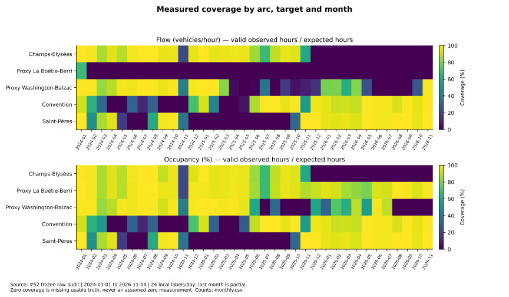
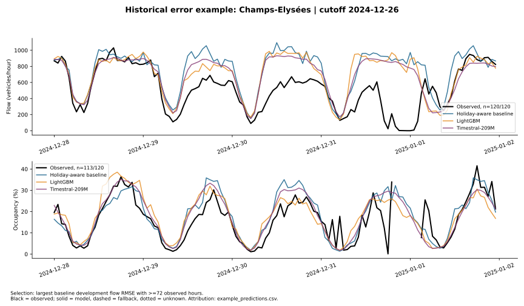

# Traffic patterns, quality and forecast errors — #56

```powershell
python -m traffic_prediction.analysis
```

Requires the frozen #52 sidecar, recorded calendar and #55 hourly predictions. No training,
API download or production-data update occurs. Override `--audit-dir`, `--comparison-dir`,
`--calendar`, `--events-file`, `--output-dir` or `--figures-dir` for another documented snapshot.
The program rejects mismatched comparison/audit/calendar fingerprints and final-test data.

## Five evidence-backed observations

1. **Usable history differs sharply by target and arc.** Champs has no usable 2026 target
   measurements in this snapshot; its last valid flow/occupancy are 2025-11-19 11:00/12:00.
   La Boétie–Berri has 507 usable flow values versus 22,782 occupancy values. The Washington
   proxy's occupancy stops in July 2026 despite later flow. This supports per-target quality,
   explicit fallback and variable-specific proxy evaluation, rather than zero-filling gaps.

2. **Hour and day kind carry distinct patterns.** Convention's working-day mean flow is
   80.1 veh/h at 05:00 (438 observations) and 562.1 at 09:00 (424); weekend 09:00 is 238.6
   (183). These are observed associations on unequal historical samples, supporting calendar
   and hourly profiles without establishing a causal effect or a delivery travel time.

3. **School-holiday associations remain after grouping by hour/day kind, but are confounded.**
   Convention working-day 18:00 flow averages 624.3 veh/h during school holidays (142 hours)
   versus 724.8 outside (294). Seasonal coverage and other differences remain; this is not
   an estimated causal reduction. Monthly and coverage charts must accompany this comparison.

4. **The aggregate leader does not win every operational slice.** At Saint-Pères, 19:00
   development occupancy RMSE is 3.20 points for Timestral-209M, 2.86 for LightGBM and 3.14
   for the holiday-aware baseline, on the same 14 observed hours per candidate. The small
   cell supports inspecting error concentrations, not tuning a new hourly rule on this result.

5. **Exceptional historical periods expose profile limitations and partial truth.** The
   baseline's largest qualifying development arc/window flow RMSE is 345.01 veh/h on Champs,
   cutoff 2024-12-26 (forecast December 28–January 1). It has 120 observed flow hours but only
   113 occupancy hours. Its largest individual flow residual is instead at 2025-11-11 12:00:
   predicted 1,165 versus observed 12 veh/h. Calendar context and the manually listed ceremony
   suggest atypical conditions worth investigating; these counts alone do not establish a
   closure's cause or exact scope. The New Year window also overlaps a manual entry for
   a motor-traffic restriction from December 31 at 15:00 to January 1 at 05:30, with a Paris-hosted
   prefecture document URL retained in `example_event_context.csv`. Its presence is contextual
   evidence, not an independently verified causal effect. #57 separately verifies final-period restrictions.

These interpretations concern measured history from **2024-01-01 through 2026-11-04**.
November 2026 is a partial month. They do not validate the real 2026 Champs outage or use
November 7–11 observations. No traffic-to-speed conversion or delivery savings are inferred.

## Presentation-ready figures

For the main presentation, prefer coverage, hourly patterns and the historical error example.
Monthly, school-holiday and hourly-error details can go in the appendix. All SVGs below are
versioned; equivalent PNG and vector PDF exports are in `outputs/figures/traffic_56/` for slides.

| Figure | Purpose and evidence |
|---|---|
| [01 — Coverage](figures/01_coverage.svg) | Five arcs, two targets, 35 months; valid/expected hours (%), with proxies named explicitly. |
| [02 — Hourly patterns](figures/02_hourly_patterns.svg) | Observed means by hour and working/weekend/holiday, with sample counts per arc/target/group. |
| [03 — Monthly patterns](figures/03_monthly_patterns.svg) | Full time axis, missing months left as gaps, counts and physical units. |
| [04 — Hourly errors](figures/04_hourly_errors.svg) | Pooled hourly RMSE on common measured development truth, including native/fallback output. |
| [05 — Error example](figures/05_error_example.svg) | Observations versus three fixed candidates; solid model, dashed fallback, dotted unknown sources. Selection rule and counts are explicit. |
| [06 — School holidays](figures/06_school_holidays.svg) | Same-hour working-day strata; seasonal/missing-data confounding remains. |





## Tables, provenance and checks

`monthly.csv`, `hourly_patterns.csv`, `weekday_patterns.csv` and `school_patterns.csv`
include expected/source/valid counts, observed mean/median, coverage and latest valid time.
Zeros remain observations when valid; absent, null and invalid measurements never become
invented zeros. The detailed quality distinctions remain available in #52's raw sidecar.

`hourly_errors.csv` records RMSE, MAE, signed bias and expected/scored/ignored counts by
phase/model/arc/target/hour. `largest_errors.csv` ranks ten baseline residuals **separately
for each target**, without mixing units. `example_predictions.csv` preserves per-hour
truth eligibility and forecast attribution. `example_event_context.csv` contains only
overlapping manual event entries, with uncertainty stated rather than asserting causality.

`run.json` pins the observation, calendar, prediction and event-context inputs, code hash,
figure hashes and deterministic example-selection rule. Comparison settings and dataset
fingerprint remain in [#55](../complexity/README.md). An independent raw-row check verifies
all **350 monthly cells** over **124,680 canonical rows** (`verification.json`). The complete
local suite passes **762 tests and 27 subtests**; all six figure families are smoke-tested
headlessly in PNG/SVG/PDF, alongside count, zero/null, alignment and final-test guards.

Hourly Parquet artifacts and raster/PDF exports stay in the local output directories;
the analysis tables and all six SVGs are shared here. The local handoff bundle is
`outputs/metrics/traffic_56_bundle.zip` and includes outputs needed to inspect the analysis.
